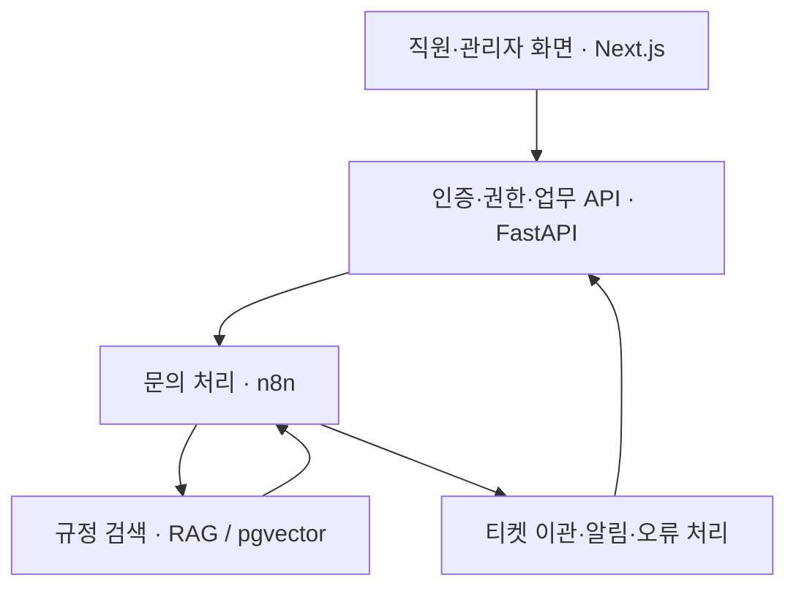

# 오케퐁 · 사내 IT 헬프데스크

**엔코아 4차 단위 프로젝트 · 1팀**

사내 IT 문의에 규정 근거로 답하고, 자동으로 해결하기 어려운 문의는 IT팀 티켓으로 이관합니다. 직원은 문의 결과를 확인하고, 관리자는 티켓에 답변하고 처리 상태를 관리합니다.

**[서비스 접속](https://aio-t1.isitsoft.kr/login)** · **[API 문서](https://aio-t1.isitsoft.kr/docs)** · **[실행 결과](docs/EXECUTION-RESULT.md)**

## 주요 기능

### 직원 질문

질문하기, 답변과 규정 근거 확인, 보완 질문 응답, 내 문의·처리 결과 조회

<!-- 직원 질문 화면 캡처 1장을 넣을 자리 -->
<blockquote>
<p>&nbsp;</p>
<p>&nbsp;</p>
<p>&nbsp;</p>
</blockquote>

### IT팀 관리자

티켓 처리, 담당자·상태·답변 관리, 긴급 알림 확인, 직원 계정 관리

<!-- IT팀 관리자 화면 캡처 1장을 넣을 자리 -->
<blockquote>
<p>&nbsp;</p>
<p>&nbsp;</p>
<p>&nbsp;</p>
</blockquote>

### 문의 자동화

분류 → 권한별 검색 → 답변 생성·검증 → 자동 답변 또는 담당자 이관

공개 회원가입은 없으며, 관리자가 직원 계정을 발급합니다. 제공된 가상 직원 6명·규정 8종·FAQ 6종·기존 티켓 4건을 사용합니다.

## 서비스 구성



화면은 FastAPI를 통해 업무를 처리합니다. n8n은 분류·답변 작성·검증을 수행하고, RAG는 권한이 허용된 규정만 검색합니다. 업무 기록과 문서 벡터는 PostgreSQL에 저장합니다.

상세 내용: [시스템 아키텍처](docs/ARCHITECTURE.md) · [워크플로우 설계](docs/WORKFLOW-DESIGN.md) · [RAG 설계](docs/RAG-ARCHITECTURE.md)

## 팀원과 역할

- **권오현 · 팀장:** 기획, 공통 계약, 통합, 배포, 제출 관리
- **이수언:** 직원·관리자 프론트엔드, 발표자료 준비
- **박지혜:** FastAPI, 인증·권한, 업무 DB
- **임다혁:** 문의 분류, 보완 질문, 답변 생성·검증, 발표
- **신유빈:** 규정 색인, 임베딩, 권한별 검색
- **이원민:** 이관, 오류 처리, 멱등성, 시험·결과 집계

## 실행 및 접속

서비스는 **팀 VM**에서 운영합니다. 발표와 검증도 팀 VM을 기준으로 진행합니다.

1. [로그인 페이지](https://aio-t1.isitsoft.kr/login)에 접속합니다. 계정·비밀번호는 팀장이 비공개로 인계합니다.
2. 직원 계정으로 로그인해 질문하고 답변·근거 또는 이관 결과를 확인합니다.
3. 관리자 계정은 별도 브라우저에서 로그인해 티켓에 답변하고 상태를 변경합니다.
4. 직원의 ‘내 문의’에서 변경된 처리 결과를 확인합니다.

운영자가 VM 서비스를 기동·재배포하는 절차와 필요한 비공개 환경 설정은 [VM 배포 안내](deploy/README.md)를 따릅니다. 접속·계정 안내는 [팀 VM 안내](docs/VM-TEAM-TESTING.md)에 있습니다.

main은 코드·데이터·배포 설정을 루트 경로에 모은 독립 제출본입니다. 개인 개발 폴더나 다른 브랜치에서 파일을 가져오지 않습니다. 실행 환경의 비공개 키·계정·DB 설정은 별도로 제공하며 저장소에 포함하지 않습니다.

## 웹훅

팀 VM의 n8n 주소는 `https://aio-t1.isitsoft.kr:5678`입니다.

- **문의 처리:** `POST /webhook/oke-support`
- **내부 규정 검색:** `POST /webhook/oke-search`
- **내부 티켓 이관:** `POST /webhook/oke-handoff`

웹훅은 `X-Team-Key`로 인증합니다. 키는 비공개로 인계합니다. 화면은 웹훅을 직접 호출하지 않고 FastAPI의 `POST /api/ask`를 사용합니다.

요청 예시: [정상 문의 JSON](requests/demo-normal.json) · 전체 명세: [API 계약](docs/API-CONTRACT.md)

## 시연 순서

1. **정상 답변** — [VPN 질문](requests/demo-normal.json)을 보내 자동 답변과 규정 근거를 확인합니다.
2. **보완 질문** — [정보가 부족한 질문](requests/demo-clarify.json)을 보내 추가 질문을 확인합니다. [보완 한도 도달](requests/clarify-3.json) 시 이관도 확인합니다.
3. **장애 대응** — 격리된 연습 모드에서 티켓 장애를 설정하고 [이관 요청](requests/demo-handoff.json)을 보냅니다. 안전한 응답, DLQ·알림 기록을 확인한 뒤 정상 복구합니다.
4. **이관·로그** — 복구 후 새 요청 ID로 이관해 티켓 발급과 실행 기록을 확인합니다. 관리자가 답변·상태를 저장하고 직원이 처리 결과를 다시 조회합니다.

시연 전 공식 키트의 `doctor`에서 `ready`, `fault all ok`, `llm up`을 확인합니다. 장애 설정과 복구 절차는 [평가 가이드](docs/EVALUATION-GUIDE.md)의 WF-04를 따릅니다. 연습 모드의 장애 대상과 운영 모드의 저장 대상은 구분해야 합니다.

독립 시험은 새 `request_id`를 사용하고, 중복 방지 시험은 같은 ID로 재요청합니다. 요청 파일만 보내는 것으로 장애가 설정되지는 않습니다.

## 검증 기록

2026-11-07 팀 VM에서 수행한 시험 기록입니다. 전체 판정과 남은 위험은 [실행 결과서](docs/EXECUTION-RESULT.md)를 확인합니다.

- [인증·권한·문의 DB 저장](runs/be-db-integration-20261107.json)
- [RAG 색인·권한별 검색](runs/rag-search-eval-20261107.json)
- [정상·보완·이관 처리](runs/support-v18-integration-20261107.json)
- [티켓·알림 중복 방지 재시험](runs/live-integration-qa-20261107T113546Z.json)

정상 답변은 첫 호출에서 8초를 초과한 기록과 이후 재측정 기록이 함께 있습니다. Mock 검사와 실제 서비스 시험은 구분합니다.

<details>
<summary>공식 러너 재현 요구와 남은 확인 사항</summary>

공식 제출 안내는 강사가 아래 순서로 실행해 같은 결과를 얻을 것을 요구합니다.

```sh
flow.py push workflows/*.json
flow.py test cases/team.json
```

현재 공식 러너를 통한 재현 성공은 확인되지 않았습니다. 기존 기록의 인증 헤더 지원 제약, `cases/team.json`의 러너 형식 호환성, 실행 환경 Credential 매핑을 확인해야 합니다. 위 명령은 공식 요구 절차이며, 실행 성공을 확인한 절차로 표시하지 않습니다.

관련 안내: [워크플로우 등록](workflows/README.md) · [저장소 검사](SUBMISSION.md) · [실행 기록 목록](runs/README.md)

</details>

## 제출·발표 준비

**제출 마감: 2026-11-09(월) 14:50.** 기본 브랜치의 마지막 커밋을 기준으로 하며, 마감 후에는 수정하지 않습니다.

문서·자료·시연 입력은 11/08에 미리 준비합니다. 이수언은 발표자료를 준비하고, 임다혁은 발표를 맡습니다. 발표는 20분, 질의는 5분이며 1팀 리허설은 82일차 3교시, 최종 발표는 6교시입니다.

제출 전에는 `tscan scan .`으로 키·실제 연락처 0건을 확인하고, 가상 연락처도 문서·로그에서 가립니다. [실행 결과서의 제출 체크리스트](docs/EXECUTION-RESULT.md#18-ksm-req-6-제출-전-체크리스트-원문-15항목)를 증거와 대조하고 저장소 비공개·강사 초대 상태를 확인합니다. 최종 변경 후 보안 검사와 시연 직전 환경 확인은 다시 수행하고 실제 확인 시각과 결과를 기록합니다.

**실제 화면 캡처는 아직 필요합니다.** 직원 답변·근거 화면과 관리자 티켓 처리 화면을 촬영·마스킹해 [실행 화면 폴더](docs/images/README.md)에 반영합니다. 기존 예상 화면은 실행 증거로 사용하지 않습니다.

## 제출 자료

- **핵심 산출물:** [워크플로우 설계서](docs/WORKFLOW-DESIGN.md) · [RAG 설계서](docs/RAG-ARCHITECTURE.md) · [실행 결과서](docs/EXECUTION-RESULT.md)
- **기획·기록:** [주제](docs/TOPIC.md) · [팀 헌장](docs/TEAM-CHARTER.md) · [데일리](daily/README.md)
- **구현:** [화면](frontend/README.md) · [API·DB](backend/README.md) · [RAG](rag/README.md) · [워크플로우](workflows/README.md)
- **데이터·시험:** [규정](knowledge/README.md) · [초기 데이터](data/README.md) · [프롬프트](prompts/README.md) · [시나리오](cases/README.md) · [요청](requests/README.md) · [실행 기록](runs/README.md)
