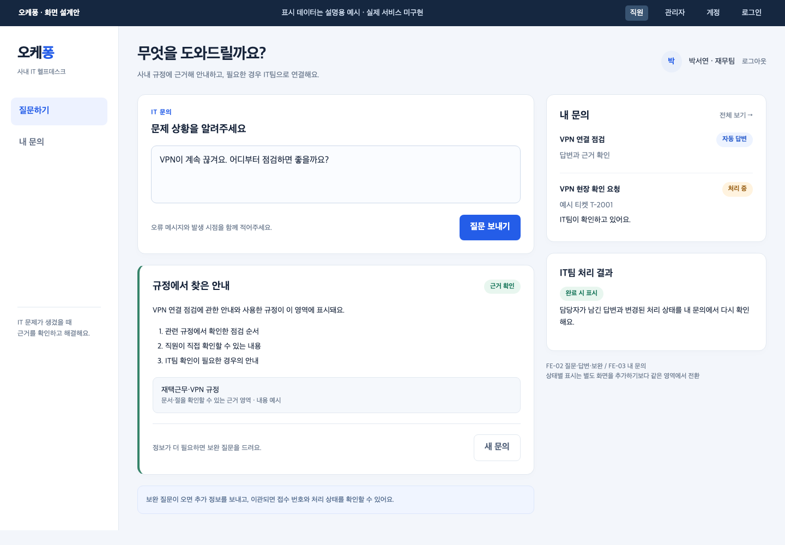
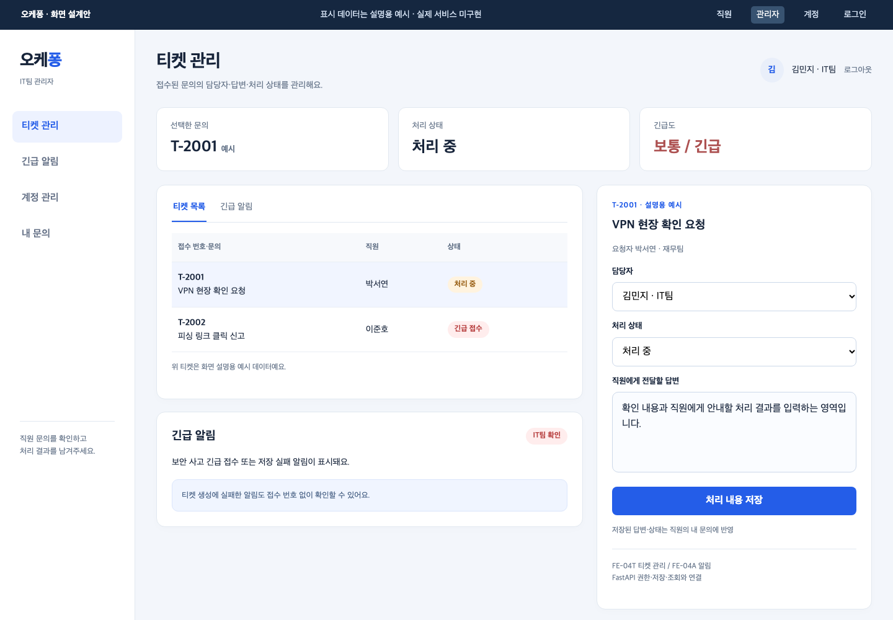
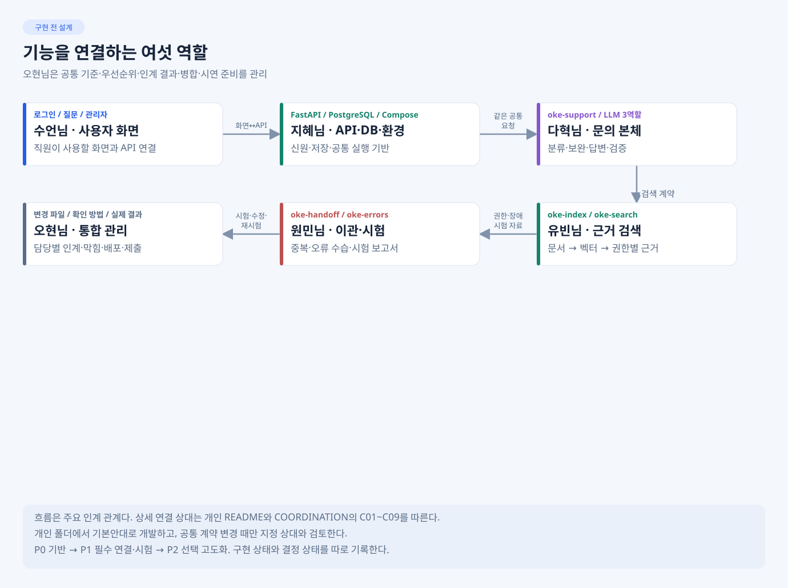

# 오케퐁 · 사내 IT 헬프데스크

직원이 질문하면 규정 근거로 안내하고, 필요한 문의는 IT팀 티켓으로 접수해 처리 결과까지 확인하는 서비스.

**현재는 설계·개발 준비 단계다. 아래는 예상 화면과 노드 설계이며 실제 구현·시험 결과가 아니다.**

| 직원 · 질문과 내 문의 | IT팀 · 티켓 처리와 알림 |
| --- | --- |
|  |  |

[화면 크게 보기 · 로그인·계정·기능표](docs/PREVIEW.md)

## 내 담당으로 바로 시작

| 담당 | 완성할 기능 | 첫 결과 · 시작 문서 |
| --- | --- | --- |
| 오현님 | 공통 기준·인계·병합·VM·제출 관리 | [팀장 작업판](develop/ohyun/README.md) |
| 수언님 | 로그인·질문·내 문의·관리자 화면 | [화면 골격·Mock부터](develop/sueon/README.md) |
| 지혜님 | 인증·업무 API·DB·실행 환경 | [API 골격·DB 기반부터](develop/jihye/README.md) |
| 다혁님 | 분류·보완·답변·검증 본체 | [입력·차단 골격부터](develop/dahyeok/README.md) |
| 유빈님 | 규정 색인·권한별 근거 검색 | [원본·권한·청크 대장부터](develop/yubeen/README.md) |
| 원민님 | 이관·오류 수습·시험·결과 집계 | [시험 입력과 기대부터](develop/wonmin/README.md) |

개인 README에는 **만들 결과 → 첫 작업 → 확정/담당자 결정/선택 → 참고 예제 → 인계 기준**이 있다. 상세 구현은 해당 단계의 SPEC·IMP-PLAN에서 확인한다. 상대 구현 전에는 같은 계약의 Mock으로 진행한다.

## 서비스가 연결되는 그림

웹 화면 → FastAPI의 신원·저장 → 같은 n8n 본체 → RAG 답변 또는 IT팀 이관 → 관리자 처리 → 직원 재조회.

LLM 역할은 **triage·writer·verifier 3개**다. Code·IF·Switch가 순서를 제어하며, 검색은 HTTP/DB 처리다. 워크플로우 5종·서비스 LLM 3역할·담당자별 개발 CLI는 서로 다른 구분이다.

| 워크플로우 | 담당 | 노드 설계 그림 |
| --- | --- | --- |
| oke-support · 문의 본체 | 다혁님 | [분류·조회·작성·검증·분기](docs/images/planned/flow-support.svg) |
| oke-index · 규정 색인 | 유빈님 | [원본·청크·임베딩·저장](docs/images/planned/flow-index.svg) |
| oke-search · 권한별 검색 | 유빈님 | [권한 선필터·정확검색·근거](docs/images/planned/flow-search.svg) |
| oke-handoff · 업무 이관 | 원민님 | [티켓·알림·DLQ·부분 실패](docs/images/planned/flow-handoff.svg) |
| oke-errors · 오류 안전망 | 원민님 | [Error Trigger·마스킹·독립 수습](docs/images/planned/flow-errors.svg) |

전체 시스템·저장 경계는 [ARCHITECTURE](docs/ARCHITECTURE.md), 각 흐름의 상세 설계는 [WORKFLOW-DESIGN](docs/WORKFLOW-DESIGN.md)에 있다.

## 이미 있는 예제로 시작하기

[내부 참고 예제와 적용표](docs/references/README.md)에서 역할에 필요한 파일만 읽는다. 화면/API 예제는 우리 6명·세션·관리자 발급에 맞추고, RAG 예제의 In-Memory는 pgvector로 교체한다. 예제 존재가 구현 완료를 뜻하지 않는다.

## 결정과 진행 상태

- **확정:** 공통 API·DB·권한·역할·평가. 그대로 구현할 때 사전 재승인은 필요 없다.
- **담당자 결정·검증:** 내부 구현·디자인·측정. 공통 연결을 바꿀 때는 지정 상대 확인 후 오현님 반영.
- **선택 고도화:** 필수 연결과 시험을 끝낸 뒤 검토.
- **구현 단계:** P0 기반 → P1 필수 구현·연결·시험 → P2 고도화. ‘확정’과 ‘구현·검증 완료’는 다르다.

## 제출과 공통 기준

필수 문서 3개: [워크플로우 설계](docs/WORKFLOW-DESIGN.md) · [RAG 설계](docs/RAG-ARCHITECTURE.md) · [실행 결과](docs/EXECUTION-RESULT.md).
담당자가 실제 자료를 제공하고 오현님이 [제출 안내](develop/ohyun/SUBMISSION.md)대로 취합한다.

[API](docs/API-CONTRACT.md) · [DB](docs/DATA-AND-DB.md) · [평가·시나리오](docs/EVALUATION-GUIDE.md) · [역할·책임](docs/TEAM-CHARTER.md) · [변경·협업](docs/COORDINATION.md) · [전체 문서](docs/README.md)

시작은 저장소 전체를 받은 뒤 자기 폴더에서 한다. 개인 코드는 자기 폴더만 수정하고, 공통 변경은 자기 HANDOFF로 요청한다. 실제 명령·시험 결과는 구현 후 기록한다.
