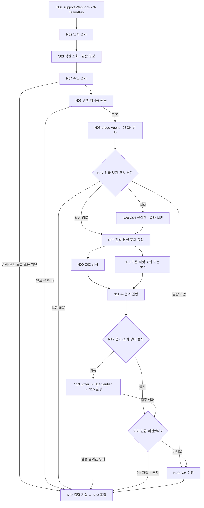

# 오케퐁 워크플로우 설계서 · 다혁 담당 원고

> 작성 기준: 2026-11-05 작업 폴더. 공통 계약은 `docs/API-CONTRACT.md`, 판정은 `docs/EVALUATION-GUIDE.md`가 우선한다. 이 문서는 오현님이 `docs/WORKFLOW-DESIGN.md`에 취합할 원고이며 공통 문서의 확정·실행 결과를 대신하지 않는다.
>
> 구현 기준: Git에 반영된 본체는 `workflows/oke-support-12.json`(`05f7724`), 현재 로컬 수정본은 `workflows/oke-support-13.json`(미커밋)이다. `13`의 실험 기록은 `HANDOFF.md`에 있으며 팀 VM·공식 평가 통과 증거는 아니다.

## 1. 업무 시나리오와 역할 경계

오케퐁은 제공 직원 6명의 사내 IT 질문을 권한이 허용된 규정으로 안내하고, 근거가 없거나 사람의 조치가 필요하면 IT팀 티켓으로 이관한다. 정보가 부족한 문의는 `attempt` 1·2에서 보완 질문을 하고 3 이상에서 이관한다. 피싱·유출 같은 보안 사고는 긴급 이관을 먼저 시도한 뒤, 확인된 초동 조치와 본인 티켓 상태만 보강한다. 자동 답변은 검색 근거·권한·출처·검증·실측 임계값이 모두 충족되어야 한다.

| 경계 | 담당 | 이 설계에서 지키는 조건 |
| --- | --- | --- |
| 직원 화면·관리자 화면 | 수언님 | 브라우저는 FastAPI만 호출한다. |
| 세션·문의/티켓/알림 저장 | 지혜님 | 웹의 직원 신원·`request_id` 소유권과 재시도는 FastAPI가 검사한다. PostgreSQL이 새 업무 기록을 저장한다. |
| `oke-support` 문의 본체 | 다혁님 | 입력·직원·주입 관문, triage, 조회 결합, writer/verifier, 최종 분기·응답. |
| `oke-index`, `oke-search` | 유빈님 | 규정 8종 색인과 문서 권한 선필터 검색. 본체는 C03 계약으로 호출한다. |
| `oke-handoff`, `oke-errors` | 원민님 | 새 티켓·알림·DLQ와 예상 밖 오류 수습. 본체는 C04 계약으로 호출한다. |
| 공통 계약·VM·제출 취합 | 오현님 | 공통 파일 반영, 한 버전 게시, 실제 시험 근거 취합. |

제공 data-api의 직원 6명·FAQ 6종·기존 티켓 4건은 조회·공통 장애 시험 대상이다. 기존 티켓 상태와 새 PostgreSQL 티켓 상태를 같은 형식으로 가정하지 않는다. RAG 청크·벡터는 PostgreSQL+pgvector에 저장하는 유빈님·지혜님 경계다.

## 2. 전체 흐름과 현재 구현

`12`·`13`에는 61개 노드가 있다. `N11 Collect retrieval`은 검색·티켓 두 입력을 append하고 `N11 Join retrieval`이 `request_id`와 상태를 확인한다. n8n 런타임의 두 갈래 실행 순서·단일 응답 보장은 실제 프로젝트 실행으로 재검증해야 한다. 모든 문의가 LLM 3역할을 모두 호출하는 것은 아니다. 입력 오류·주입은 LLM 0회가 목표다.

`12`부터 직원 GET, C03 POST, 기존 티켓 GET, C04 POST의 HTTP Request 노드가 들어갔다. `SERVICE_MODE=practice|app`일 때 실제 HTTP·Agent 경로를 선택한다. 로컬 Code 검사기의 `mock` 모드는 합성 사례 전용이다. 값이 없거나 다른 값이면 직원 확인을 안전하게 종료한다. `13`은 로컬 n8n에서 확인한 직원 응답 형식과 triage 파서·프롬프트 문제를 수정한 작업본이다. 번호판은 이력을 위해 보존하되 같은 `oke-support` 웹훅을 여러 버전에서 동시에 활성화하지 않는다.

## 3. 에이전트 역할, 분기와 반복

| 역할 | 실제 노드 | 입력 → 출력 | 금지·검증 조건 |
| --- | --- | --- | --- |
| triage | `N06 Triage Agent`, `N06 Parse triage` | 질문/context → `type`, `urgency`, `missing`, `ticket_id`, `needs_action` | 분류 결과의 enum·타입과 질문 속 티켓 ID를 Code가 확인한다. 티켓 생성·권한 부여는 하지 않는다. |
| retriever | `N09 C03 HTTP`, `N10 Own ticket HTTP` | 검색어·검증된 권한, 티켓 ID·검증된 직원 → evidence·본인 상태 | 별도 LLM이 아니다. 타인 티켓 403과 검색 장애 503을 구분한다. |
| writer | `N13 Writer Agent`, `N13 Parse writer` | 허용 evidence·가린 본인 상태 → answer·사용 출처·티켓 사용 여부 | 허용 근거 밖 출처와 성공하지 않은 조회 사실 사용을 거절한다. |
| verifier | `N14 Verifier Agent`, `N14 Parse verifier` | 원근거·초안 → `grounded`, `policy_ok`, `issues` | 정확한 불리언·배열 형식만 수용한다. 답을 다시 쓰지 않는다. |
| 최종 Code | `N15 Decide answer`, `N22 Output filter` | 실제 상태·Agent 결과 → 공통 route·sources·ticket·security | 점수만으로 자동 답변하지 않고 출처·권한·검증·가림을 다시 확인한다. |

LLM 역할은 triage·writer·verifier 3개이며 각각 모델 연결을 가진다. 검색은 HTTP/DB 처리다. 보완은 워크플로우 내부 무한 루프가 아니라 다음 사용자 요청의 새 `request_id`와 증가한 `attempt`·`context`로 이어진다. 기본 검색 1회, writer 재작성 0회다. `N20` 티켓 생성은 본체에서 자동 재시도하지 않고 C04·저장 API의 멱등 경계를 따른다.

## 4. 외부 계약과 노드 간 페이로드

| 연결 | 요청·인증 | 응답·처리 | 현황 |
| --- | --- | --- | --- |
| C02 FastAPI → support | `POST /webhook/oke-support`, `X-Team-Key`; 필수 `request_id,user,question`, 선택 `channel,attempt,context` | 7필드 `request_id,route,answer,sources,ticket,agents,security`; 입력 오류 HTTP400 `codes` | Webhook·응답 노드 구현. FastAPI P1-2 실제 연결은 미확인. |
| 직원 조회 | `GET /employees`, data-api `X-Api-Key` | 제공 직원의 name/dept로 `all` 또는 `all,it` 생성 | `13`은 실제 data-api의 `employees` 배열과 설계상 `items` 배열을 수용. 팀 환경 재확인 필요. |
| C03 support → search | `POST /webhook/oke-search`, `X-Team-Key`; `request_id,query,type,access_levels,top_k:3` | HTTP200 evidence/빈 결과, HTTP503 `search_unavailable` | HTTP 노드·어댑터 구현. 실제 검색 호출·근거는 미검증. |
| 기존 티켓 조회 | `GET /tickets/{id}?requester={검증된 직원}`, `X-Api-Key` | 200 본인 상태, 403 타인, 404 없음, timeout 장애; 연락처 가림 | HTTP 노드·어댑터 구현. 로컬 본인/타인 일부 관측, 프로젝트 통합 미확인. |
| C04 support → handoff | `POST /webhook/oke-handoff`, `X-Team-Key`; `request_id,requester,title,category,priority,reason`, 선택 `evidence_summary` | 티켓·`duplicate`·`alerts_down`·`tickets_down`·전송 실패를 구별 | HTTP 노드·어댑터 구현. 실제 티켓·알림·DLQ는 미검증. |

Header Auth Credential 참조에는 실제 키 값이 없다. `N01` 입구 Webhook Credential, data-api용 HTTP Credential, C03·C04용 HTTP Credential, LLM Credential은 n8n 인스턴스에서 바인딩한다. HTTP 노드는 상태·본문을 함께 받고 오류 코드를 정상 본문과 구분한다. 초기 timeout은 직원·티켓 2초, 검색 4초, 이관 5초이며 실측 후 조정한다. 접속 주소와 Credential을 바꿀 때 practice/app 저장 대상·관측 대상이 같은지 확인한다.

## 5. 주요 분기와 보안

| 조건 | 처리 |
| --- | --- |
| 빈 질문·501자 초과·미등록 직원 | HTTP400 및 `question_required`·`too_long`·`unknown_user`; LLM 호출 없음. |
| 알려진 프롬프트 주입 | `route=차단`, 티켓 생성·LLM 호출 없음. 정상적인 ‘관리자’ 단어만으로 차단하지 않음. |
| 정보 부족 | `attempt` 1·2는 구체적인 보완 질문, 3 이상은 일반 이관. |
| 보안 사고 | `priority=high`로 선이관. 검색·조회 실패가 선이관 결과를 지우거나 C04를 재호출하지 않음. |
| 타인 티켓 403 | 타인 상태·연락처를 버리고 `권한 없음`; 긴급 사고는 타인 부분을 버리고 선이관 사실 유지. |
| 검색 빈 결과·장애 | 각각 `no_evidence`와 `search_unavailable`로 구별해 추측 답변 없이 이관. |
| 티켓 조회 404·장애 | 조회 상태를 만들지 않고 자동 답변을 차단. |
| C04 티켓 저장 실패·알림 실패·응답 유실 | ticket/null·reason·알림 상태를 실제 ACK에 맞춰 반환. 불명확한 결과를 접수 완료로 말하지 않음. |
| 동일 `request_id` | 웹 결과 저장·소유권은 FastAPI, 티켓 1건은 C04/DB의 UNIQUE로 보장하는 설계. 본체 N05 재사용은 아직 Mock. |

일반 직원은 `all`, IT팀 직원은 `all,it`만 검색에 전달한다. 권한은 직원 조회의 name/dept에서 만들고 질문 속 관리자 주장을 무시한다. 검색 전 RAG의 문서 권한 필터는 유빈님 담당이다. 질문·context·근거·본인 티켓·답변의 전화번호·이메일 등은 writer 전과 최종 출력에서 가리며 실제 연락처나 키를 JSON·문서·실행 기록에 남기지 않는다. 관리자 화면 권한은 FastAPI 세션으로 별도 검사한다.

## 6. 오류 경계와 응답

입구의 `X-Team-Key` 오류는 Webhook 인증에서 거절한다. 입력 오류는 HTTP400 `codes`를 유지한다. 예상 가능한 하위 403·404·503·timeout, LLM JSON 오류와 검증 실패는 본체 분기에서 처리한다. 예상 밖 워크플로우 실패는 원민님 `oke-errors`의 마지막 안전망 범위이며 부모 응답을 대신한다고 가정하지 않는다. `N23 Respond`가 JSON과 분기별 HTTP 상태를 반환한다. 최종 `route`는 `자동 답변`, `보완 질문`, `담당자 이관`, `권한 없음`, `차단` 중 하나다.

자동 답변 임계값 `0.8`은 로컬 Mock 분기값일 뿐 실제 품질 기준이 아니다. `12`·`13`의 실제 Agent 경로는 품질 임계값 확정 전 자동 답변을 허용하지 않는다. 따라서 현 상태로는 WF-01의 자동 답변 통과를 주장할 수 없다. 이관 응답은 C04의 실제 저장 ACK가 없으면 `ticket:null`을 유지한다.

## 7. 검증 근거와 미완료

| 범위 | 확인 결과 | 증거의 한계 |
| --- | --- | --- |
| `12` 합성 HTTP 어댑터 | 12/12 | Code에 합성 `statusCode/body`를 넣은 로컬 검사. 실제 HTTP 호출 아님. |
| `12` Mock 회귀 | replay 13/13, 긴급·장애 14/14, 보완 9/9, writer/verifier 20/20, 합계 56/56 | 기존 실습 컨테이너의 Node.js로 독립 Code 실행. 프로젝트 n8n 판정 아님. |
| `13` 로컬 n8n | `HANDOFF.md`의 execution 1553~1577에서 25건 실행·기록 | 개인 로컬 n8n 2.42.6. C03·C04는 404였고 실제 검색·티켓·알림·자동 답변은 미검증. 성공 실행 수는 기능 통과 수가 아님. |
| 공통 평가 | WF-01~13+02b 14유형, 팀 5개 이상, LLM 3회 반복·bench | 공식 `flow.py`·원본 `common.json`, 프로젝트 n8n/VM 통합 결과가 아직 없음. |

`13`의 입력·직원·주입·타인 기존 티켓·보완 경로는 로컬에서 일부 관측했다. `13`은 아직 미커밋이며 실행별 응답·노드·시간을 보존한 별도 `runs/` 보고서는 작성되지 않았다. 현재 문서만으로 공통 시험이나 기능 완료 체크를 하지 않는다. 정식 제출 전에는 원민님 실제 C04/오류 결과와 유빈님 실제 C03/색인·권한 결과, 지혜님 FastAPI 문의 저장·세션 결과를 각각 받아 해당 부분을 확인해야 한다.

## 8. 다음 통합·제출 작업

1. 유빈님 C03과 원민님 C04를 같은 로컬 n8n·서비스 모드에서 게시한 뒤 `13`의 실제 HTTP 입력·응답을 재확인한다. 테스트용 본체 한 버전만 활성화한다.
2. 실제 근거·사용자 권한·점수 분포를 측정하고 임계값을 팀 기준에 반영한 뒤 writer/verifier 실제 경로와 WF-01 자동 답변을 검증한다.
3. 지혜님 P1-2의 웹 문의 선저장·소유권·결과 저장을 연결한다. 직접 웹훅 WF-09는 C04/저장 API의 동일 키 티켓 1건과 `duplicate` 표시를 원민님·오현님과 대조한다.
4. 공식 평가 키트가 제공되면 `flow.py check` 후 사람이 n8n에 게시·시험한다. 공통 14유형, 팀 5개 이상, LLM 3회 반복, hit@3·권한 누출·p50/p95·장애 후 재시험을 실제 실행 보고서에 남긴다.
5. 오현님이 확인한 최종 번호판을 제출용 `oke-support.json`으로 정리하고, 이 원고와 다른 담당자의 검증 자료를 `docs/WORKFLOW-DESIGN.md`에 반영한다. 본체 버전·노드 이름·실행 ID·미해결 문제를 최종본과 일치시킨다.

## 참조

- 공통: `docs/TOPIC.md`, `docs/API-CONTRACT.md`, `docs/DATA-AND-DB.md`, `docs/EVALUATION-GUIDE.md`, `docs/WORKFLOW-DESIGN.md`.
- 본체: `develop/dahyeok/workflows/oke-support-12.json`, `develop/dahyeok/workflows/oke-support-13.json`, `develop/dahyeok/Doc/SPEC.md`, `develop/dahyeok/Doc/HANDOFF.md`.
- 다른 담당의 구현·시험 상태는 각 담당자의 최신 실행 증거로 최종 확인한다.
