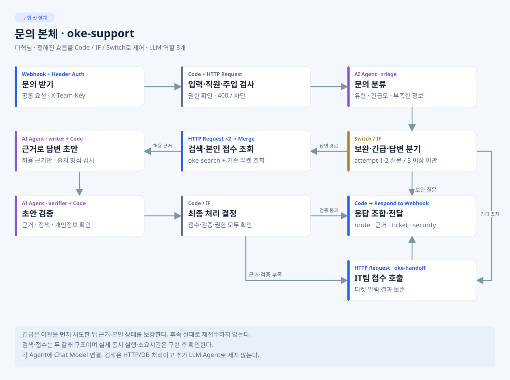

# 다혁님 · 문의 처리 본체

**목표:** 질문을 검사·분류하고 근거 답변, 보완 질문 또는 IT팀 이관으로 끝낸다. 작업 폴더는 develop/dahyeok. 아래는 실제 n8n 캡처가 아닌 설계다.

## 내가 만들 것

- `workflows/oke-support.json`은 P0-1 원본으로 보존하고, 이후 단계는 번호를 붙인 JSON에 누적 구현한다. P1-5 실제 HTTP 연결 준비본은 `workflows/oke-support-12.json`, 그 로컬 실행 버그 수정본이자 현재 최신본은 `workflows/oke-support-13.json`이다.
- triage 분류 → 검색/본인 접수 조회 → writer 초안 → verifier 검증.
- Code·IF·Switch로 보완·긴급·이관·실패를 제어하고 공통 응답을 한 번 반환.
- 요청·Mock·예외 확인 자료와 실제 노드·연결선 설계 자료. 검색·저장은 다른 담당 모듈을 호출한다.

## 지금 첫 작업 · P0-1

저장소 루트에서 cd develop/dahyeok 후 [IMP-PLAN P0-1](Doc/IMP-PLAN.md)의 Webhook→입력/직원 Mock→주입 검사→Respond 골격과 요청 파일부터 만든다. 첫 완료는 빈 질문·501자·없는 직원의 400, 주입 차단, LLM0회 확인이다. 아직 접수하지 않은 임시 응답을 접수 완료로 표시하지 않는다.

## 정해진 것과 내가 정할 것

| 구분 | 적용·결정 |
| --- | --- |
| 확정 | 공통 입출력·route5개·LLM3역할, 보완1·2/부족3이상 이관, 긴급 우선, 같은 support, search/handoff는 타 담당 소유 |
| 담당자 결정 | 내부 노드 배치·프롬프트를 SPEC대로 구체화. 점수 기준은 유빈님 측정으로 제안, 하위 오류·시간은 원민님/지혜님과 확인 후 공통 반영 |
| 선택 고도화 | 재검색·초안 재작성·추가 도구는 필수 경로 검증 뒤 |

별도 Supervisor LLM을 추가한 구조가 아니다. Code가 정해진 순서를 제어한다. oke-handoff는 업무 티켓 이관이며 Agent 간 자율 Handoff와 다르다.

## 바로 볼 예제

[도구 조회](../../docs/references/workflows/tools.json.example) · [작성/검토](../../docs/references/workflows/pipeline.json.example) · [모듈](../../docs/references/workflows/module.json.example)

조회·파싱·분기·모듈 경계를 참고한다. 예제 Tool 구성·executeWorkflow·재작성 루프는 우리 HTTP 하위 계약·Agent3역할·기본 재작성0회에 맞춰 바꾼다. [적용표](../../docs/references/README.md).

## 누구에게 받고 무엇을 넘기나

- 유빈님에게 C03 근거 응답, 원민님에게 C04 티켓·실패 응답을 받는다. 준비 전에는 같은 계약 Mock으로 진행한다.
- 지혜님과 C02 신원·응답 보존을 연결하고 원민님에게 정상/보완/주입/권한/장애 입력과 기대를 넘긴다.
- 오현님에게 실제 본체 JSON·노드/연결선·프롬프트·페이로드·확인 결과를 넘겨 워크플로우 설계서를 완성한다.
- 보고: 변경 파일 / 확인 입력·명령 / 기대와 실제 / Mock·남은 문제·다음 상대. JSON check 후 n8n 게시·시험은 담당자가 확인한다.

## 내 CLI 첫 요청

    내 README·AGENTS·공통 API와 SPEC SUP-01/02를 읽고 IMP-PLAN P0-1만 구현해.
    develop/dahyeok 밖은 수정하지 말고 임시 응답과 실제 접수를 구분해.
    확인 결과와 사람이 실행할 게시·시험 절차를 보고해.

상세: [TODO](Doc/TODO.md) · [SPEC](Doc/SPEC.md) · [IMP-PLAN](Doc/IMP-PLAN.md) · [HANDOFF](Doc/HANDOFF.md).
