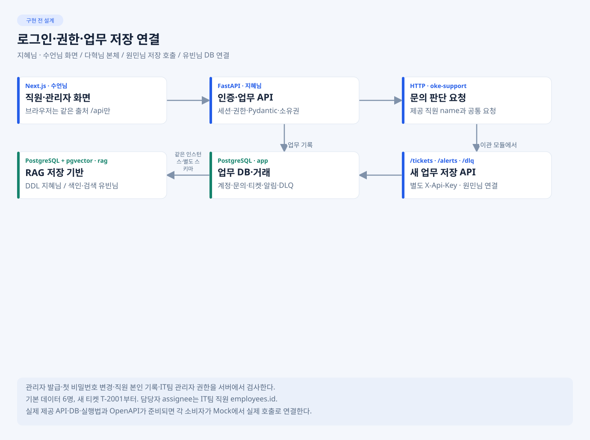

# 지혜님 · 로그인·업무 API·DB·실행 환경

**목표:** 화면·워크플로우가 같은 신원·저장 규칙과 실행 환경을 사용하게 한다. 작업 폴더는 develop/jihye. P0-1 골격만 구현·로컬 검증했으며 나머지는 설계 단계다.



## 내가 만들 것

- 로그인·세션·첫 변경·관리자 계정 발급과 직원/관리자 권한 검사.
- 문의 선저장·support 호출·내 문의·관리자 티켓/알림 API.
- /tickets·/alerts·/dlq, 멱등·부분 실패·소유권.
- app/rag 마이그레이션·직원 seed·첫 관리자·pgvector·Compose·API 명세와 실행법.

## 지금 첫 작업 · P0-1

저장소 루트에서 cd develop/jihye 후 [IMP-PLAN P0-1](Doc/IMP-PLAN.md)의 pyproject.toml·app/main.py·config·health·공통 검증 타입을 만든다. DB/n8n 없이 골격·입력/오류 형식을 확인한다. 이어 P0-2 계약 모델, P0-3~5 DB 기반을 먼저 공유해 유빈님·원민님이 실제 연결을 시작하게 한다.

### P0-1 실행·확인 (2026-11-04)

작업 디렉터리는 저장소의 `develop/jihye`이며 Python 3.12 이상과 uv를 사용한다.

```bash
uv sync --dev --locked
uv run pytest tests/test_contract_basics.py -q
uv run uvicorn app.main:app --host 127.0.0.1 --port 8000
```

별도 터미널에서 `curl --fail http://127.0.0.1:8000/health/live`로 프로세스 상태를 확인한다. 응답은 `{"status":"ok"}`다. 실제 소켓 검증은 포트 충돌을 피하려고 18000에서 수행했다. OpenAPI는 `/openapi.json`, 문서 UI는 `/docs`다. 현재 OpenAPI에는 `/health/live`만 등록되어 있다.

공통 환경변수 이름은 `app/core/config.py`에서 읽는다. `SERVICE_MODE`는 기본 `app`이며 `app`/`practice`만 허용한다. P0-1에서는 DB·외부 키 없이 시작하며 모드에 따른 저장 동작은 아직 없다. `.env`는 자동으로 읽지 않으므로 실제 설정은 프로세스 환경으로 주입한다. DB URL·키·세션 비밀·bootstrap 암호는 repr와 직렬화에서 제외한다. 후속 서비스가 구현될 때 필요한 설정을 사용 경계에서 필수 검사해야 한다.

검증 결과는 **30 passed, 경고 1건**이다. Starlette TestClient의 HTTPX 사용에 대한 폐기 예정 경고이며 HTTPX는 support 클라이언트용으로 유지한다. 설치 버전·오류 예시·소켓 제한과 재확인 내역은 [P0-1 실행 기록](Doc/IMP-PLAN.md#p0-1-실제-기록--2026-11-04)에 남겼다. 로그인·권한·업무 API·DB readiness·n8n 연결·VM 배포는 미실행이다.

## 정해진 것과 내가 정할 것

| 구분 | 적용·결정 |
| --- | --- |
| 확정 | FastAPI·Pydantic, PostgreSQL app/rag·pgvector3072, 관리자 발급·쿠키, assignee는 IT 직원 employees.id |
| 담당자 결정 | 내부 코드 구조·의존성 버전·물리 마이그레이션. 목록 DTO·처리 중/충돌 응답 세부는 수언님/다혁님과 계약 확인, DB 사용 변경은 유빈님, 저장 ACK는 원민님과 확인 |
| 선택 고도화 | 추가 모니터링·세밀한 인증 고도화·추가 성능 최적화는 필수 뒤 |

## 바로 볼 예제

[FastAPI 앱](../../docs/references/qnaweb/src-be/app/main.py.example) · [모델](../../docs/references/qnaweb/src-be/app/models.py.example) · [Q&A 라우터](../../docs/references/qnaweb/src-be/app/routers/qna.py.example) · [Compose](../../docs/references/qnaweb/docker/compose/docker-compose.yml.example)

라우터·저장·컨테이너 구성을 참고한다. create_all·자동 샘플 시드 대신 Alembic·명시적 bootstrap, 10명/InfluxDB/JWT 예제 대신 우리 6명·app/rag·세션 규칙을 적용한다. [적용표](../../docs/references/README.md).

## 누구에게 받고 무엇을 넘기나

- 수언님에게 요청/응답 명세·실행 주소·오류 예시, 유빈님에게 rag DDL·권한·접속법, 원민님에게 저장 API·관측법을 먼저 넘긴다.
- 다혁님과 공통 요청/응답·시간 예산을 확인한다. 오현님에게 Compose·마이그레이션·seed·기동·회귀 절차와 실제 결과를 넘긴다.
- 완료 기준: 빈 환경에서 재현 가능한 실행, 권한 거절·같은 키 티켓1건·재시작 유지, 화면과 워크플로우의 실제 연결. 비밀값을 문서에 넣지 않는다.
- 보고: 변경 파일 / 확인 명령·입력 / 기대와 실제 / 미해결·다음 상대. 실제 API 명세는 구현된 OpenAPI와 맞춰 제공한다.

## 내 CLI 첫 요청

    내 README·AGENTS·공통 API/DB를 읽고 IMP-PLAN P0-1만 구현해.
    예제에서 참고할 구조와 우리 기준의 차이를 먼저 말해.
    develop/jihye 밖은 수정하지 말고 실제 확인 결과·다음 연결을 보고해.

상세: [TODO](Doc/TODO.md) · [SPEC](Doc/SPEC.md) · [IMP-PLAN](Doc/IMP-PLAN.md) · [마이그레이션](migrations/README.md) · [배포](deploy/README.md) · [HANDOFF](Doc/HANDOFF.md).
