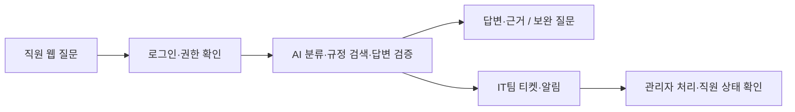

# 1팀 · 오케퐁 사내 IT 헬프데스크

**80일차 아침 · 주제와 역할 소개**

오케퐁 직원을 위한 사내 IT 문의 지원 서비스를 만들겠습니다. 직원이 웹에서 질문하면 사내 규정에 근거해 안내하고, 자동 해결이 어려운 문의는 IT팀에 접수해 처리 상태까지 확인하도록 하겠습니다.

## 해결하려는 문제

- 직원은 비밀번호·VPN·메일·장비 문제의 해결 방법을 여러 문서에서 찾아야 합니다.
- IT 담당자는 반복 문의에 답하면서 실제 조치가 필요한 요청도 함께 처리해야 합니다.
- 질문부터 담당자 접수·처리 결과 확인까지 한 흐름으로 연결하려고 합니다.

## 무엇을 만들 것인가

| 사용자 | 제공할 기능 |
| --- | --- |
| 직원 | 로그인, IT 질문, 답변과 규정 근거 확인, 내 문의·티켓 상태 확인 |
| IT팀 관리자 | 직원 계정 발급, 티켓 목록·긴급 알림 확인, 담당자 배정·답변·상태 변경 |

정보가 부족하면 보완 질문을 하고, 근거가 없거나 실제 조치가 필요하면 IT팀으로 넘깁니다. 보안 사고는 긴급 접수와 알림을 우선합니다. 직원은 본인 문의만 확인하고, 관리자는 권한이 있는 업무만 처리하도록 하겠습니다.

## 전체 처리 흐름

화면은 **Next.js**, 업무 API는 **FastAPI**, 문의 자동화는 **n8n**으로 연결합니다. 계정·문의·티켓은 **PostgreSQL**, 규정의 청크·임베딩은 **pgvector**에 저장할 계획입니다. AI는 분류·답변 작성·검증의 세 역할로 나눕니다.

## 팀원과 담당

| 팀원 | 담당 | 만들거나 관리할 부분 |
| --- | --- | --- |
| 오현님 | 팀장·통합 | 범위·연결 기준, PR 병합, 팀 VM 배포, 문서 취합·발표 |
| 수언님 | 프론트엔드 | 직원·관리자 웹 화면과 API 연결 |
| 지혜님 | 백엔드·DB | 로그인·권한·업무 API, PostgreSQL·pgvector 기반, 실행 환경 |
| 다혁님 | 문의 처리 본체 | 입력 검사, 분류·답변·검증, 보완 질문·이관 분기 |
| 유빈님 | RAG | 규정 전처리·청킹·임베딩·색인·권한별 검색 |
| 원민님 | 연동·안정성·시험 | 티켓·알림·오류 처리, 팀 시나리오·시험·실행 결과 |

## 사용할 데이터와 오늘 진행할 일

선생님이 제공한 **규정 8종·FAQ 6종·가상 직원 6명·기존 티켓 4건**을 활용합니다. 제공된 공통 시나리오와 팀 시나리오로 동작을 확인하겠습니다.

1. 주제·역할·문의 범위를 확인하고 팀 VM과 실행 환경을 준비하겠습니다.
2. 워크플로우 설계서 1~4절과 RAG 설계서 1~2절 초안을 정리하고, 팀 시나리오 5개 이상을 준비하겠습니다.
3. 규정 색인·청크 측정을 진행하고, 기본 브랜치의 검토된 결과를 VM에 첫 배포해 입력 검사·주입 차단부터 확인하겠습니다.

현재는 설계 초안과 역할별 개발 자료를 준비한 단계입니다. 오후 점검·발표에서는 실제 구현·실행한 범위와 남은 일을 구분해 보여드리겠습니다.

---

[주제 제안서](../../../docs/TOPIC.md) · [전체 구조](../../../docs/ARCHITECTURE.md) · [예상 화면](../../../docs/PREVIEW.md)

팀장 작업용: [준비 체크리스트](PREPARATION.md) · [팀원에게 받을 자료](TEAM-INPUTS.md) · [오후 점검·발표 준비](PRESENTATION.md)
