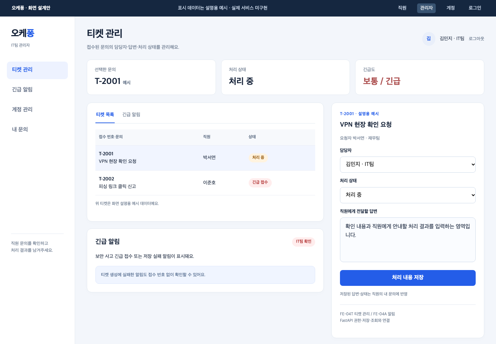
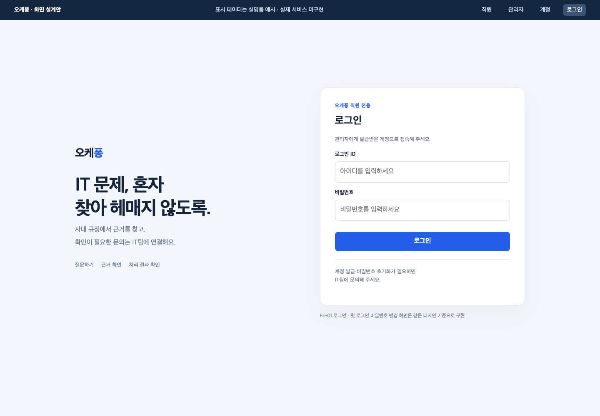
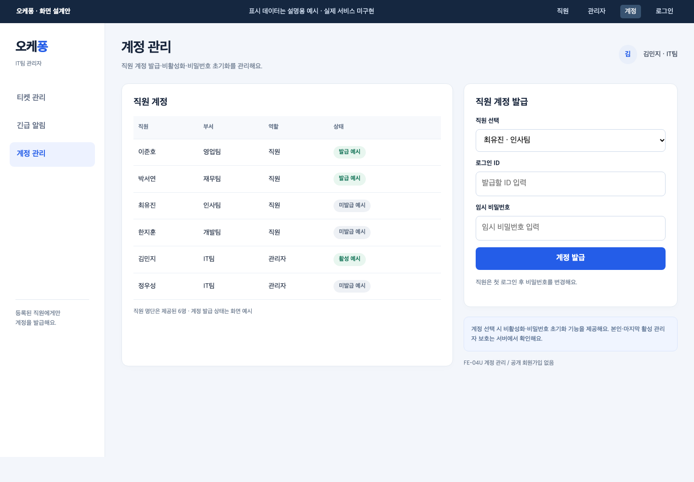
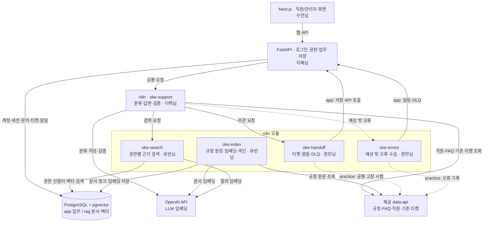
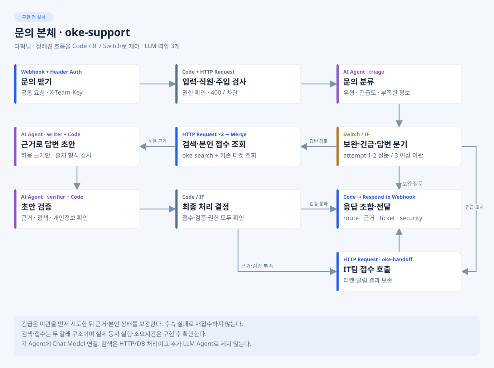
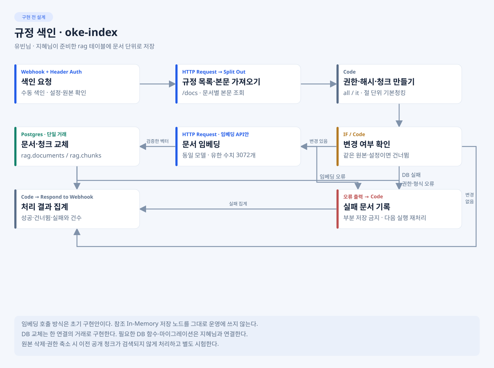
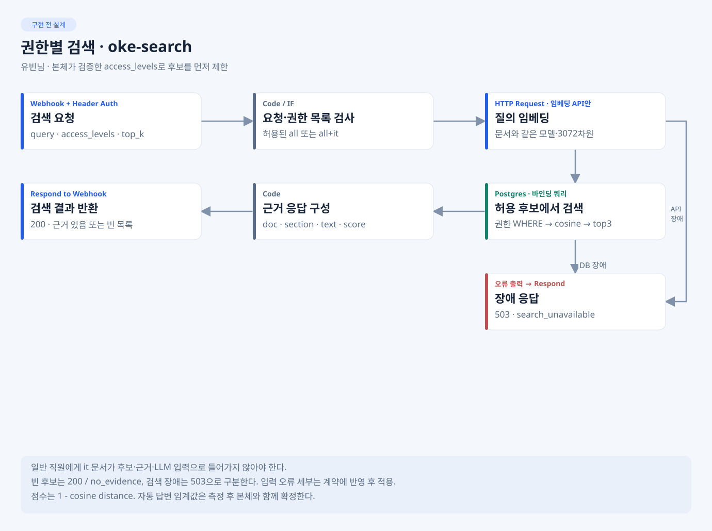
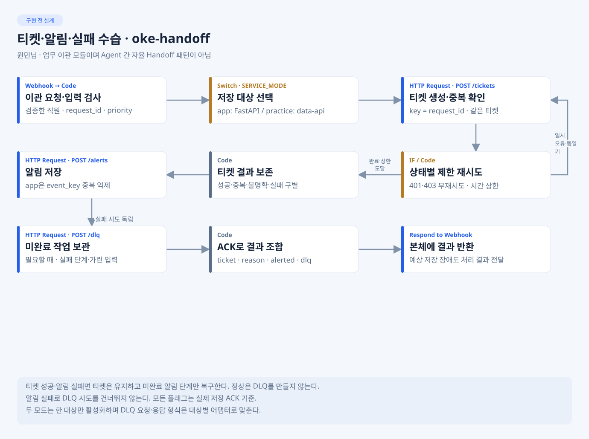
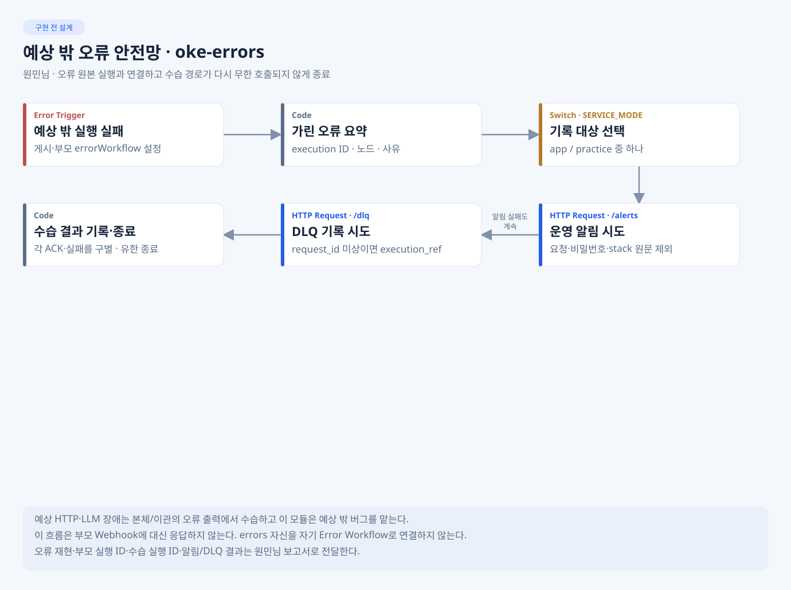

# 1팀 · 오케퐁 사내 IT 헬프데스크

**80일차 아침 · 주제·서비스 구성·역할·진행 계획**

> 메인 README와 docs/에 정리한 화면·설계를 함께 보여 주는 발표 자료입니다. 아래 화면과 흐름도는 구현 목표이며 실제 실행 결과는 오후 점검·발표에서 별도로 확인합니다. 설계·계약의 원본은 각 공통 문서를 따릅니다.

[주제와 문제](#1-주제와-해결할-문제) · [예상 화면](#2-완성했을-때의-사용-화면) · [데이터 흐름](#3-vpn-문의-한-건의-처리-흐름) · [시스템 구조](#4-전체-시스템-아키텍처) · [워크플로우](#5-ai-역할과-워크플로우-5종) · [데이터와 RAG](#6-사용할-데이터와-db--rag) · [팀 역할](#7-팀원별-담당과-연결) · [오늘 목표](#8-80일차에-진행할-내용)

## 1. 주제와 해결할 문제

**오케퐁 직원 6명을 위한 사내 IT 문의 지원 서비스**를 만들겠습니다. 직원이 웹에서 질문하면 사내 규정에 근거해 안내하고, 자동 해결이 어려운 문의는 IT팀에 접수해 처리 결과까지 확인하도록 하겠습니다.

| 해결할 문제 | 우리 서비스의 처리 방식 |
| --- | --- |
| 직원이 비밀번호·VPN·메일·장비 문제의 해결 절차를 여러 문서에서 찾아야 함 | 질문에 맞는 규정을 검색해 답변과 출처를 함께 제공 |
| 문의에 필요한 정보가 부족해 담당자가 다시 확인해야 함 | 어떤 문제·오류·발생 상황인지 보완 질문 |
| 반복 안내와 실제 조치가 필요한 요청이 섞여 있음 | 근거로 안내할 문의와 IT팀에 넘길 문의를 분기 |
| 접수 후 누가 처리하며 어디까지 진행됐는지 확인하기 어려움 | 직원의 내 문의와 관리자의 티켓 처리 화면을 연결 |

문의 범위는 계정·비밀번호, VPN·네트워크, 메일·문서, 장비·프린터·회의실, 소프트웨어, 보안 사고입니다. 실제 비밀번호 변경·설치·장비 조치를 AI가 대신 수행하는 기능은 만들지 않고 필요한 경우 담당자에게 접수합니다.

## 2. 완성했을 때의 사용 화면

### 직원 · 질문·근거·내 문의

직원은 관리자가 발급한 계정으로 로그인해 질문합니다. 답변의 규정 근거를 확인하고, 이관된 문의는 본인 티켓의 상태와 IT팀 답변을 다시 확인합니다.

### IT팀 관리자 · 티켓·긴급 알림·처리

관리자는 접수된 티켓과 긴급 알림을 확인하고 담당자·답변·처리 상태를 저장합니다. 상태는 **접수 → 처리 중 → 완료**로 표시합니다. 저장한 내용은 직원의 내 문의 화면과 연결합니다.

로그인·관리자 계정 발급 화면도 보기

공개 회원가입은 없고 관리자가 계정을 발급합니다. 첫 로그인에는 임시 비밀번호를 변경하며, 직원은 본인 문의만 보고 IT팀 관리자는 관리자 기능을 사용합니다.

화면별 기능과 API 연결 기준: [PREVIEW](../../../docs/PREVIEW.md).

## 3. VPN 문의 한 건의 처리 흐름

예를 들어 직원이 **“VPN이 계속 끊겨요. 어떻게 해야 하나요?”**라고 질문하는 상황입니다.

| 순서 | 처리 | 담당 연결 |
| --- | --- | --- |
| 1 | 화면에서 질문하고 로그인 세션으로 직원을 확인 | 수언님 → 지혜님 |
| 2 | 문의를 기록하고 공통 요청 형식으로 n8n 본체 호출 | 지혜님 → 다혁님 |
| 3 | 문의 유형·긴급도·부족한 정보 분류 | 다혁님 |
| 4 | 권한이 허용된 VPN 규정의 문서·절·내용 검색 | 다혁님 → 유빈님 |
| 5 | 근거로 답변을 작성하고 내용·정책·개인정보 검증 | 다혁님 |
| 6 | 안내가 가능하면 답변·출처 반환. 근거가 없거나 실제 조치가 필요하면 티켓 접수 | 다혁님 → 원민님 → 지혜님 저장 API |
| 7 | 화면에 답변 또는 실제 접수 결과 표시. 관리자 처리 후 직원이 상태 재조회 | 지혜님 → 수언님 |

정보가 부족하면 보완 질문을 합니다. 보완 1·2차 이후에도 3차에 정보가 부족하면 이관합니다. 피싱·유출 같은 보안 사고는 긴급 티켓과 알림을 우선하며, 근거 없는 답이나 저장에 실패한 티켓을 성공으로 표시하지 않겠습니다.

## 4. 전체 시스템 아키텍처

화면은 FastAPI만 호출합니다. FastAPI가 신원·권한·업무 저장을 맡고, n8n이 AI 처리 흐름을 맡습니다. DB·n8n 내부 주소·API 키를 브라우저에 노출하지 않습니다. 각 계층은 Docker Compose로 함께 실행할 계획입니다.

제공 data-api는 원본 데이터 조회와 공통 장애 시험에 사용하고, 실제 서비스의 새 업무 기록은 FastAPI를 통해 PostgreSQL에 저장합니다. practice/app은 한 대상을 선택하며 같은 티켓을 양쪽에 동시에 저장하지 않습니다. 응답은 본체 → FastAPI → 화면으로 돌려줍니다.

이 그림은 발표용 요약입니다. 포트·네트워크·부모 오류 연결·인증의 상세 기준은 [ARCHITECTURE](../../../docs/ARCHITECTURE.md)·[API-CONTRACT](../../../docs/API-CONTRACT.md)를 따릅니다.

## 5. AI 역할과 워크플로우 5종

### 문의 처리 본체

| AI 역할 | 하는 일 |
| --- | --- |
| triage · 분류 | 문의 유형·긴급도·부족한 정보 판단 |
| writer · 답변 작성 | 허용된 규정 근거로 안내 초안 작성 |
| verifier · 검증 | 근거 일치·정책·개인정보 확인 |

흐름은 Code·IF·Switch로 제어하고, 검색은 HTTP/DB 처리로 분리합니다. 별도 Supervisor LLM을 추가하는 기본안은 아닙니다. 입력 오류·차단은 LLM을 호출하기 전에 처리합니다.

| 워크플로우 | 목적 | 담당 |
| --- | --- | --- |
| oke-support | 입력 검사·분류·보완 질문·검색 호출·작성·검증·최종 분기 | 다혁님 |
| oke-index | 규정 청킹·임베딩·문서 단위 저장/갱신 | 유빈님 |
| oke-search | 권한이 허용된 문서에서 근거 검색 | 유빈님 |
| oke-handoff | 티켓·알림 저장, 중복 방지·부분 실패·DLQ 수습 | 원민님 |
| oke-errors | 예상하지 못한 실행 오류의 알림·DLQ 안전망 | 원민님 |

oke-handoff의 handoff는 **IT팀 업무 이관**입니다. Agent끼리 자율적으로 제어권을 넘기는 패턴과 구분합니다. 같은 request_id의 티켓은 한 건만 생성하고, 이미 만든 티켓은 후속 알림 실패로 다시 만들지 않습니다.

규정 색인·검색의 노드 설계 보기

업무 이관·오류 수습의 노드 설계 보기

상세 역할 카드·분기/병렬/루프·연결선 페이로드: [WORKFLOW-DESIGN](../../../docs/WORKFLOW-DESIGN.md).

## 6. 사용할 데이터와 DB · RAG

### 제공 자료와 우리가 구현할 것

| 제공 자료 | 활용 | 우리 팀이 추가로 구현할 것 |
| --- | --- | --- |
| 가상 직원 6명 | 직원 신원·부서·IT팀 권한 확인 | 실제 로그인·관리자 계정 발급·세션·접근 통제 |
| 규정 8종 | 비밀번호·VPN·메일/문서·장비·소프트웨어·보안·회의실·개인정보의 근거 | 청킹·임베딩·pgvector 색인·권한별 검색 |
| FAQ 6종 | 반복 문의의 보조 조회 | 본체의 조회·분류·답변·검증 연결 |
| 기존 티켓 4건 | 본인 확인·타인 조회 차단·개인정보 가림 시험 | 새 문의·티켓·알림 저장과 관리자 처리 화면 |
| 연습용 data-api·공통 시나리오 | 같은 기준으로 정상·오류·권한·장애 확인 | 워크플로우 5종·팀 시나리오·실행 보고서 |

제공 데이터가 있다는 것은 원본 준비 시간을 줄인다는 뜻입니다. 로그인·화면·저장 API·RAG 검색·오류 처리가 완성돼 있다는 뜻은 아닙니다.

### 저장소를 어떻게 쓸 것인가

| 저장 구분 | 저장할 내용 | 구현 연결 |
| --- | --- | --- |
| PostgreSQL · app | 직원·계정·세션·문의·새 티켓·알림·DLQ | 지혜님 API·DB, 원민님 저장 호출 |
| PostgreSQL+pgvector · rag | 원본 문서 정보·권한·청크·임베딩 | 지혜님 확장/테이블, 유빈님 색인·검색 |
| 제공 data-api | 규정·FAQ·직원·기존 티켓 원본과 공통 고장 시험용 상태 | 본체·색인 조회, 시험 모드 연동 |

app/rag는 같은 PostgreSQL 안의 별도 스키마로 분리합니다. pgvector를 포함하며, 이번 필수 범위에 MongoDB·InfluxDB는 추가하지 않습니다.

RAG는 **규정 원문 → 절 단위 청킹 → 임베딩 → pgvector 저장 → 권한으로 후보 제한 → 관련 근거 상위 3개 반환 → 답변 검증** 순서로 설계했습니다. 임베딩은 text-embedding-3-large·3072차원으로 통일하고, 절 단위와 300자 청킹을 비교해 실제 문서/청크 수·길이 분포·검색 품질을 확인하겠습니다. 자동 답변의 점수 기준은 실제 측정 후 정합니다. FAQ·티켓을 규정 색인에 무조건 합치지는 않습니다.

공통 기준: [DATA-AND-DB](../../../docs/DATA-AND-DB.md) · [RAG-ARCHITECTURE](../../../docs/RAG-ARCHITECTURE.md).

## 7. 팀원별 담당과 연결

| 팀원 | 담당 | 만들 결과·다음 연결 |
| --- | --- | --- |
| 오현님 | 팀장·통합 | 범위·공통 기준·병합·VM 배포·발표. 담당별 실제 자료를 받아 제출 문서로 취합 |
| 수언님 | 프론트엔드 | 직원/관리자 화면 → 지혜님 API와 연결 |
| 지혜님 | 백엔드·DB·환경 | 인증·업무 API·DB·pgvector·실행 환경 → 화면·RAG·저장 모듈에 제공 |
| 다혁님 | 문의 처리 본체 | 분류·작성·검증·보완/이관 흐름 → 검색·이관 모듈 호출, 워크플로우 설계 자료 제공 |
| 유빈님 | RAG | 색인·권한별 검색 → 다혁님에게 근거 응답, RAG 설계·측정 자료 제공 |
| 원민님 | 연동·안정성·시험 | 이관·오류 모듈 → 저장 API 연결, 팀 사례·실제 보고서·실행 결과 집계 |

각자 이름 폴더에서 개발하고, 기능 원본은 해당 담당자가 수정합니다. 공통 연결 형식을 먼저 정해 상대 구현 전에는 같은 계약의 Mock으로 진행하고, 준비되면 실제 API·워크플로우로 바꿔 검증합니다. 오현님이 모든 기능을 대신 개발하는 방식으로 진행하지 않습니다.

역할·문서 책임 원본: [TEAM-CHARTER](../../../docs/TEAM-CHARTER.md) · 변경 협의: [COORDINATION](../../../docs/COORDINATION.md).

## 8. 80일차에 진행할 내용

| 시점 | 준비할 결과 | 담당 |
| --- | --- | --- |
| 1~2교시 | 주제·역할·문의 범위 확인, 주제 제안서 승인, 팀 VM 접속 | 오현님·전원 |
| 3교시 | 공식 키트·n8n·data-api·Credential 준비, 팀 시나리오 5개 이상 초안 | 오현님·원민님, 환경 지원 지혜님 |
| 4~5교시 | 워크플로우 설계서 1~4절·공통 계약·팀 사례 점검, 입력/차단 골격 확인 | 다혁님·원민님 → 오현님 취합 |
| 6교시 | RAG 설계서 1~2절, 실제 색인·청크 길이 측정 | 유빈님·지혜님 → 오현님 취합 |
| 7교시 | 검토된 기본 브랜치 커밋을 팀 VM에 첫 배포, WF-08·WF-13 확인 | 오현님 배포·원민님 시험·기능 담당 협력 |
| 8교시 | 설계 2종 초안·VM 동작·실패/막힘·다음 계획 발표, DAY80 기록 | 오현님·전원 자료 제공 |

80일차 목표는 설계 초안과 기본 동작입니다. 수언님·지혜님은 화면/API/DB 기반을 병행하고, 81일차에는 본체와 실제 웹·업무 저장 연결을 진행합니다. 81일차 말에는 기능을 동결하고, 82일차에는 회귀 시험·실패 수정·문서·리허설·최종 제출에 집중합니다. 당일 강사 피드백에 따라 조정하겠습니다.

## 9. 검증과 최종 산출물

최종적으로 **공통 14유형·팀 시나리오 5개 이상**을 확인하고, LLM 관련 시험은 3회 반복하겠습니다. 정상 답변뿐 아니라 보완 한도·무근거·타인 조회·개인정보·주입·장애·중복·긴급 이관을 검증합니다.

| 필수 문서 | 정리할 내용 | 자료 책임 |
| --- | --- | --- |
| WORKFLOW-DESIGN | 실제 흐름·Agent 역할·노드·연결선·외부 연동·오류 처리 | 다혁님 중심, 관련 담당 보완 |
| RAG-ARCHITECTURE | 원본·청킹 비교·임베딩·저장·권한·재색인·복구 | 유빈님 중심, 지혜님 기반 지원 |
| EXECUTION-RESULT | 실제 시험·시간·실패·수정·재시험·시연 근거 | 원민님 집계, 전원 실제 근거 제공 |

설계 초안·예상 화면·역할별 개발 자료는 준비돼 있습니다. 원격 작업 브랜치의 로컬/Mock 검증은 준비 현황으로 구분하고, 실제 VM·API·DB·색인 결과를 받아 공통 문서를 완성하겠습니다. 최종 제출은 제출 저장소의 기본 브랜치 커밋 기준으로 확인합니다.

---

이 페이지의 화면·노드 그림은 [메인 README](../../../README.md)와 [docs/](../../../docs/README.md)의 기존 자료를 그대로 참조합니다. 별도 이미지 사본·공통 계약 원본을 만들지 않습니다.

[81일차 연결·동결 발표](../DAY81/README.md) · [82일차 최종 발표](../DAY82/README.md)

팀장 작업용: [준비 체크리스트](PREPARATION.md) · [팀원에게 받을 자료](TEAM-INPUTS.md) · [오후 점검·발표 준비](PRESENTATION.md)
