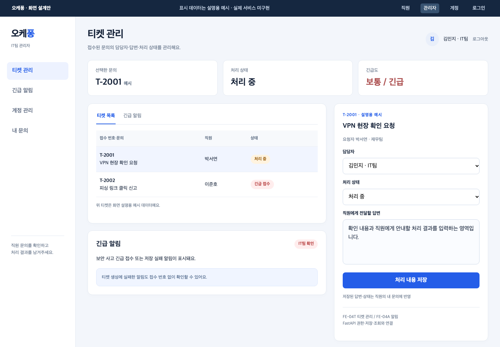
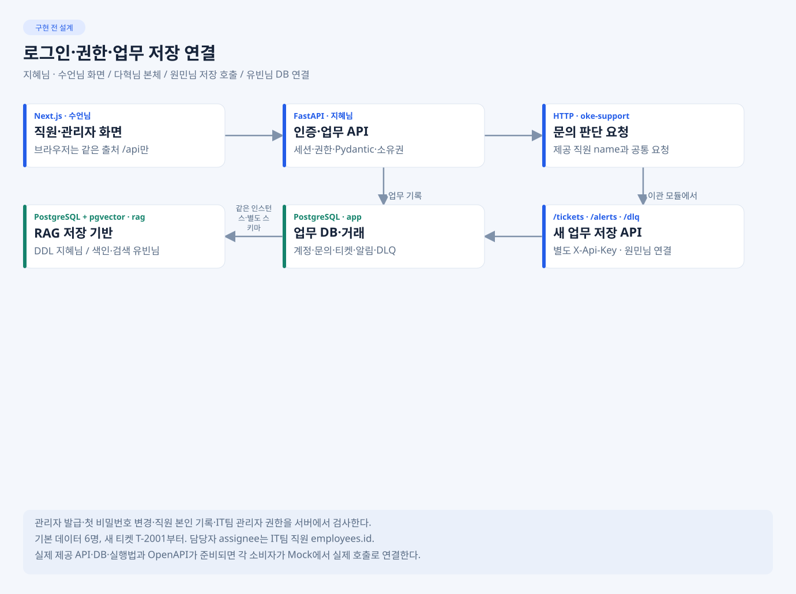
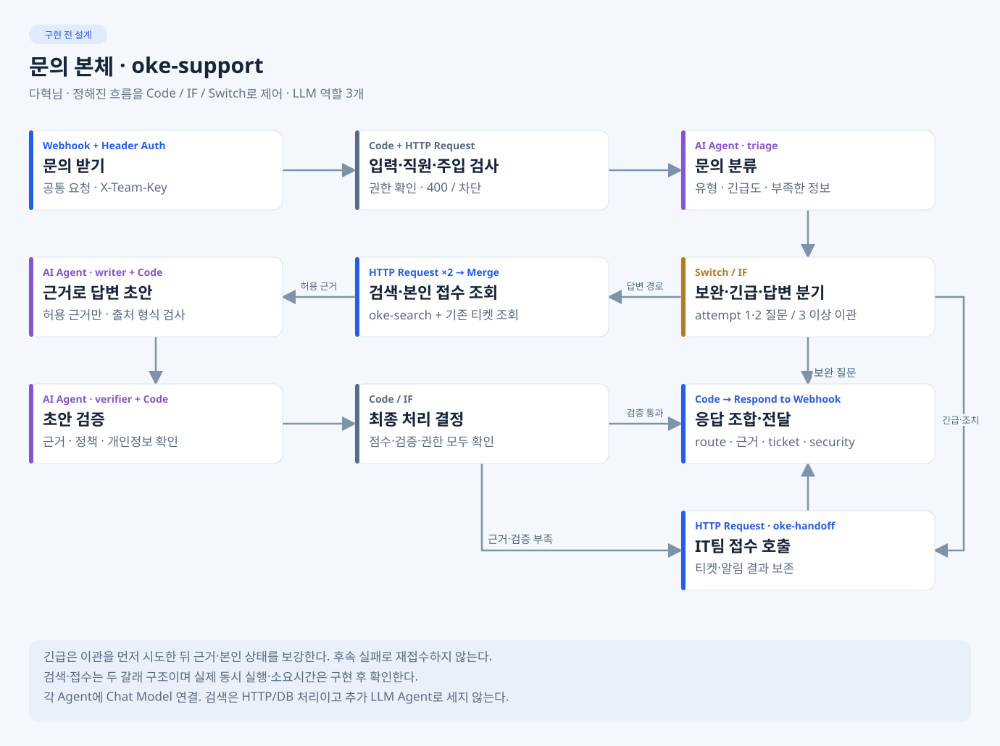
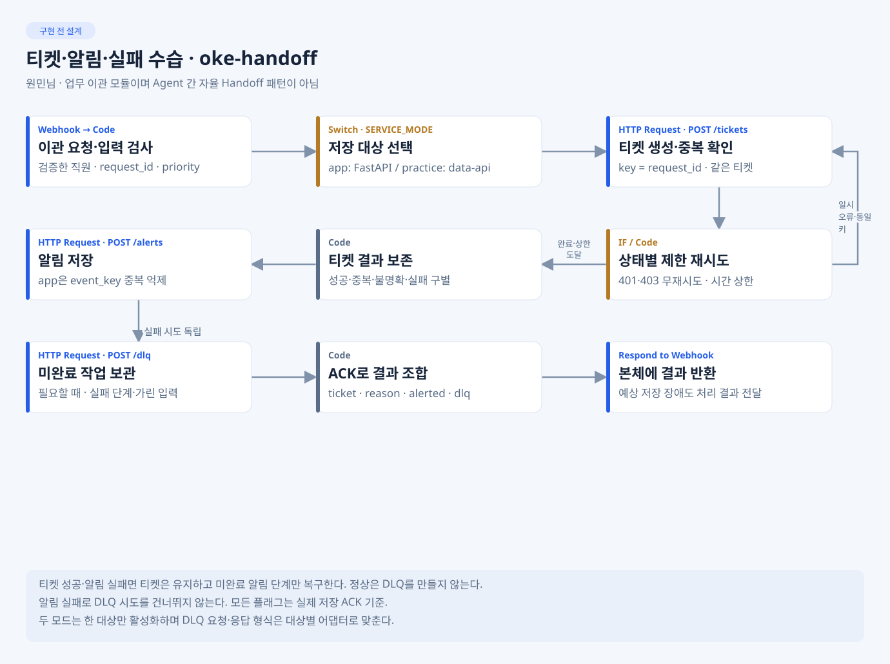
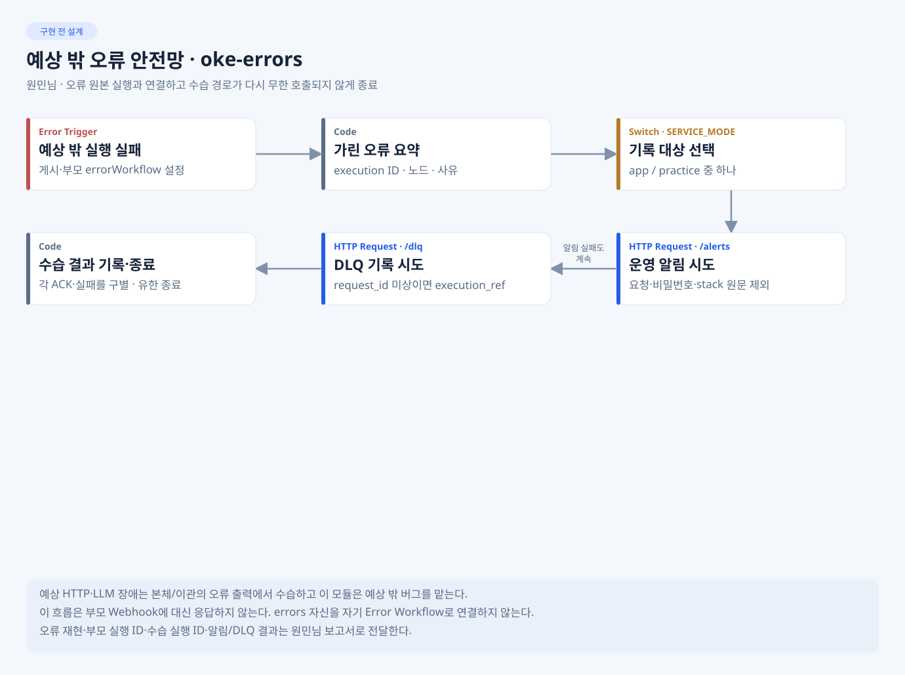
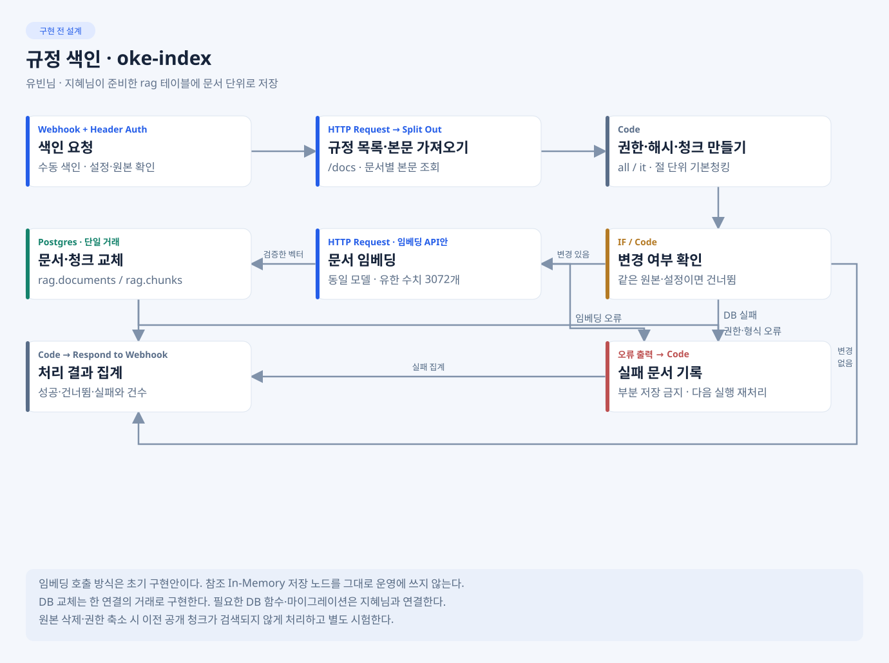
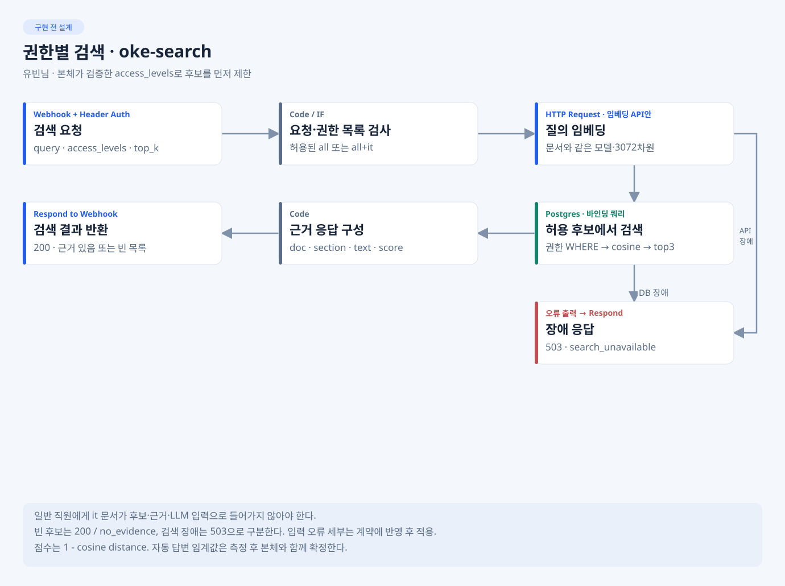

# 1팀 · 오케퐁 사내 IT 헬프데스크

**81일차 · 실제 연결·예외 처리·설계 완성·기능 동결**

> 발표 준비본입니다. 그림은 기존 설계이며 구현 완료를 뜻하지 않습니다. 당일 실제 상태·수치·실행 화면은 공통 설계서·실행 결과서·DAY81의 근거를 확인해 설명합니다. 아직 확인하지 않은 결과는 확인 대기로 표시했습니다.

[서비스와 화면](#1-서비스와-화면) · [연결과 페이로드](#2-웹api워크플로우저장-연결) · [워크플로우](#3-문의-처리와-안정성) · [RAG](#4-rag-설계-완성과-측정) · [검증](#5-정상보안장애를-어떻게-확인할까) · [역할과 일정](#6-오늘-담당별-결과와-점검-일정) · [발표·동결](#7-8교시-발표와-기능-동결)

## 1. 서비스와 화면

오케퐁 직원 6명이 웹으로 IT 문제를 질문하고, 규정 근거로 안내받거나 IT팀에 접수해 처리 상태를 확인하는 서비스입니다. 오늘은 80일차의 설계·골격에서 **실제 검색·답변·검증·티켓 저장과 웹/API 연결**로 진행합니다.

| 직원 · 질문·근거·내 문의 | 관리자 · 티켓·알림·처리 |
| --- | --- |
|  |  |

화면은 예상안입니다. 당일 시연에서는 실제 화면이 연결됐는지, Mock 응답인지, FastAPI·n8n·DB까지 연결됐는지를 구분해 보여 줍니다. 실제 화면 캡처는 확인 후 공통 [images/](../../../docs/images/README.md)에 연결합니다.

| 오늘 출발점으로 확인할 것 | 확인할 원본 | 실제 상태 |
| --- | --- | --- |
| 80일차 강사 피드백과 미완료 | [DAY80](../../../daily/DAY80.md) | 당일 기록 확인 대기 |
| VM 기준 커밋·공통 시험 통과 수 | [DAY81](../../../daily/DAY81.md)·원민님 보고서 | 시작 시 시험 후 확인 |
| 오늘 수정할 우선순위·소유자 | DAY81·각 담당 HANDOFF | 첫 스탠드업에서 확인 |

## 2. 웹·API·워크플로우·저장 연결



직원 화면 → FastAPI의 세션·권한 검사 → 동일한 oke-support → 권한별 검색 또는 업무 이관 → FastAPI의 저장 API → PostgreSQL → 화면 재조회로 연결합니다.

| 연결 | 전달하는 것 | 확인할 동작 |
| --- | --- | --- |
| 화면 → FastAPI | question, 선택 request_id·attempt·context | 직원 신원은 브라우저 입력 대신 서버 세션에서 확인 |
| FastAPI → support | request_id·user·question·channel·attempt·context | 공통 요청 형식·인증, 응답 필드 보존 |
| support → search | query·검증된 access_levels·top_k | 권한 선필터 후 doc·section·text·score 반환 |
| support → handoff | request_id·requester·title·category·priority·reason | 실제 ticket·alerted·dlq 결과를 공통 응답에 매핑 |
| handoff → 저장 API | /tickets·/alerts·/dlq | 같은 키 티켓 1건, 실제 ACK와 미완료 작업 구분 |

아래는 요청 **형식 예시**이며 실제 실행 로그가 아닙니다. 4교시에는 같은 연결의 실제 노드 입력·출력과 가린 실행 캡처를 함께 보여 줍니다.

```json
{"request_id":"day81-demo-001","user":"박서연","question":"VPN이 계속 끊겨요. 어떻게 해야 하나요?","channel":"web","attempt":1}
```

practice는 제공 data-api로 공통 장애 조건을 시험하고, app은 FastAPI/PostgreSQL의 실제 저장을 확인합니다. 같은 본체를 사용하되 호출·고장 주입·관측 대상을 맞추며 양쪽에 같은 티켓을 동시에 저장하지 않습니다.

상세 계약·네트워크: [API-CONTRACT](../../../docs/API-CONTRACT.md) · [ARCHITECTURE](../../../docs/ARCHITECTURE.md).

## 3. 문의 처리와 안정성



triage가 유형·긴급도·부족한 정보를 판단하고, writer가 허용 근거로 초안을 작성하며, verifier가 근거·정책·개인정보를 검사합니다. Code·IF·Switch가 최종 경로를 제어합니다. 검색은 HTTP/DB 처리이고 별도 Supervisor LLM을 추가하는 기본안은 아닙니다.

| 구조 | 설계와 확인할 점 |
| --- | --- |
| 분기 | 충분한 근거·검증 통과면 답변, 부족 정보는 질문, 무근거·실제 조치·긴급은 이관 |
| 보완 루프 | attempt 1·2는 보완 질문, 3 이상에도 부족하면 이관. 새 차례와 동일 요청 재시도를 구분 |
| 두 갈래 조회 | 규정 검색과 본인 접수 조회를 request_id 기준으로 합침. 실제 실행 순서·시간을 확인하고 동시 실행 성과로 추정하지 않음 |
| 중복 방지 | 동일 request_id로 반복·동시 요청해도 같은 티켓 1건 |
| 예상 장애 | 시간 제한·제한 재시도·부분 실패·알림·DLQ. 티켓 성공 뒤 알림 실패로 티켓 재생성 금지 |
| 예상 밖 오류 | oke-errors의 Error Trigger로 가린 오류 기록·알림/DLQ 수습. 부모 Webhook 응답을 대신한다고 가정하지 않음 |

<details>
<summary>업무 이관·예상 밖 오류의 노드 설계 보기</summary>





</details>

최종 게시 대상은 support·index·search·handoff·errors 5종입니다. 실제 파일·노드·연결·인증·게시 여부는 [WORKFLOW-DESIGN](../../../docs/WORKFLOW-DESIGN.md)의 구현 기록과 대조합니다. 단계별 보존 JSON은 같은 웹훅으로 함께 게시하지 않습니다.

## 4. RAG 설계 완성과 측정

제공 규정 8종과 확인된 권한 정보를 사용합니다. 규정을 청킹·임베딩해 PostgreSQL의 rag.documents/chunks에 저장하고, 직원 권한으로 후보를 먼저 제한한 뒤 관련 근거 상위 3개를 반환합니다. 업무 기록은 app 스키마로 분리합니다.

<details>
<summary>색인·권한별 검색의 노드 설계 보기</summary>





</details>

| 항목 | 정해진 설계·확인 방법 | 실제 결과 |
| --- | --- | --- |
| 청킹 비교 | 같은 원본·질문으로 절 단위와 300자 비교. 청크 수·길이 분포·정답 문서/절·근거 포함률 확인 | 측정 확인 대기 |
| 임베딩 | text-embedding-3-large·3072차원, 문서와 질의에 같은 설정 | 실제 호출·차원 확인 대기 |
| 검색 | 권한 WHERE → 정확 cosine → top_k=3 | 검색·권한 쌍 시험 확인 대기 |
| 자동 답변 기준 | 답 있음/없음 질문의 점수 분포와 검증 결과로 기준 결정 | 후보·채택 근거 확인 대기 |
| 갱신·복구 | 문서 단위 재색인·권한 축소/삭제·중복·재시작·복원 확인 | 실제 시험·미구현 구분 필요 |

4교시에는 RAG 설계서 **3~5절**, 7~8교시에는 **전체 설계 완성본**을 보여 줄 목표입니다. Mock 원문·가짜 벡터·DB 더블 검증은 실제 색인·복구 측정과 따로 설명합니다.

측정 원본: [RAG-ARCHITECTURE](../../../docs/RAG-ARCHITECTURE.md) · [DATA-AND-DB](../../../docs/DATA-AND-DB.md).

## 5. 정상·보안·장애를 어떻게 확인할까

| 대상 | 시나리오 | 확인할 결과 |
| --- | --- | --- |
| 정상·무근거 | WF-01·03 | 근거 있는 답변 / 추정 없이 실제 이관 |
| 보완·느린 조회·복합 긴급 | WF-02·02b·11·12 | 한도 있는 질문·시간 제한·긴급 접수와 필요한 근거/본인 상태 |
| 권한·개인정보·주입 | WF-05~08 | 관리자 문서·타인 건 미노출·연락처 가림·LLM 호출 전 차단 |
| 티켓/LLM 장애·중복 | WF-04·09·10 | 무한 재시도 없음·알림/DLQ·티켓 1건·실패 사실 보존 |
| 입력 오류 | WF-13 | 빈 질문·없는 직원·501자에 공통 HTTP400 |
| 우리 팀 기능 | 팀 사례 5개 이상·app 통합 | 로그인·관리자 발급·본인 조회·저장·재시작 등 실제 범위 확인 |

실제 공통 통과 수·실패·미실행·장애 시험은 [DAY81](../../../daily/DAY81.md)과 [EXECUTION-RESULT](../../../docs/EXECUTION-RESULT.md)에 보고서 링크로 연결합니다. 로컬 단위/Mock 테스트 수를 공통 14유형의 통과 수로 합치지 않습니다.

## 6. 오늘 담당별 결과와 점검 일정

| 담당 | 오늘 받을 결과 | 다음 연결·문서 |
| --- | --- | --- |
| 수언님 | 실제 API 연결 화면·상태별 표시·미연결 기능 | 지혜님 인증/업무 API, 원민님 통합 시험 |
| 지혜님 | 실제 인증·저장·app/rag·마이그레이션·실행/배포 절차 | 화면·RAG·handoff 연결과 VM 배포 |
| 다혁님 | 본체·실제 노드/분기/페이로드·설계 1~7절 자료 | 검색·이관 연결, 워크플로우 설계 완성 |
| 유빈님 | index/search·청킹/검색·권한·갱신/복구 실제 근거 | RAG 설계 전체 완성, 본체·시험 자료 |
| 원민님 | handoff/errors·공통/팀/장애 보고서·결과서 초안 | 실패 수정 담당에게 재현 전달, 실행 결과 집계 |
| 오현님 | 검토·병합·VM 배포 2회·공통 문서 취합·발표 | 통과 수와 잔여 위험 확인 후 기능 동결 |

| 시점 | 수업자료의 점검 목표 |
| --- | --- |
| 1교시 | 전날 피드백·VM 공통 시험 출발점 기록 |
| 2~3교시 | 정상 답변·근거·검증·무근거 이관 확인 |
| 4교시 | VM 배포 1회·팀별 10분 중간점검: 페이로드·RAG 3~5절·외부 연동 표 |
| 5~6교시 | 권한·가림·주입·장애·중복·재시도·DLQ 확인 |
| 7교시 | Error Workflow 게시·설계 2종 완성·결과서 초안·VM 배포 2회와 전체 회귀 |
| 8교시 | 팀별 10분 발표 ②·DAY81·기능 동결 |

## 7. 8교시 발표와 기능 동결

오늘 발표는 **어제 설계에서 실제로 무엇이 연결됐는지, 무엇이 실패하는지**를 보여 줍니다. 권장 구성은 전날 대비/구현 범위 1분, 본체·연결선 3분, RAG 실제 비교 2분, VM·시험/장애 3분, 남은 문제·동결 계획 1분입니다.

| 발표 근거 | 확인할 원본 | 상태 |
| --- | --- | --- |
| 두 설계서의 실제 구현 일치 | WORKFLOW-DESIGN·RAG-ARCHITECTURE | 당일 대조 대기 |
| 공통·팀 통과 수·실패·미실행 | 실행 결과서·runs·DAY81 | 당일 결과 확인 대기 |
| VM 커밋·모드·배포 후 회귀 | DAY81·원민님 보고서 | 실제 배포 확인 대기 |
| 미완료·수정 소유자·82일차 우선순위 | DAY81·담당 HANDOFF | 동결 전 확인 |

**81일차 8교시에 기능을 동결합니다.** 완료 범위·미완료·필수 수정·기준 커밋을 확인한 뒤 선언하고, 82일차에는 새 기능 대신 시험·수정·문서·발표를 진행합니다. 공통 시나리오가 절반도 통과하지 못하면 수업자료 기준대로 가산 기능을 내려놓고 필수부터 수정합니다.

공식 기록은 main의 공통 문서에 반영합니다. submission에는 main → submission merge로만 가져오며, 제출용 문서 원본을 따로 편집하지 않습니다.

---

[80일차 소개](../DAY80/README.md) · [82일차 최종 발표](../DAY82/README.md) · [공통 문서](../../../docs/README.md)

팀장 작업용: [준비 체크리스트](PREPARATION.md) · [팀원에게 받을 자료](TEAM-INPUTS.md) · [중간점검·발표 순서](PRESENTATION.md)
