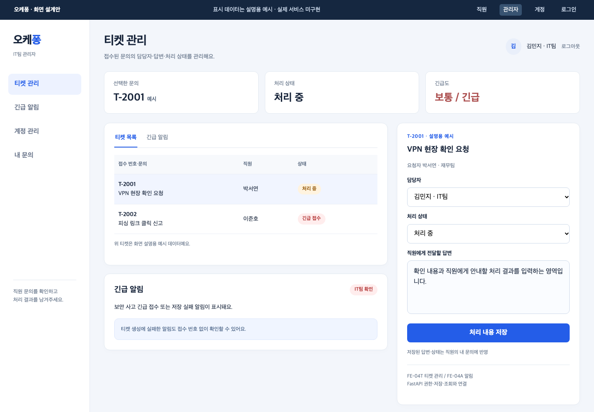
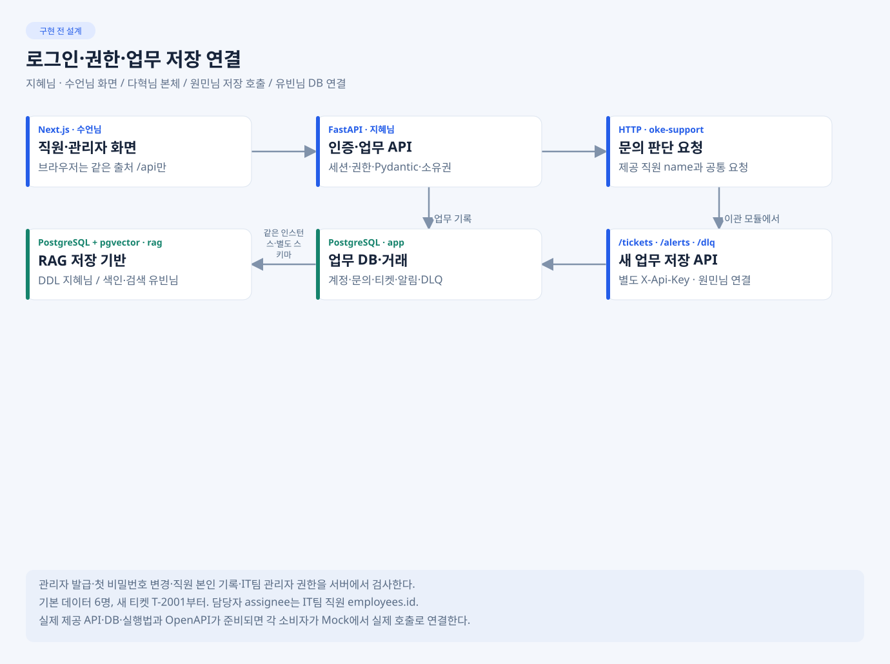
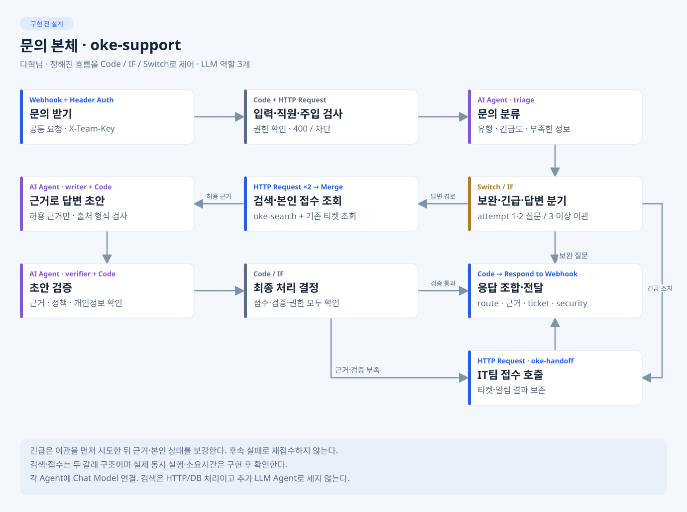
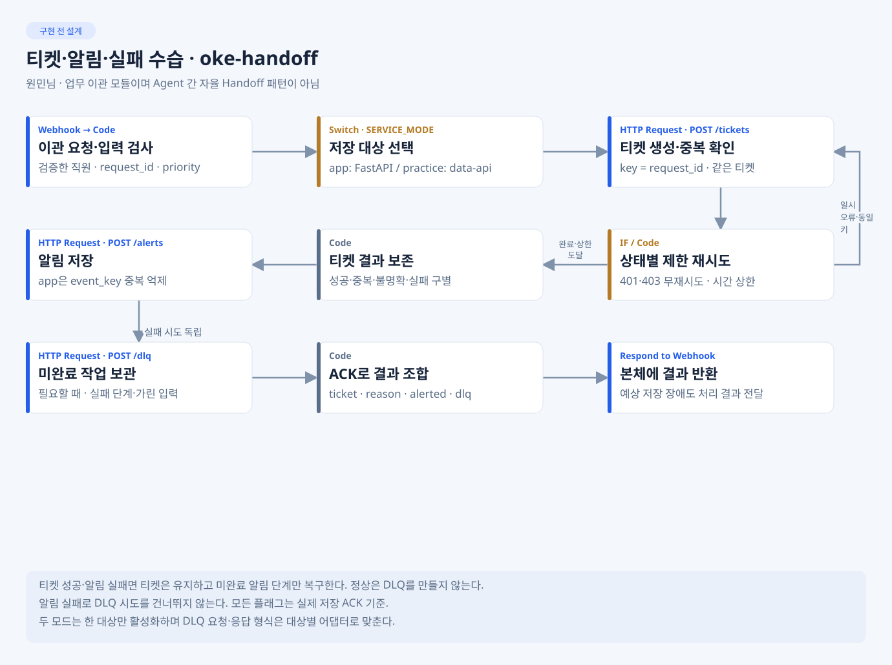
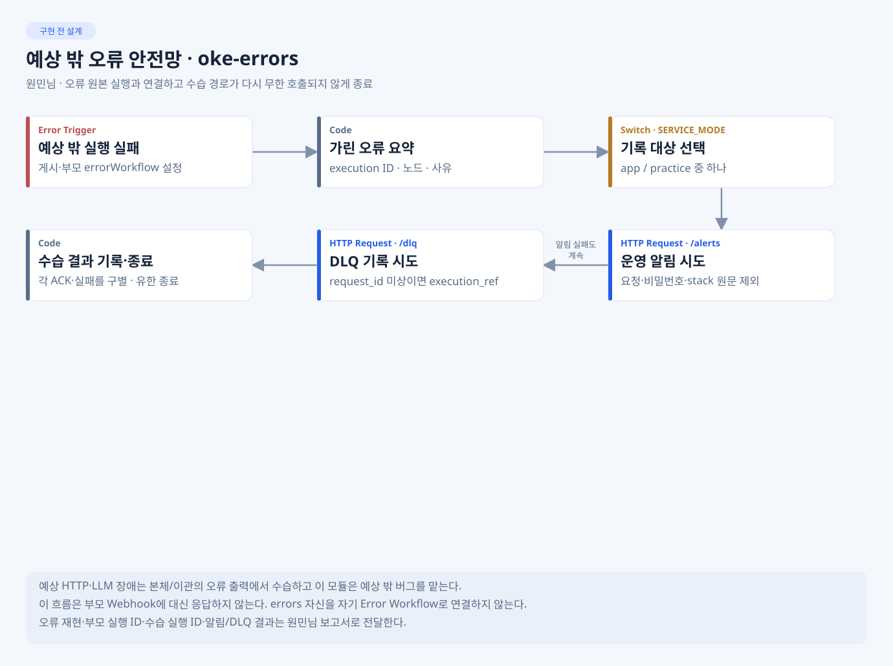
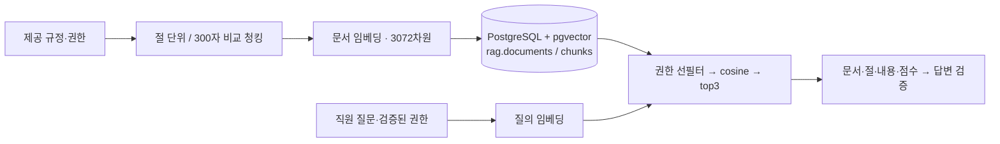
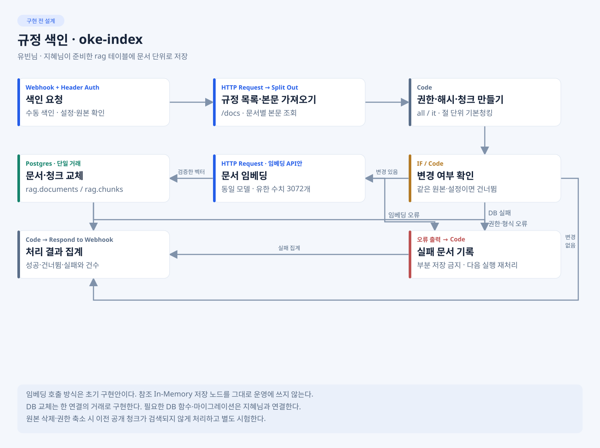
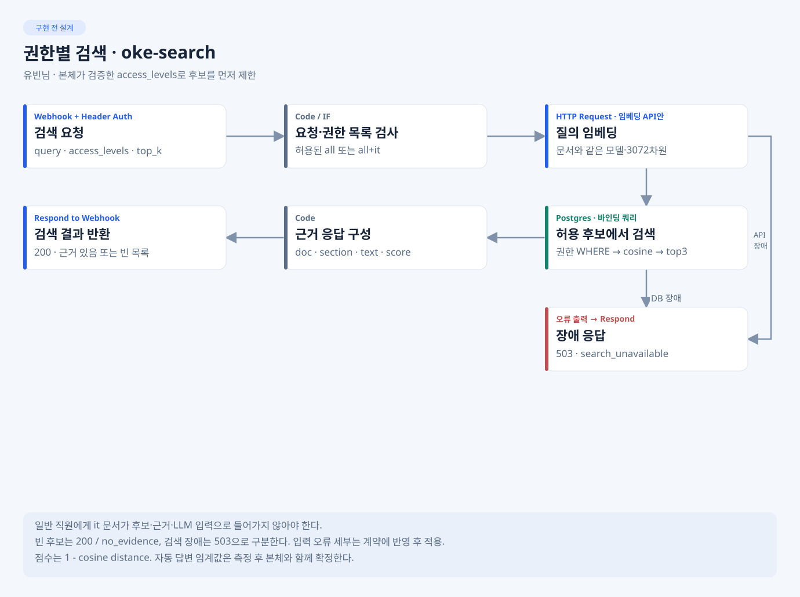

# 1팀 · 오케퐁 사내 IT 헬프데스크

**82일차 · 최종 산출물·VM 시연·실제 시험 결과**

> 최종 발표 준비본입니다. 서비스 설명·설계는 기존 공통 자료를 사용하고, 실제 화면·측정·통과 수·실패·제출 정보는 당일 결과로 확인합니다. 아래 설계 그림·예상 화면은 실제 실행 증거가 아닙니다. 확인 대기 항목을 완료로 발표하지 않습니다.

[발표 순서](#1-최종-발표-순서) · [문제·범위·역할](#2-문제범위팀-역할) · [흐름·연결](#3-워크플로우와-시스템-연결) · [RAG](#4-rag-설계와-실제-비교) · [VM 시연](#5-팀-vm-시연) · [결과·실패](#6-실제-결과와-실패--재시험) · [제출](#7-최종-산출물과-제출)

## 1. 최종 발표 순서

**팀당 20분 발표·시연 + 질의 5분**입니다. 아래 시간은 수업자료의 권장 배분입니다. 발표 순서는 별도 공지이며, 저장소의 1팀이라는 이름만으로 리허설/발표 시간을 확정하지 않습니다.

| 분 | 설명 | 보여 줄 근거 |
| --- | --- | --- |
| 3 | 업무 시나리오·범위·팀 역할 | 주제·헌장·서비스 화면 |
| 5 | 흐름도·Agent 역할·분기/병렬/루프·연결선 페이로드 | 실제 JSON·워크플로우 설계서 |
| 4 | 청킹 비교·임베딩·권한 필터·재색인 | RAG 설계서·실제 측정 |
| 5 | 정상 → 보완 → 장애 → 이관·로그의 VM 시연 | 미리 준비한 요청·실제 VM |
| 3 | 결과 숫자·실패 사례·남은 위험 | 실행 결과서·runs·실패/재시험 |

## 2. 문제·범위·팀 역할

오케퐁 직원 6명의 사내 IT 문의를 받아, 규정 근거로 안내하고 실제 조치가 필요한 문의를 IT팀에 접수하는 서비스입니다. 반복 안내와 담당자 처리, 직원의 상태 확인을 한 흐름으로 연결하는 것이 목표입니다.

| 직원 · 질문·근거·내 문의의 예상안 | 관리자 · 티켓·알림·처리의 예상안 |
| --- | --- |
|  |  |

위 그림은 설계 소개용입니다. 최종 시연은 실제 VM에서 하며, 실제 화면 캡처는 [images/](../../../docs/images/README.md)와 [실행 결과서](../../../docs/EXECUTION-RESULT.md)의 검증된 링크를 사용합니다.

| 범위 | 실제 확인할 것 |
| --- | --- |
| 직원 | 관리자 발급 계정·로그인·질문·근거·본인 문의/티켓 조회 |
| 관리자 | 계정 발급·티켓 배정/답변/상태·긴급/저장 실패 알림 |
| AI | 분류·보완·권한별 근거·작성·검증·업무 이관 |
| 안전성 | 타인/관리자 자료 차단·가림·주입 차단·중복·장애 수습 |

실제 완료 범위·미완료·Mock 전용 기능은 공통 실행 결과서에서 확인한 뒤 설명합니다. 웹이 준비되지 않아 웹훅으로 시연하는 경우 그 범위를 밝히고 웹/DB 통합까지 완료했다고 소개하지 않습니다.

| 팀원 | 담당 |
| --- | --- |
| 오현님 | 범위·계약·병합·VM 배포·문서 취합·발표 |
| 수언님 | 직원/관리자 웹 화면·API 연결 |
| 지혜님 | FastAPI·로그인/권한·업무 저장·DB/pgvector·실행 환경 |
| 다혁님 | 문의 본체·분류/작성/검증·분기·보완 |
| 유빈님 | 규정 청킹·임베딩·색인·검색·RAG 측정 |
| 원민님 | 이관/오류·시나리오·실제 시험·결과 집계 |

주제·역할 원본: [TOPIC](../../../docs/TOPIC.md) · [TEAM-CHARTER](../../../docs/TEAM-CHARTER.md).

## 3. 워크플로우와 시스템 연결

Next.js → FastAPI의 세션·권한 확인 → 동일한 n8n 본체 → 검색/답변 또는 티켓·알림 → PostgreSQL → 직원/관리자 화면으로 연결합니다. data-api는 제공 규정·FAQ·직원·기존 티켓과 공통 장애 시험에 사용하고, app 새 업무 기록은 FastAPI/PostgreSQL에 저장합니다.

triage·writer·verifier 3역할을 Code·IF·Switch로 제어합니다. 근거·권한·검증을 통과해야 자동 답변하고, 정보가 부족하면 보완 질문, 무근거·실제 조치·긴급은 IT팀 이관으로 처리합니다. 업무 이관과 Agent 간 자율 Handoff는 구분합니다.

| 구성 | 발표에서 보여 줄 것 |
| --- | --- |
| 분기 | 자동 답변·보완·이관·권한 없음·차단의 실제 경로 |
| 병렬/두 갈래 조회 | 검색·본인 접수 조회의 연결·병합과 실제 실행 순서/시간. 동시 실행 여부를 추정하지 않음 |
| 루프 | attempt/context의 보완 한도·동일 요청 재시도와 새 차례 구분 |
| 연결선 페이로드 | 실제 실행에서 한 연결의 필수/선택 필드·변환·가린 입력/출력 |
| 오류/중복 | 제한 재시도·실제 티켓1건·알림/DLQ·Error Workflow 연결·부분 실패 |

이관·오류 안전망 설계 보기

그림과 실제 노드 이름·흐름·파일은 제출 전에 대조합니다. 실제 JSON·페이로드·게시 정보의 원본: [WORKFLOW-DESIGN](../../../docs/WORKFLOW-DESIGN.md) · [API-CONTRACT](../../../docs/API-CONTRACT.md) · [ARCHITECTURE](../../../docs/ARCHITECTURE.md).

## 4. RAG 설계와 실제 비교

규정 8종을 중심으로 색인하며, FAQ 6종과 기존 티켓 4건은 보조 조회로 구분합니다. 문서·질의의 기본 모델은 text-embedding-3-large·3072차원이고, 업무 app과 검색 rag 스키마를 분리합니다. 자동 답변 점수 기준은 실제 점수 분포와 검증 결과로 정합니다.

| 비교·설명할 내용 | 실제 결과의 원본 | 발표 준비 상태 |
| --- | --- | --- |
| 절 단위 vs 300자: 청크 수·최소/중앙/최대 길이 | RAG 설계서 2절·유빈님 측정 자료 | 실제 값 확인 대기 |
| 같은 질문의 문서/절 hit@3·근거 포함률·채택 이유 | RAG 설계서 2절 | 비교 결과 확인 대기 |
| 모델·차원·검색 시간·색인 비용·점수 기준 | RAG 설계서 3절 | 실제 호출/측정 확인 대기 |
| 일반/IT 권한 쌍·검색 전 필터·메타데이터 | RAG 설계서 4절·권한 시험 보고서 | 실제 누출/차단 결과 확인 대기 |
| 재색인·재시작 유지·부분 실패·백업/복구 | RAG 설계서 5절·보고서 | 구현/측정/운영 계획 구분 필요 |

설계된 설정·Mock 수치·실제 API/DB 측정을 구분합니다. 문서가 늘었을 때의 확장은 실제 시험 결과와 추정/계획을 나눠 설명합니다.

색인·검색 노드 설계 보기

측정 원본: [RAG-ARCHITECTURE](../../../docs/RAG-ARCHITECTURE.md) · [DATA-AND-DB](../../../docs/DATA-AND-DB.md).

## 5. 팀 VM 시연

아래는 원본 요구의 7단계 시연 순서입니다. 요청 파일·워크플로우·실행 화면을 미리 열고, 실제 VM에서 동작을 보여 줍니다.

| 순서 | 시연 장면 | 실제로 확인할 것 |
| --- | --- | --- |
| 1 | 정상 IT 문의 입력 | 준비한 정상 요청·로그인 직원·문의 수신 |
| 2 | 분류·RAG 검색·작성·검증 흐름 | 실제 실행 노드와 Agent 역할 |
| 3 | 근거와 최종 답변 | 문서·절·내용이 답을 뒷받침하는지 |
| 4 | 정보 부족 문의 | 구체적 보완 질문·한도·차례 처리 |
| 5 | 무근거 또는 외부 API 장애 | 추정/성공 위장 없이 예외 처리·사유 |
| 6 | 담당자 이관·실행 로그 | 실제 티켓·긴급도·알림/DLQ·가린 로그 |
| 7 | 결과와 실패 사례 설명 | 실행 결과서·실패→수정→동일 조건 재시험 |

시작 전 doctor ready·고장 해제·LLM 정상·색인 준비·VM 커밋을 확인합니다. 장애 시연 후 고장 상태를 되돌립니다. 호출·고장 주입·관측은 같은 대상을 사용하고, practice 공통 시험과 app 저장 시연을 구분합니다.

시연 중 실제 화면·응답·저장이 실패하면 그 현상을 설명하고 준비한 실제 실행 근거와 비교합니다. 예상 화면이나 Mock으로 성공한 것처럼 대체하지 않습니다. 구체 순서·운영은 [PRESENTATION](PRESENTATION.md)을 따릅니다.

## 6. 실제 결과와 실패 · 재시험

**아래 값은 실제 runs에서만 확인합니다.** 아직 실행하지 않은 결과는 공란/미실행으로 두고 0건이나 PASS로 채우지 않습니다. 공식 원본은 [EXECUTION-RESULT](../../../docs/EXECUTION-RESULT.md)와 [DAY82](../../../docs/daily/DAY82.md)입니다.

| 최종 설명할 결과 | 근거 | 현재 준비 상태 |
| --- | --- | --- |
| 공통 14유형·팀 5개 이상의 통과/실패/미실행 | 최종 test JSON | 최종 보고서 확인 대기 |
| LLM 관련 3회 반복·흔들린 사례 | 반복별 원 보고서 | 실제 반복 확인 대기 |
| 처리시간 p50·p95·측정 조건 | 실제 bench JSON | 측정 확인 대기 |
| 자동 답변/이관·예외 처리·권한 위반·무근거 답변 | 응답·로그·저장 관측 | 집계 확인 대기 |
| 대표 정상·예외·이관 로그 | 실행 ID·가린 캡처·요청/응답 | 실제 근거 확인 대기 |
| 실패 사례 2건 이상·수정·같은 조건 재시험 | 최초 실패·수정 커밋·재시험 보고서 | 사례 수신 대기 |

실패 사례는 현상 → 재현 조건 → 로그/노드로 확인한 원인 → 소유자 수정 → 같은 조건 재시험 → 남은 위험 순으로 설명합니다. 결과서에는 2건 이상을 남기고, 3분 결과 설명에서는 대표 사례 하나를 중심으로 보여 줍니다.

## 7. 최종 산출물과 제출

| 필수 문서 | 완성할 내용 | 자료 제공 |
| --- | --- | --- |
| WORKFLOW-DESIGN | 실제 흐름·3역할·노드·연결선·외부 연동·오류 | 다혁님 중심, 원민님·유빈님·지혜님 보완 |
| RAG-ARCHITECTURE | 실제 원본·청킹 비교·모델·저장·권한·재색인/복구 | 유빈님·지혜님 |
| EXECUTION-RESULT | 실제 시험·수치·대표 로그·실패/재시험·시연 | 원민님 집계·전원 근거·다혁님 동작 확인 |

함께 제출할 것은 주제·헌장·AGENTS·실행 README·데일리 3장·실제 캡처·워크플로우 JSON·팀 사례·요청·실행 보고서와 웹/API/배포에 필요한 실제 코드입니다.

**82일차 14:50, 최종 제출 저장소의 Default branch 마지막 커밋이 기준입니다.** submission 푸시만으로 제출 완료가 되지 않습니다. main에서 공통 문서를 완성하고 main → submission merge로 가져온 뒤, 최종 결과를 제출처 기본 브랜치에 반영·검증합니다. submission → 개발 main 역병합은 하지 않습니다.

제출 커밋·VM 커밋·검사 결과·접근 권한·마감 확인은 실제 수행 후 공통 DAY82에 기록합니다. 마감 후에는 제출본을 수정하지 않습니다. 현재는 제출·리허설·최종 검증 전입니다.

---

[80일차 소개](../DAY80/README.md) · [81일차 중간 발표](../DAY81/README.md) · [공통 문서](../../../docs/README.md)

팀장 작업용: [준비·제출 체크리스트](PREPARATION.md) · [최종 받을 자료](TEAM-INPUTS.md) · [20분 발표·시연 순서](PRESENTATION.md)
