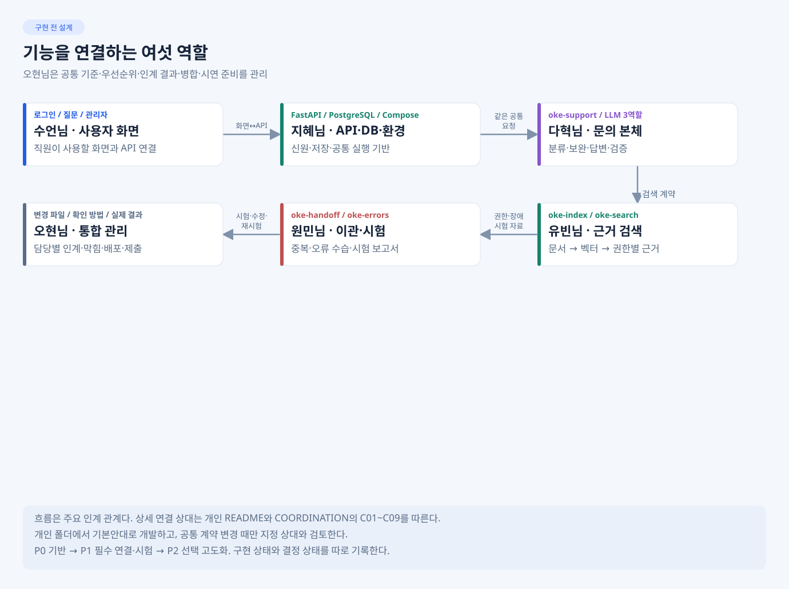

# 오현님 · 팀장·통합 관리

**목표:** 담당자가 자기 개발에 집중하도록 기준·연결·인계·병합·시연 준비를 관리한다. 오현님이 모든 기능을 직접 구현하는 역할은 아니다.

## 지금 먼저 볼 것

1. [예상 화면·기능표](../../docs/PREVIEW.md)에서 무엇을 완성할지 확인한다.
2. 아래 표로 각 담당자의 첫 결과·다음 연결을 받는다. 세부 코드는 해당 담당 CLI가 설명·확인하도록 한다.
3. [80일차 아침 발표 자료](DAY80/README.md)를 열어 주제·역할·오늘 계획을 소개한다. 실제 작업 관리는 [준비 체크리스트](DAY80/PREPARATION.md)와 [전체 TODO](Doc/TODO.md)를 따른다.

## 누구에게 무엇을 받나

| 담당 | 첫 인계 | 최종 인계·다음 연결 |
| --- | --- | --- |
| 수언님 | 화면 골격·Mock·API 대응 | 실제 연결 화면·실행법·캡처 → 지혜님/원민님 확인 |
| 지혜님 | 공통 타입·OpenAPI 예시·DB/Compose 기반 | 인증·저장·마이그레이션·seed·실행법 → 수언님/유빈님/원민님 |
| 다혁님 | 입력·차단 골격·공통 응답 | 본체 JSON·실제 노드/분기/페이로드 → 설계서 |
| 유빈님 | 원본/권한 대장·청크 매핑 | index/search·비교·권한·복구 측정 → 다혁님/지혜님·RAG 설계서 |
| 원민님 | 팀 시험 입력·기대 | handoff/errors·실제 runs·실패/재시험 → 결과서 |

각 CLI/담당자에게 매번 **변경 파일 / 확인 방법·입력 / 실제 결과 / 남은 문제·다음 상대** 네 묶음으로 보고받는다. 실제 실행 결과는 담당자가 확인하고 미실행과 구분한다.

## 정해진 것과 팀장이 판단할 것

| 구분 | 관리 |
| --- | --- |
| 확정 | 6명 역할·폴더, 공통 API/DB, LLM3역할·워크플로우5종, 필수 제출과 평가 |
| 오현님 판단 | 연결 우선순위·범위·공통 변경 반영·PR 검토·동결. 상대 구현 오류는 소유자에게 재현 자료로 요청 |
| 팀 확인 필요 | 백업 지원 가능 여부·실제 통합 시각·VM/계정/키 접근·실행 근거 |
| 선택 고도화 | 필수 통합과 시험 뒤 남은 시간·영향을 보고 채택 |

## 연결·검토 순서

DB·API 기반과 화면 Mock → 검색·이관 단독 확인 → 본체 연결/화면 API 연결 → practice 공통 시험·app 실제 저장 → VM 회귀 → 동결·제출.

공통 문서는 오현님 관리 범위이며 개인 개발 코드 수정은 담당자가 맡는다. VM 배포는 검증된 절차를 인계받아 리드가 관리하고, 실제 계정·기밀값은 저장소 밖에서 관리한다.

## 참고와 제출

[참고 예제 적용표](../../docs/references/README.md)로 예제를 그대로 복사해 생긴 구조 차이를 검토한다. 3개 필수 문서는 다혁님 설계·유빈님 RAG·원민님 실행 자료를 받아 [SUBMISSION](SUBMISSION.md)대로 취합한다.

## 팀장 CLI 첫 요청

    내 README·AGENTS와 이번 인계 자료를 읽고 기준 불일치·누락·연결 순서를 요약해.
    공통 문서와 develop/ohyun 범위에서 지정한 관리 작업만 진행해.
    다른 담당자 기능 코드는 대신 구현하지 말고 수정 소유자와 확인할 결과를 알려줘.

상세: [TODO](Doc/TODO.md) · [SPEC](Doc/SPEC.md) · [IMP-PLAN](Doc/IMP-PLAN.md) · [변경·인계 기록](Doc/HANDOFF.md).
