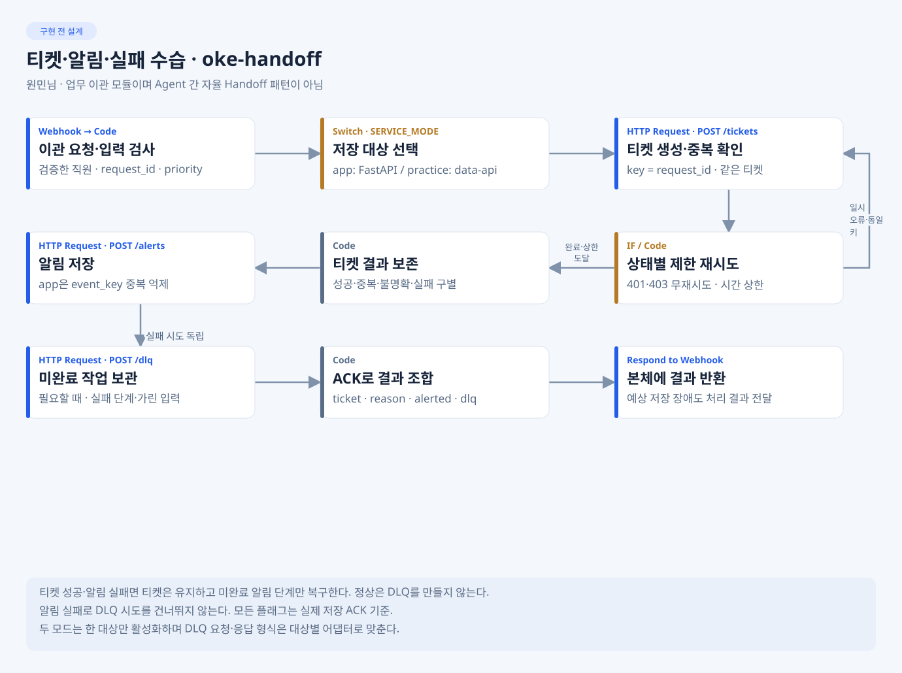

# 원민님 · 이관·오류 수습·시험

최종 실환경 확인(2026-11-05): [Ubuntu Compose·로컬 모델·자동 Error Trigger 결과](Doc/UBUNTU-INTEGRATION-RESULT.md). 실제 errors ID를 부모에 연결하고 정상/부분/전체 수습 4조건을 확인했다. Ollama 실제 HTTP 200, PostgreSQL 시험 45개·원민 회귀 89개 통과. **실제 C05 저장 API는 501로 미완료**이며 공용 VM 배포·업무 LLM 통합은 별도다. 아래 미실행 표기는 이전 단계 당시 기록이다.

최신 P1-3(2026-11-05): [Error Trigger 수습 결과·부모 연결 절차](Doc/P1-3-RESULT.md). oke-errors.json을 구현했고 전체 로컬89개 통과. 실제 부모 errorWorkflow ID 설정·자동 오류 발화 및 n8n/backend/DB는 미실행이다.

최신(2026-11-05): [P1-2 수습 구현 결과·다음 진행 가이드](Doc/P1-2-RESULT.md). 알림 duplicate·DLQ HTTP200 승인 적용, 티켓 제한 재시도와 알림/DLQ 부분·전체 실패 수습을 구현했다. 실제 n8n/백엔드 연결은 대기다.

다혁님 C04 최신 재확인(2026-11-05): [aac0dbf/P1-2 본체와 로컬 경계 연결](Doc/C04-PAIR-REVIEW.md). 요청 생성·응답 매핑 구현을 확인했고 정상/중복/긴급/부분실패 등 17개 로컬 관측이 일치했다. 실제 발신 노드는 아직 Mock이며 n8n HTTP 연결은 미확인이다.

지혜님 C05 모델 대조 결과: [요청 표본·응답 호환 검토](Doc/C05-MODEL-REVIEW.md). 요청 7/7 적합, 중복 알림 ACK 불일치 1건 및 DLQ HTTP 기대 정리 항목을 기록했다. 실제 API 연결은 미확인이다.

**목표:** 티켓 중복과 저장 실패를 안전하게 처리하고 시험으로 동작을 증명한다. 작업 폴더는 develop/wonmin. 아래 그림은 구현 전 설계다.



[예상 밖 오류 설계 그림](../../docs/images/planned/flow-errors.svg) · [평가 기준](../../docs/EVALUATION-GUIDE.md)

## 내가 만들 것

- workflows/oke-handoff.json: 같은 키 티켓1건·알림·DLQ·제한 재시도·부분 실패.
- workflows/oke-errors.json: Error Trigger·가린 오류·독립 수습·유한 종료.
- cases/team.json 5개 이상·요청 파일·공통14유형/LLM3회/bench·실제 runs.
- 실패→수정→동일 조건 재시험 자료와 실행 결과서 집계.

## 지금 첫 작업 · P0

저장소 루트에서 cd develop/wonmin 후 [IMP-PLAN P0](Doc/IMP-PLAN.md)의 팀 사례·handoff 사례·시연 요청을 먼저 쓴다. SPEC의 TM 사례를 가져와 입력·조건·기대·부작용·정리를 고정한다. 공통 common.json·flow.py는 실제 키트가 준비되면 원본을 확보하고 버전·실행 위치를 기록한다.

## 정해진 것과 내가 정할 것

| 구분 | 적용·결정 |
| --- | --- |
| 확정 | C04/C05, request_id 멱등, /dlq·app event_key, 예상 오류와 Error Trigger 분리, 실제 ACK·14+5이상·LLM3회 |
| 담당자 검증 | 모드별 DLQ 변환·실제 호출/관측 일치·시간 예산 검증·실패 재현. 지혜님 저장/관측, 다혁님 결과 매핑과 확인. 미정 부분실패 필드·진행 중 응답은 공통 계약에 반영 후 최종 판정 |
| 선택 고도화 | 자동 replay·알림 묶음·추가 대시보드는 필수 시험 뒤 |

## 바로 볼 예제

[티켓 처리](../../docs/references/workflows/intake.json.example) · [오류 알림](../../docs/references/workflows/errors.json.example) · [재처리](../../docs/references/workflows/replay.json.example)

키·오류 출력·Error Trigger·성공 건 해제를 참고한다. 오류 예제는 알림만 있으므로 우리 독립 DLQ·마스킹·모드별 계약을 추가한다. replay는 복구 방식 참고이며 P1에서 새 자동 복구 서비스를 만들라는 뜻이 아니다. [적용표](../../docs/references/README.md).

## 누구에게 받고 무엇을 넘기나

- 지혜님에게 저장 API·모드·실제 관측법을 받고 다혁님에게 C04 성공/실패 JSON과 errors 설정 정보를 넘긴다.
- 기능 담당자에게 재현 입력·기대/실제·보고서를 전달하고 소유자가 수정한 뒤 같은 조건으로 재시험한다.
- 오현님에게 실제 JSON·팀 사례·요청·runs·실패/재시험·시연 순서와 결과서 집계를 넘긴다.
- 완료 기준: 티켓1건·부분 실패 티켓 보존·무한 재귀 없음·모드 일치·필수 실제 보고서. HTTP200만으로 PASS 처리하지 않는다.
- 보고: 변경 파일 / 확인 입력·명령 / 기대와 실제 / 실패·수정 소유자·다음 상대. n8n 게시·시험은 사람이 확인한다.

## 내 CLI 첫 요청

    내 README·AGENTS·평가 기준·SPEC TM 사례를 읽고 IMP-PLAN P0의 시험 입력부터 작성해.
    develop/wonmin 밖은 수정하지 말고 원본 공통 판정을 바꾸지 마.
    입력·기대·부작용·정리와 미정 정책을 구분해서 보고해.

상세: [TODO](Doc/TODO.md) · [SPEC](Doc/SPEC.md) · [IMP-PLAN](Doc/IMP-PLAN.md) · [HANDOFF](Doc/HANDOFF.md).

## P0 입력 준비 결과 · 2026-11-04

팀 사례 12개, handoff 사례 13개, 시연/bench 요청 6개와 app 통합 확인 절차를 작성했다. [실제 확인·대기 색인](runs/INDEX.md), [정적 확인 출력](runs/p0-validation.txt)을 참조한다. 기능 시험은 아직 미실행이다.

로컬 JSON 문법 재확인(저장소 루트 기준):

```bash
cd develop/wonmin
python3 -m json.tool cases/team.json > /dev/null
python3 -m json.tool cases/handoff.json > /dev/null
python3 -m json.tool requests/demo-normal.json > /dev/null
python3 -m json.tool requests/demo-clarify.json > /dev/null
python3 -m json.tool requests/demo-handoff.json > /dev/null
python3 -m json.tool requests/demo-urgent.json > /dev/null
python3 -m json.tool requests/demo-failure.json > /dev/null
python3 -m json.tool requests/bench-normal.json > /dev/null
```

`cases/*.json`은 현재 수동 검토 명세다. 공식 키트 suite 형식과의 호환은 원본 확보 후 확인한다. common.json과 flow.py를 임의로 만들지 않는다. P0는 환경변수나 서버 연결을 쓰지 않으므로 루트 .env는 생성하지 않았다.

시연은 정상 → 보완 → 이관(같은 body 2회로 중복 확인) → 긴급 순서다. 장애 요청은 전용 practice의 tickets=error를 먼저 확인한 뒤 보내고 실패해도 fault를 해제한다. 모든 독립 시연·bench 실행에는 새 request_id를 사용한다. `bench-normal.json` 동일 ID 반복은 캐시 측정과 구분한다. 요청 JSON에 장애 주입 옵션·키·주소를 넣지 않는다.

참고 예제의 key 기반 티켓 처리·HTTP 결과 분기, Error Trigger와 성공한 항목만 재처리 해제하는 구조를 검토했다. P1에서는 C04/C05, 모드 선택, ACK, 마스킹, 독립 알림/DLQ를 적용한다. 예제의 알림 전용 오류 처리와 전체 replay를 그대로 복사하지 않는다.

다음 단계는 P1-1 `workflows/oke-handoff.json` 정상·중복 및 C05 Mock 구현이다. n8n 게시·시험은 팀 규칙대로 사람이 수행하고 실제 결과를 기록한다.

## P1-1 로컬 구현 결과 · 2026-11-04

`workflows/oke-handoff.json`의 정상·중복 경로와 `tools/mock-store.py`의 C05 HTTP Mock을 구현했다. 설정·Credential·남은 범위는 [워크플로우 안내](workflows/README.md), 실제 증거는 [runs/INDEX.md](runs/INDEX.md)를 따른다.

로컬 검증(저장소 루트):

```bash
node --test
python3 -B develop/wonmin/tools/mock-store.py --help
```

Node.js 22 이상(내장 test/fetch/VM), Python 3.10 이상(표준 라이브러리)으로 별도 의존성 설치 없이 실행한다. 실제 검증 환경은 Node v26.12.1·Python 3.15.1이다. 테스트는 임시 키를 메모리에서 만들고 127.0.0.1의 임의 포트에 독립 Mock 두 개를 기동·종료한다. 프로젝트 서버·DB·공유 데이터를 호출/초기화하지 않는다.

수동 Mock 실행(저장소 루트, INTERNAL_API_KEY가 로컬 환경에 준비된 상태):

```bash
python3 -B develop/wonmin/tools/mock-store.py --port 18800
```

기본 바인딩은 127.0.0.1이다. Docker에서 호출하는 전용 시험은 실행자가 `--host 0.0.0.0`와 올바른 호스트 매핑을 명시한다. 키는 환경에만 두고 명령/보고서에 값이나 셸 추적을 출력하지 않는다. `/tickets`, `/alerts`, `/dlq`, `GET /_mock/ops` 모두 X-Api-Key가 필요하다. `/_mock/ops`는 Mock 전용 관측이며 실제 app/data-api ops가 아니다. 서버 재시작 시 상태가 사라지고 삭제/reset API는 없다.

로컬 검증은 40개 통과했다. 신규·긴급·순차 중복·동시 8건, 단일 저장소 선택, 입력 오류 쓰기 차단, 티켓/알림 응답 검증, 인증/충돌 경계와 제한된 마스킹을 확인했다. 테스트 어댑터는 저장된 JSON의 Code·표현식·분기를 실행하고 HTTP는 실제 Mock에 전송한다. n8n 자체의 Header Auth/노드 import/실행 연결을 재현한 도구가 아니므로 실제 n8n 통과는 미확인이다.

재실행 증거가 필요하면 기존 결과를 덮어쓰지 않는 새 basename을 사용한다. 아래 환경변수는 키가 아니라 보고서 파일명이다.

```bash
WONMIN_TEST_REPORT_BASENAME=p1-1-local-new-run.json node --test
```

실제 n8n/백엔드/DB/VM 연결과 공식 flow.py 검사는 미실행이다. P1-1은 로컬 구현·Mock 검증 완료, 실제 연결 확인 대기이며 P1-2/P1-3은 미구현이다.
