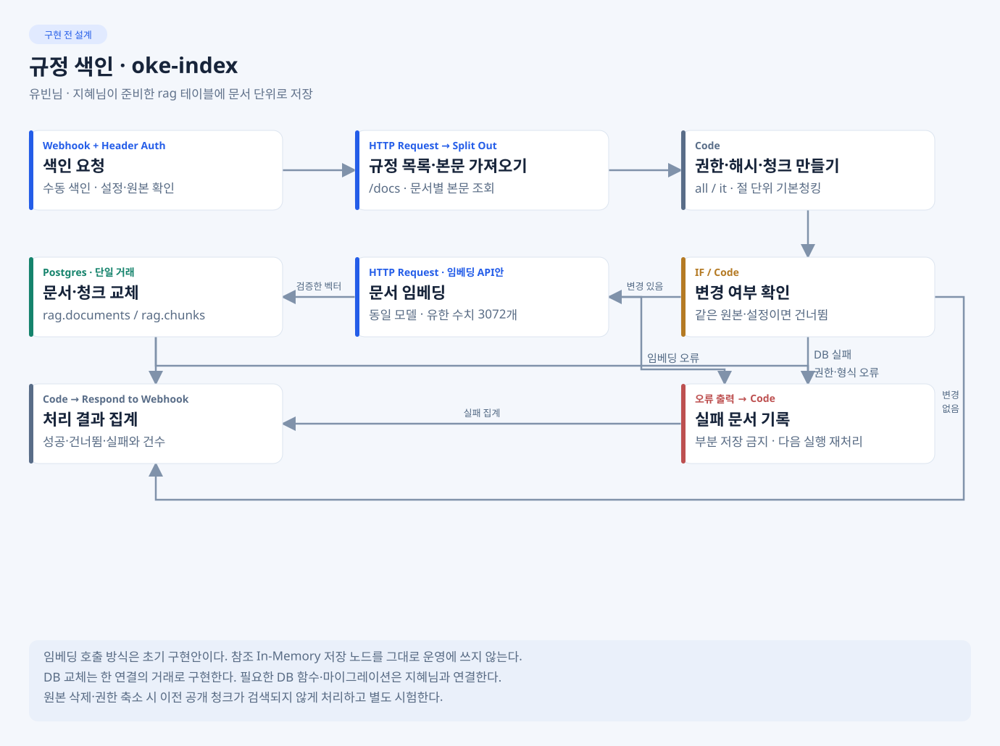

# 유빈님 · 규정 색인·권한별 검색

**목표:** 규정을 벡터로 저장하고 직원에게 허용된 근거만 본체에 전달한다. 작업 폴더는 develop/yubeen. 그림과 결과 파일은 구현 계획이다.

[검색 설계 그림](../../docs/images/planned/flow-search.svg) · [전체 RAG 기준](../../docs/RAG-ARCHITECTURE.md)

## 내가 만들 것

- workflows/oke-index.json: 원본·권한·청크·임베딩·문서 단위 저장/갱신.
- workflows/oke-search.json: 검증된 권한 WHERE → 정확 cosine top3 → 근거 응답.
- 원본/권한 대장·청킹 비교·검색 평가·재색인/재시작·복구 확인 자료.
- rag DDL은 지혜님, 본체 호출·답변 판단은 다혁님 소유다.

## 지금 첫 작업 · P0-1

저장소 루트에서 cd develop/yubeen 후 [IMP-PLAN P0-1](Doc/IMP-PLAN.md)의 tools/rag_prepare.py와 Doc/SOURCE-MANIFEST.md부터 만든다. 문서 목록·절·해시·권한 근거를 기록하고 누락/거절을 구별한다. data-api 미준비면 같은 응답 Mock으로 시작한다. 검색 전에 기대 문서·절을 고정한다.

## 정해진 것과 내가 정할 것

| 구분 | 적용·결정 |
| --- | --- |
| 확정 | PostgreSQL+pgvector·rag 두 테이블, text-embedding-3-large·3072차원, cosine·top_k3, all/it 선필터 |
| 담당자 검증 | 절 단위와 300자 청킹 비교·점수 분포·검색 시간·임계값 후보. 다혁님과 분기 확인, DB/갱신 방식은 지혜님과 확인하고 공통 변경은 오현님 반영 |
| 선택 고도화 | 재순위화·질문 재작성·근사 인덱스·자동 갱신은 필수 검증 뒤 |

## 바로 볼 예제

[색인 흐름](../../docs/references/workflows/index.json.example) · [검색 흐름](../../docs/references/workflows/search.json.example)

목록·본문·청킹·임베딩·근거 반환을 참고한다. 예제 In-Memory 저장은 우리 rag 스키마·pgvector로 교체하고 권한 조건을 SQL 후보에 먼저 적용한다. 단순 노드 교체만으로 DDL·거래·메타데이터가 맞는다고 가정하지 않는다. [적용표](../../docs/references/README.md).

## 누구에게 받고 무엇을 넘기나

- 지혜님에게 확장·rag 테이블·접속 권한·빈 검증 DB를 받고, 다혁님에게 C03 실제 근거·빈 결과·503 예시를 넘긴다.
- 원민님에게 권한 쌍·장애·정답 질문·측정 자료, 오현님에게 RAG 설계서의 원본/청킹/모델/저장/복구 자료를 넘긴다.
- 완료 기준: 권한 누출0·중복 없는 재색인·같은 볼륨 재시작 유지·같은 질문의 청킹 비교와 실제 시간. 측정 전 점수·품질 PASS를 채우지 않는다.
- 보고: 변경 파일 / 확인 입력·명령 / 기대와 실제 / 미측정·실패·다음 상대.

## 내 CLI 첫 요청

    내 README·AGENTS·공통 DB와 SPEC RAG-01/02를 읽고 IMP-PLAN P0-1만 구현해.
    참고 예제에서 In-Memory를 그대로 가져오지 말고 전처리부터 진행해.
    develop/yubeen 밖은 수정하지 말고 원본 대장·거절 사유·다음 연결을 보고해.

상세: [TODO](Doc/TODO.md) · [SPEC](Doc/SPEC.md) · [IMP-PLAN](Doc/IMP-PLAN.md) · [HANDOFF](Doc/HANDOFF.md).
