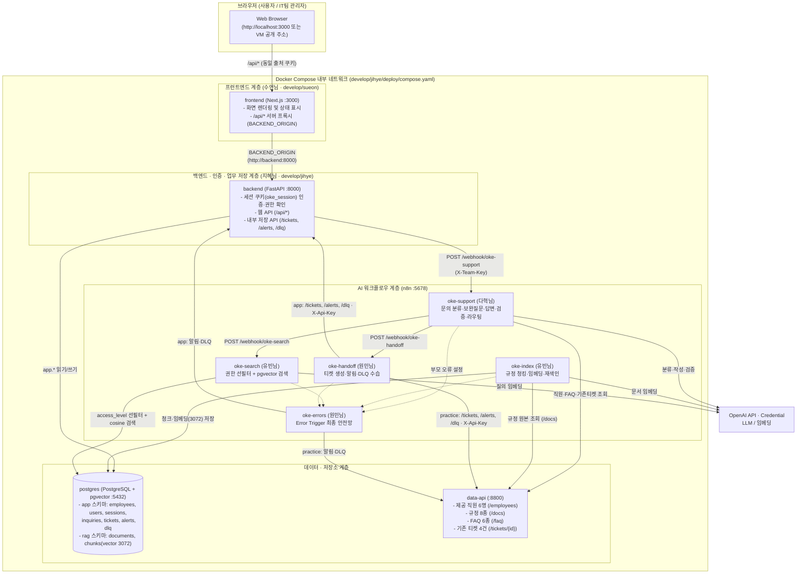

# 오케퐁(OKE-Pong) 전체 시스템 아키텍처

> 상태: 구현 전 설계 기준. Compose·서비스·연결선의 실제 기동·게시·시험은 담당자 구현 후 확인한다.

본 문서는 **프런트엔드(Next.js) · 백엔드(FastAPI) · 워크플로우(n8n 5종) · 저장소(PostgreSQL+pgvector & data-api)**의 전체 연결 구조와 네트워크·폴더 경계를 한눈에 보여주는 기준 구성도다. 세부 필드는 [API-CONTRACT.md](API-CONTRACT.md), 테이블 구조는 [DATA-AND-DB.md](DATA-AND-DB.md), 의사결정 배경은 [adr/ADR-001-project-decisions.md](adr/ADR-001-project-decisions.md)를 따른다.

---

## 1. 전체 계층 및 컨테이너 연결 구조



---

## 2. 핵심 네트워크 · 호출 불변식 (바이브 코딩 주의사항)

1. **브라우저 ↔ 백엔드 (CORS 및 내부 호스트명 문제 방지)**
   - 브라우저는 Docker 컨테이너 내부 이름(`http://backend:8000`, `http://n8n:5678`)을 알지 못한다.
   - 따라서 브라우저 코드는 항상 같은 출처의 `/api/...`만 호출하고, Next.js 서버가 `BACKEND_ORIGIN` 환경변수(로컬 개발 시 `http://127.0.0.1:8000`, Docker 실행 시 `http://backend:8000`)를 통해 FastAPI로 프록시한다.
   - 브라우저에서 DB, `n8n`, `data-api`를 직접 호출하거나 `NEXT_PUBLIC_*`에 내부 비밀키를 노출하지 않는다.

2. **컨테이너 기동 순서 및 영속 볼륨 (`compose.yaml`)**
   - `postgres` 컨테이너는 `pg_isready` 기반 `healthcheck`와 `named volume`을 사용한다.
   - `backend`는 `depends_on: postgres: { condition: service_healthy }` 설정으로 DB 준비 완료 후 기동한다.
   - `docker compose down -v`는 DB 및 n8n 볼륨 데이터를 모두 삭제하므로 일상 재시작 시 `-v` 옵션을 사용하지 않는다.

3. **단일 공통 진입점과 모드 분리 (`SERVICE_MODE`)**
   - 웹 요청(`FastAPI` → `oke-support`)과 강사 공통 시험 스크립트(`flow.py` → `oke-support`)는 모두 동일한 `POST /webhook/oke-support` 계약을 사용한다.
   - `SERVICE_MODE=app`일 때는 FastAPI 내부 API(`/tickets`, `/alerts`, `/dlq`)를 통해 PostgreSQL(`app` 스키마)에 기록하고, `SERVICE_MODE=practice` 고장 주입 시험일 때는 수업 `data-api`를 사용한다.

---

## 3. 역할별 폴더 소유권 구조

```text
Aio-4pj-1team/
├─ AGENTS.md / CLAUDE.md       # 모든 AI 코딩 에이전트 공통 작업 규칙
├─ .env.example                # 환경변수 키 이름 기준표 (실제 값은 .env에 두고 Git 제외)
├─ .github/                    # PR 템플릿 및 GitHub Actions CI 자동 검사
├─ docs/                       # 팀 공통 기준 문서 및 최종 제출 산출물 (오현님 관리)
│  ├─ ARCHITECTURE.md          # 전체 시스템 아키텍처 구성도 (본 문서)
│  ├─ adr/                     # 아키텍처 의사결정 기록 (ADR)
│  ├─ API-CONTRACT.md          # C01~C07 API·웹훅·환경 계약
│  ├─ DATA-AND-DB.md           # PostgreSQL(app/rag) 및 data-api 스키마 기준
│  ├─ COORDINATION.md          # 개발·협업·PR·통합 절차
│  ├─ WORKFLOW-DESIGN.md       # [제출 필수 1] 워크플로우 설계서 (다혁님 초안 → 오현님 통합)
│  ├─ RAG-ARCHITECTURE.md      # [제출 필수 2] RAG 설계서 (유빈님 초안 → 오현님 통합)
│  └─ EXECUTION-RESULT.md      # [제출 필수 3] 실행 결과서 (원민님 집계·다혁님 확인 → 오현님 통합)
└─ develop/                    # 6명 역할별 독립 작업 공간 (자기 폴더 안에서만 수정)
   ├─ ohyun/                   # 팀장 · 계약/문서/배포/제출 통합
   ├─ sueon/                   # 프런트엔드 (Next.js)
   ├─ jihye/                   # 백엔드 (FastAPI) · DB 마이그레이션 · Docker Compose
   ├─ dahyeok/                 # 메인 워크플로우 (oke-support.json)
   ├─ yubeen/                  # RAG 파이프라인 (oke-index.json, oke-search.json)
   └─ wonmin/                  # 이관·오류 워크플로우 (oke-handoff.json, oke-errors.json) · 통합 시험
```
