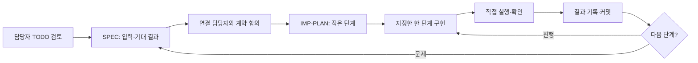

# 역할별 개발 순서와 연결 기준

> 상태: 개발 준비 안내. 역할별 문서는 참고 초안이며 담당자가 검토·구체화한다. 코드·워크플로우·실제 시험 결과는 아직 없다.

## 1. 담당자는 여기서 시작한다

| 역할 | 자기 말로 요구 정리 | 확인 가능한 요구 | 단계·파일·확인 방법 |
| --- | --- | --- | --- |
| 화면 · 이수언 | [TODO](../frontend/Doc/TODO.md) | [SPEC](../frontend/Doc/SPEC.md) | [IMP-PLAN](../frontend/Doc/IMP-PLAN.md) |
| 업무 API·DB·실행 환경 · 박지혜 | [TODO](../backend/Doc/TODO.md) | [SPEC](../backend/Doc/SPEC.md) | [IMP-PLAN](../backend/Doc/IMP-PLAN.md) |
| 문의 처리 · 임다혁 | [TODO](../workflows/Doc/support/TODO.md) | [SPEC](../workflows/Doc/support/SPEC.md) | [IMP-PLAN](../workflows/Doc/support/IMP-PLAN.md) |
| RAG · 신유빈 | [TODO](../workflows/Doc/rag/TODO.md) | [SPEC](../workflows/Doc/rag/SPEC.md) | [IMP-PLAN](../workflows/Doc/rag/IMP-PLAN.md) |
| 안정성·시험 · 이원민 | [TODO](../workflows/Doc/reliability/TODO.md) | [SPEC](../workflows/Doc/reliability/SPEC.md) | [IMP-PLAN](../workflows/Doc/reliability/IMP-PLAN.md) |

각 담당자가 작성하고 이해할 문서다. 팀장이 모든 세부 설계를 대신 확정하지 않는다. 이번 TODO에는 지금까지의 합의 내용을 참고 초안으로 넣었으므로, 담당자가 자기 말로 고치고 빠진 요구·필수·나중을 표시한다.

## 2. 수업에서 배운 진행 방식

- TODO: 무엇을 왜 만들지. 담당자가 이해한 말로 정리한다.
- SPEC: 정상·권한·오류·경계에서 어떤 결과가 나와야 하는지. 해당 입력과 출력 예시, 시나리오 ID를 붙인다.
- IMP-PLAN: 단계마다 요구 ID·수정 파일·연결 대상·확인 명령·완료 조건. 처음부터 전체 기능 구현을 한 번에 요청하지 않는다.
- 확인 전 통과 체크를 하지 않는다. 개발 중인 화면의 임시 응답과 실제 API 연결 결과를 구분한다.
- n8n JSON은 에이전트가 check하고, push·test는 사람이 한다. 다음 단계는 담당자의 확인 후 진행한다.

수업 원문: [77일차 요청서](https://gl.isitsoft.kr/publicproj/aio-01d4-stu/-/blob/9ce9aceba6f66f2ec93a5a32ab23f3bedb06b9a4/Last3Mon/77/VIBE-REQ-TLOG.md), [78일차 1~4단계](https://gl.isitsoft.kr/publicproj/aio-01d4-stu/-/blob/9ce9aceba6f66f2ec93a5a32ab23f3bedb06b9a4/Last3Mon/78/VIBE-Q-TCHECK.md), [프로젝트 에이전트 규칙](https://gl.isitsoft.kr/publicproj/aio-01d4-stu/-/blob/9ce9aceba6f66f2ec93a5a32ab23f3bedb06b9a4/Lecture/80-82-Project/student/09-AGENT-WORKING-RULES.md).
수업의 엔진→TUI 원칙을 여기서는 업무 로직·계약→실제 화면 연결로 적용한다. 계약이 맞춰지면 화면은 합의한 임시 응답으로 병행 개발할 수 있다. 이 병행 방식은 우리 팀 운영안이다.

## 3. 팀 전체 연결 순서

| 단계 | 함께 준비할 것 | 연결하기 위한 조건 |
| --- | --- | --- |
| 준비 | 역할별 TODO·SPEC·계획, 공통 API 예시·파일 소유권 합의 | 각자 담당 경로와 받는 값·보내는 값을 설명 가능 |
| 골격 | 본체 웹훅·입력 검사, RAG 색인, API·DB·인증 실행 뼈대, 화면 임시 응답을 병행 | 본체 400·차단, 색인 수 확인, 서버·DB 실행, 화면 상태 확인 |
| 정상 연결 | 본체→search→답변·검증, 본체→handoff→티켓·알림 | 정상·보완·근거 없음·이관의 실제 시나리오 확인 |
| 웹 연결 | 로그인한 화면→FastAPI→같은 support, FastAPI 티켓·알림 저장 | 직원/관리자 권한과 새 티켓이 실제 DB·화면에서 일치 |
| 안정화 | 장애·중복·권한·마스킹·복구·반복·VM 회귀 | 실제 보고서·실패/재시험 기록과 설계서 일치 |
| 동결·제출 | 81일차 8교시 기능 동결, 82일차 시험·문서·발표 | README로 재실행, 핵심 3종·헌장·데일리·시험 증거 완비 |

선생님 순서인 **data-api 기반 기본 공통 시험 → 웹·FastAPI 어댑터 통합**을 지킨다.
공통 시험의 고장 스위치는 data-api에 적용되므로 FastAPI로 호출 대상을 바꾸고도 고장이 적용됐다고 가정하면 안 된다.
안정성·백엔드·문의 담당이 시험 설정과 FastAPI 연동 설정을 명시하고, **같은 문의 본체**에 연결한다.
FastAPI 저장·권한 시험을 공통 워크플로우 시험만으로 대체하지 않는다.

근거: [환경·C형 어댑터](https://gl.isitsoft.kr/publicproj/aio-01d4-stu/-/blob/9ce9aceba6f66f2ec93a5a32ab23f3bedb06b9a4/Lecture/80-82-Project/student/02-ENVIRONMENT-AND-SERVICES.md), [일정](https://gl.isitsoft.kr/publicproj/aio-01d4-stu/-/blob/9ce9aceba6f66f2ec93a5a32ab23f3bedb06b9a4/Lecture/80-82-Project/student/01-SCHEDULE-AND-TEAMS.md), [시험](https://gl.isitsoft.kr/publicproj/aio-01d4-stu/-/blob/9ce9aceba6f66f2ec93a5a32ab23f3bedb06b9a4/Lecture/80-82-Project/student/07-TESTING-GUIDE.md).

## 4. 연결 계약과 파일 경계

| 파일·경로 | 주 담당 역할 | 맞춰야 할 상대 |
| --- | --- | --- |
| frontend/ | 화면 | 백엔드: 웹 API·오류·쿠키·화면 상태 |
| backend/ · deploy/ | 업무 API·DB | 화면·안정성: 계정·문의·티켓·알림, 리드: 실행·배포 |
| workflows/oke-support.json | 문의 처리 | RAG: search, 안정성: handoff |
| workflows/oke-index.json · oke-search.json | RAG | 문의 처리: 검색 요청·근거 목록·오류 |
| workflows/oke-handoff.json · oke-errors.json | 안정성·시험 | 백엔드: 티켓·알림, 문의 처리: 이관·실패 결과 |
| cases/ · requests/ · runs/ | 안정성·시험 | 전 역할: 실제 기대 결과·실행 근거 |
| docs/ 공통 문서·기본 브랜치·VM 배포 | 리드 관리 | 각 역할은 자기 실제 설계·측정·실패 원인을 제공 |

워크플로우 JSON 다섯 개는 구현 후 생길 결과물이다. 현재는 안내 문서만 있다.
개별 코드 파일 경로는 각 담당자가 계획에 쓰고 겹치면 구현 전에 조정한다.

공통 API는 [API-CONTRACT](API-CONTRACT.md) 한 곳에서 관리한다. 각 SPEC에는 해당 절과 요구 ID를 참조한다.
변경은 **제안한 담당자 → 연결 상대 검토 → 리드 승인 → 공통 계약·관련 SPEC 함께 갱신** 순서다.
교사 공통 웹훅 필드·route·공통 시험 판정은 임의 변경하지 않는다.

## 5. 무엇을 누가 정하나

| 항목 | 담당자가 제안·구체화 | 팀장이 조율·확정 |
| --- | --- | --- |
| 구현 순서 | 자기 단계·요구 ID·파일·확인 명령 | 첫 연결 날짜·시각, 통합 순서·기능 동결 |
| API·완료 기준 | 관련 담당자끼리 정상·오류 JSON·화면 상태·시나리오 | 공통 계약 변경·범위 충돌 |
| 파일 경계 | 역할별 세부 파일·모듈 | 주 담당·지원 담당 배정, 공동 수정 조정 |
| 실행 환경 | 백엔드의 Compose·서비스명·포트·DB 초기화안 | 팀 VM 배포·실제 환경값 관리 |
| RAG 품질 | 청킹·검색 비교 측정 후 임계값 제안 | 일정 대비 범위·품질 목표 조율 |

작성·합의가 필요한 상태는 각 SPEC의 체크 목록에 남긴다. 사람별 주 역할은 [TEAM-CHARTER](TEAM-CHARTER.md)에 반영했다. 지원 담당과 첫 통합 시각은 추가 확정한다.

## 6. 개발 문서와 제출 문서

역할별 세 문서는 개발을 진행하는 기준이다. 핵심 제출물인 WORKFLOW-DESIGN·RAG-ARCHITECTURE·EXECUTION-RESULT를 대신하지 않는다.
각 역할이 구현하면서 자기 부분을 제공하고, 리드가 실제 파일·보고서와 맞춰 취합한다.
설계서에는 실제 노드·연결선, RAG 설계서에는 실제 측정값, 결과서에는 실제 runs 보고서를 적는다.
