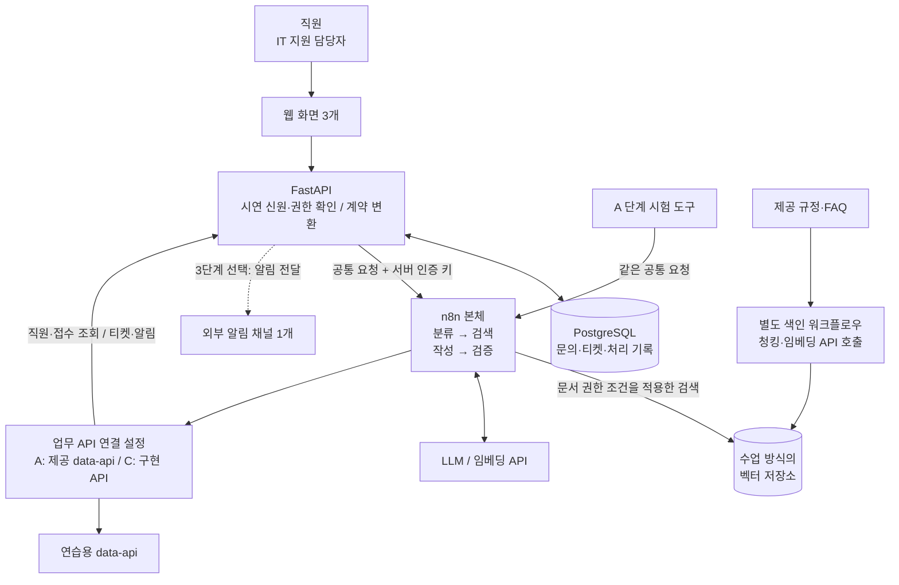
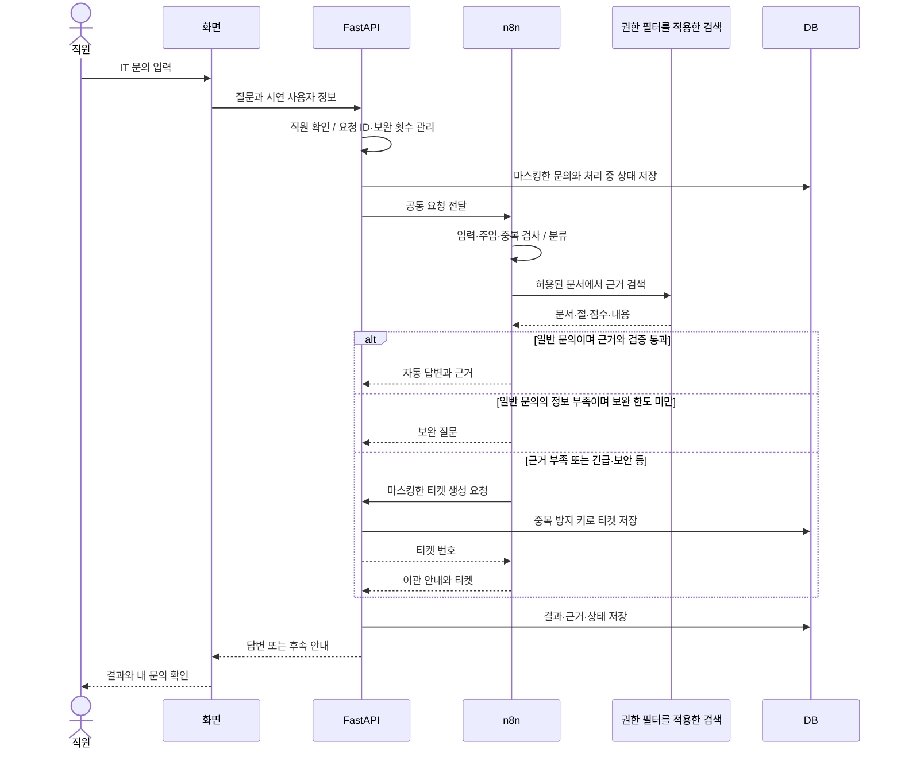

# 사내 IT 헬프데스크 구현 기획안

> 2026-11-02 · 회의 반영 추천안. 주제는 결정됐으며 회사 설정·C형 선택·세부 역할은 합의 전입니다. 아직 구현·배포·시험하지 않았습니다.
> 결정 근거: [회의·강사 설명 정리](1102-회의와-강사설명-정리.md). 준비 자원과 일정: [준비 현황](PREPARATION-PLAN.md).

## 1. 무엇을 만드는가

**가상 회사의 직원이 IT 문제를 질문하면 사내 규정에 근거해 안내하고, 자동 해결이 어려운 문제는 IT팀에 접수해 처리 상태를 확인할 수 있는 서비스.**

- 회사 설정 제안: 기존 예시인 온라인 유통사 ‘한빛커머스’. 업종·명칭·규모는 미정이며, 이번 구현은 일반적인 사무 업무 IT 지원에 한정합니다.
- 이용자: 일반 직원과 IT 지원 담당자. 제공 직원 6명은 시연 표본이며 회사 전체 인원이라는 뜻은 아닙니다.
- 해결할 문제: 반복 문의를 매번 사람이 설명하는 일, 불충분한 정보로 접수되는 일, 문의 후 처리 상태를 알기 어려운 일.
- 문의 범위: 계정·VPN·메일·장비·소프트웨어·보안. 규정 8종과 FAQ 6종을 활용합니다.
- 안내와 접수를 자동화합니다. 실제 비밀번호 변경·프로그램 설치·PC 원격 제어·보안 사고 복구는 담당자의 업무입니다.

**발표에서 보여 줄 가치:** “VPN 문의는 근거와 함께 안내하고, 피싱 신고는 안전한 초동 안내와 긴급 접수로 연결하며, 직원은 자신의 처리 상태를 확인한다.”

## 2. 단계와 완료 기준

| 단계 | 만들 것 | 다음 단계로 가는 기준 |
| --- | --- | --- |
| 1. A 핵심 | 제공 data-api + n8n + RAG, 공통 요청·응답, 이관·예외 처리 | 합의한 핵심 시험이 실제로 통과하고, 미통과 항목·제외 범위를 기록 |
| 2. 작은 C 웹서비스 — 추천 목표 | 질문하기·내 문의·관리자 티켓, FastAPI, 영속 DB | 정상 답변과 긴급 이관이 화면부터 저장·조회까지 이어짐. 권한·중복 요청 확인 |
| 3. 외부 알림 1개 — 여유 시 | 긴급 접수 또는 처리 완료를 선택한 채널에 알림 | 같은 이벤트가 중복 발송되지 않고 실패가 기록됨. 기본 서비스가 알림 실패 때문에 중단되지 않음 |

C의 화면 설계·API 약속은 A와 병행해서 준비하되, 실제 연결은 검증된 핵심 흐름을 사용합니다. 확장한다고 본체를 다시 만들지 않습니다.

**범위 조절:** C를 시작하기 전 웹 API 연결·백엔드·DB 담당과 실행 환경이 확보되어야 합니다. 확보하지 못하면 80일차 승인 전에 B형으로 전환하거나 A형 완성 범위를 강사와 조율합니다. B와 C 전체를 동시에 만드는 계획은 잡지 않습니다. 81일차 기능 동결 전까지 미완성 확장은 제출 범위에서 분리하고, 시도·실패 원인을 남깁니다.

외부 채널은 텔레그램·디스코드 등에서 한 가지를 정합니다. ‘사용자가 질문하는 입구’와 ‘IT팀에 보내는 알림’은 다른 기능입니다. 3단계에서는 **알림만 추가**하는 것을 추천하며, 실제 전송 대상·계정은 팀이 정합니다.

## 3. 화면은 세 개

| 화면 | 꼭 있어야 할 것 | 이번에 늘리지 않을 것 |
| --- | --- | --- |
| 질문하기 | 가상 직원 선택, 질문, 로딩·실패 표시, 답변·근거, 보완 질문 입력 | 회원가입·SSO·첨부파일·음성 입력 |
| 내 문의 | 내 문의 목록, 자동 답변/보완/이관 상태, 티켓 번호·처리 상태 | 타인의 문의 검색·복잡한 통계 |
| 관리자 티켓 | 허용된 지원 담당자의 이관 목록, 처리 답변·상태 변경 | 조직 전체 권한 관리·자동 담당자 배정·보고서 대시보드 |

직원 선택은 강사가 허용한 **가상 데이터 시연용 신원 선택**입니다. 실제 인증 기능으로 설명하지 않습니다. 인터넷 공개 시연에는 별도 접근 제한을 두고, 실제 임직원용 배포에는 정식 인증이 필요하다는 경계를 명시합니다.

관리자 화면은 공통 시험의 ‘남의 접수 조회 금지’와 구분해야 합니다. 일반 질문·본인 조회 API는 IT부서 사용자도 타인 건을 조회하지 못하게 유지합니다. 관리자 목록은 별도 지원 업무 권한과 API로 최소 정보만 제공하는 안이며, **강사와 허용 범위를 확인한 뒤 구현**합니다. IT부서라는 이유만으로 모든 조회를 허용하지 않습니다.

## 4. 예상 시스템 아키텍처



A와 C의 업무 데이터 저장소는 **실행 환경별로 하나를 선택**합니다. 같은 티켓을 Mock과 실제 DB에 동시에 생성하지 않습니다. C에서는 제공 직원·기존 티켓을 같은 식별자로 초기 적재하고 본인 조회·부서 판정을 재현합니다. 제공 문서는 같은 원본에서 색인하며, 재색인 방법도 남깁니다.

기술 선택 제안은 수업 예시인 웹 화면 + FastAPI + PostgreSQL입니다. 화면은 Next.js 또는 팀이 익숙한 Streamlit 중 연결 담당이 감당할 수 있는 것으로 정합니다. 벡터 저장소는 수업에서 검증한 방식을 우선하고, 이번 기획 단계에서 새로운 인프라를 추가 확정하지 않습니다.

## 5. 문의 데이터가 흐르는 과정



그림은 정상 연결의 대표 흐름입니다. 차단·권한 없음은 즉시 정해진 응답으로 종료하고, 티켓 생성 실패 시 접수 성공으로 표시하지 않습니다. 화면의 ‘답변 대기·보완 필요·담당자 처리 중·완료’와 공통 응답 `route`는 서로 다른 상태값으로 관리합니다.

## 6. 오케스트레이션 추천

**n8n이 정해진 규칙으로 조정하고, LLM은 분류·답변 작성·검증을 맡는 중앙 조정 구조**를 추천합니다. 별도 Supervisor LLM을 추가할 필요는 없습니다. 회의에서 말한 Supervisor와 유사한 조정 역할은 있지만, 구현 전부터 자율형 Supervisor 에이전트를 구현했다고 부르지 않습니다.

| 구성 | 담당 | 설계 기준 |
| --- | --- | --- |
| 입력·보안·권한 | 규칙·API | 사용자/부서 확인, 주입 차단, 접근 가능한 문서 결정 |
| triage | LLM | 문의 유형·긴급도·부족 정보·티켓 번호 추출 |
| retriever | RAG 도구 | 허용 문서 검색, 낮은 점수 제외, 출처 반환 |
| writer | LLM | 검색 근거로만 답변 작성 |
| verifier | LLM + 최종 규칙 | 근거 일치·민감 정보 점검. 검증 실패면 이관 |
| handoff/errors | 규칙·업무 API | 중복 없는 접수, 알림, 제한 재시도·실패 기록 |

- **분기:** 자동 답변 / 보완 질문 / 담당자 이관 / 권한 없음 / 차단. 공통 `route`의 한국어 값을 그대로 씁니다.
- **병렬 구조:** 필요한 경우 지식 검색과 본인 티켓 조회를 두 갈래로 수행해 결과를 합칩니다. n8n 실행 순서에 따라 차례로 처리될 수 있으므로 동시 실행·시간 단축을 측정 없이 주장하지 않습니다.
- **루프:** 정보 부족은 다음 사용자 입력으로 보완하며 `attempt >= 3`이면 이관합니다. 무제한 내부 재질문은 만들지 않습니다.
- **사람에게 이관:** IT 담당자에게 티켓을 전달하는 업무입니다. 에이전트끼리 제어권을 넘기는 Handoff 패턴과 같은 뜻으로 사용하지 않습니다.

RAG 담당은 문서·권한 목록, 청킹 비교, 검색 평가 질문, 근거 부족 처리를 준비합니다. 이미 Markdown으로 제공된 문서는 PDF 변환 작업을 추가하지 않습니다. 청크 크기·top_k·임계값·임베딩 모델은 수업 예제를 출발점으로 측정 후 기록하며, 슬라이드 예시 숫자를 실측 결과로 쓰지 않습니다.

## 7. 통합 전에 정할 API·데이터 약속

공통 Webhook 계약은 [수업 원문](../../Aio/aio-01d4-stu/Lecture/80-82-Project/student/04-REFERENCE-ARCHITECTURE.md)을 기준으로 합니다. 웹 API 계약은 별도 문서 `docs/API-CONTRACT.md`로 확정할 예정이며 현재는 아래 범위 제안입니다.

| 연결 | 먼저 합의할 내용 |
| --- | --- |
| 화면 → API | `POST /api/ask`, `GET /api/my-requests`, 관리자 목록·수정 API. 입력 예·정상 결과·오류·표시 상태 |
| API → n8n | `request_id`, `user`, `question`, `channel`, `attempt`, `context`. 부서·권한은 사용자가 제출한 값 대신 서버 데이터로 판정 |
| n8n → API | 티켓·알림 생성 외에 직원 확인, 본인 티켓 조회, 캐시·DLQ 등 실제 본체에서 쓰는 경로의 호환성 |
| RAG → 본체 | `evidence`의 문서·절·본문·점수, 근거 없는 경우 빈 목록, 권한 조건 |
| API → 화면 | 공통 응답을 표시용 데이터로 전달. 원본 route·근거·티켓·오류 의미를 유지 |

슬라이드의 ‘API 6개’는 화면·이관 흐름을 설명하는 최소 예시입니다. 본체가 사용하는 `/employees`, 본인 티켓 조회, 캐시·DLQ까지 자동으로 구현되는 것은 아닙니다. **실제 키트의 호출 목록을 확인한 뒤 C에서 구현하거나 위임할 경로를 정해야 합니다.**

통합에서 빠뜨리면 안 되는 규칙:

1. 같은 전송의 재시도는 같은 `request_id`를 사용해 중복 티켓을 막습니다. 보완 답변은 새 요청 ID를 만들고 동일 문의 묶음에 연결하며, 이전 맥락·횟수를 서버에서 이어갑니다.
2. 화면의 요청 제한 시간과 n8n의 외부 호출 제한 시간을 함께 정합니다. 타임아웃 이후 이미 생성된 티켓을 다시 만들지 않도록 요청 ID로 상태를 확인합니다.
3. C의 최소 저장 대상은 제공 직원, 문의/응답, 티켓, 처리 상태·답변 기록입니다. 외부 알림을 추가하면 알림 결과도 저장합니다. 문의·로그·알림에는 마스킹한 내용만 남깁니다.
4. 계정·문서 접근은 서버에서 판단합니다. 일반 본인 조회와 지원 업무용 관리자 목록을 별도 권한으로 구분합니다.
5. API 키는 브라우저로 보내지 않습니다. n8n은 Credential, FastAPI는 서버 환경변수를 사용합니다. 팀 키 사용량 담당을 두고 발표용 예산을 남깁니다.

## 8. 6명 역할 조율안

> 오현 팀장과 회의에서 언급된 유빈 RAG 방향을 제외한 아래 배정은 추천입니다. 실제 가용 시간·의사와 작은 연결 작업 결과를 보고 확정합니다. 개인의 성향 평가는 배포 문서에 포함하지 않습니다.

| 팀원 | 주 책임 제안 | 첫 작업 | 산출물·협업 |
| --- | --- | --- | --- |
| 오현 | 범위·공통 계약·통합·VM 배포 | 단계·회사 설정·API 약속과 담당 확정 | TOPIC·헌장·API 계약 승인, 일일 통합·배포 기록 |
| 신유빈 | RAG·색인·검색 | 제공 문서와 권한표, 대표 질문 10개 | index/search, RAG 설계서. 다혁과 검색 입출력 합의 |
| 임다혁 | n8n 본체·오케스트레이션 | 분류 → 검색 → 작성 → 검증 흐름 | support, 워크플로우 설계서 2~4절. 유빈·원민과 연결 |
| 박지혜 | C형 어댑터: API·DB·화면 데이터 연결 | 화면 → API → 모의 응답 한 번 연결 | api, web 데이터 연결 부분, API 계약 초안. 수언 화면과 협업 |
| 이원민 | 연동·안정성 및 시험 취합 | 티켓·알림·실패 처리 입출력, 시험 기대값 | handoff/errors, 설계서 5~7절, cases/runs·실행 결과서 취합 |
| 이수언 | 화면 구성·디자인·사용자 관점 확인·시연 | 3개 화면과 로딩·오류·보완·이관 상태안 | 화면 표현 부분, 시연 요청·캡처. 지혜와 화면 연결, 원민과 UI 시험 |

**부담 조정:** 지혜에게 웹 전체와 백엔드를 무조건 맡기는 안은 아닙니다. 수언은 화면 표현을 맡고 API 연결 책임은 지혜로 명확히 나눕니다. 연결 담당이 감당하기 어려우면 C 범위나 화면 기술을 먼저 줄입니다. 원민도 연동과 모든 시험을 혼자 수행하지 않습니다. 각 구현자가 자기 시험·근거를 제출하고, 원민은 실패 목록과 결과서를 취합하며 수언은 화면 시연을 지원합니다.

필수 문서는 각 구현 담당이 자기 내용을 작성합니다. 디자인 담당이나 팀장이 모든 기술 문서를 대신 쓰는 방식으로 배분하지 않습니다. 파일·모듈마다 최종 편집 담당을 한 명 정하고 연결 변경은 공통 계약부터 갱신합니다.

## 9. 남은 산출물과 폴더

아래는 **목표 구조**입니다. 실제 생성 여부는 준비 현황 문서에서 확인합니다.

```text
docs/
  TOPIC.md / TEAM-CHARTER.md             # 초안 있음, 승인·역할 확정 필요
  IMPLEMENTATION-PLAN.md                # 이 기획안
  API-CONTRACT.md                       # C 선택 후 연결 담당이 작성
  WORKFLOW-DESIGN.md                    # 필수: 실제 흐름·노드·연결 데이터
  RAG-ARCHITECTURE.md                   # 필수: 문서·권한·청킹·검색 비교
  EXECUTION-RESULT.md                   # 필수: 시험·실패·수정·측정 근거
  daily/                               # DAY80~82 실제 작업 기록
workflows/
  team1-support.json / team1-index.json / team1-errors.json
  team1-search.json / team1-handoff.json # 역할 분리를 위한 추가 제안
web/                                   # C 선택 시 화면
api/                                   # C 선택 시 API·DB 초기화/변경
knowledge/                             # 제공 원본·권한·재색인 정보
cases/common.json / team.json           # 원본 공통 시험 + 자체 5개 이상
requests/ / runs/                       # 요청 예·실제 시험 결과
AGENTS.md / README.md                   # 협업 규칙·재현 방법
```

키트가 없는 상태에서 완성된 워크플로우 JSON·시험 보고서·가짜 통과값을 먼저 만들지 않습니다. 현재 설계서 세 파일은 작성 틀이므로 실제 담당 설계와 실행 증거로 채워야 합니다.

## 10. 진행 순서와 시험

| 시점 | 핵심 목표 | 확인할 결과 |
| --- | --- | --- |
| 11/02~04, 수업 병행 | 역할·C 여부·회사 설정 합의, 화면 초안·API 계약·시험 기대값 준비 | 각자 첫 작업과 연결 상대가 명확함. 키트 확보 시 실제 데이터 확인 |
| 11/05 80일차 | 10:50 승인, 5교시 설계 점검, 7교시 VM 배포, 8교시 발표① | A 골격·입력 검사와 작은 연결 흐름. C는 검증 가능한 최소 경로부터 |
| 11/06 81일차 | 핵심 기능 통합·공통 시험, 4교시 중간점검·배포, 7교시 배포 | 8교시 발표②·기능 동결. 미완성 확장 분리 |
| 11/09 82일차 | VM 회귀 시험·재현 확인·문서 수치 일치·발표 | 14:50 제출, 20분 발표+5분 질의. 담당자 모두 자기 부분 설명 |

공통 14개는 원본을 보존하고, 팀 시험은 [기존 5개 기획](../cases/TEAM-PLAN.md)을 출발점으로 구체화합니다. 공통 시험의 최종 제외 범위는 강사와 확인한 기록을 따릅니다. 결과는 통과·실패·미실행·범위 제외로 구분하고 분모와 제외 이유를 함께 적습니다. LLM 반복 시험·성능 측정도 실제 실행 후 기록합니다.

C 추가 검증은 공통 Webhook 시험을 대체하지 않습니다. 정상 답변의 근거 표시, 보완 입력의 횟수·맥락 유지, 이중 클릭의 티켓 중복 방지, 본인/관리자 접근 구분, 처리 상태 반영, 서버 재시작 후 기록 유지까지 확인합니다. 외부 알림을 넣으면 발송 성공·중복·실패도 별도로 확인합니다.

## 11. 다음 회의에서 확정할 네 가지

1. **회사 설정:** 한빛커머스 예시를 그대로 쓸지 결정. 새로운 도메인 데이터 제작은 추가하지 않는 안.
2. **최종 목표:** A → 작은 C를 목표로 할지, 연결 담당·환경을 고려해 B를 택할지 결정. 외부 알림은 후순위.
3. **역할 수락:** 표의 주 책임·첫 작업·연결 상대를 각자가 확인. 특히 웹 연결 담당과 연동/QA 업무량 점검.
4. **강사 확인:** 공통 시험의 최종 적용·제외 범위, C 관리자 화면의 타인 티켓 열람 범위, 키트 확보 경로 확인.

이 네 가지가 정해지면 API 계약과 담당별 작업 목록을 확정하고 구현에 들어갑니다. 그 전에도 문서 목록·검색 질문·화면 상태·시험 기대값은 준비할 수 있습니다.
