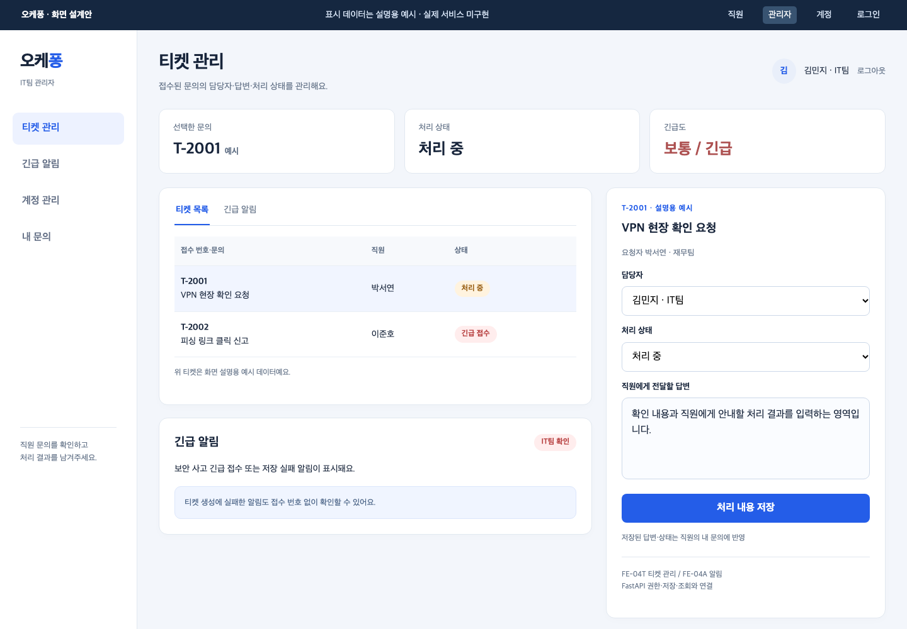
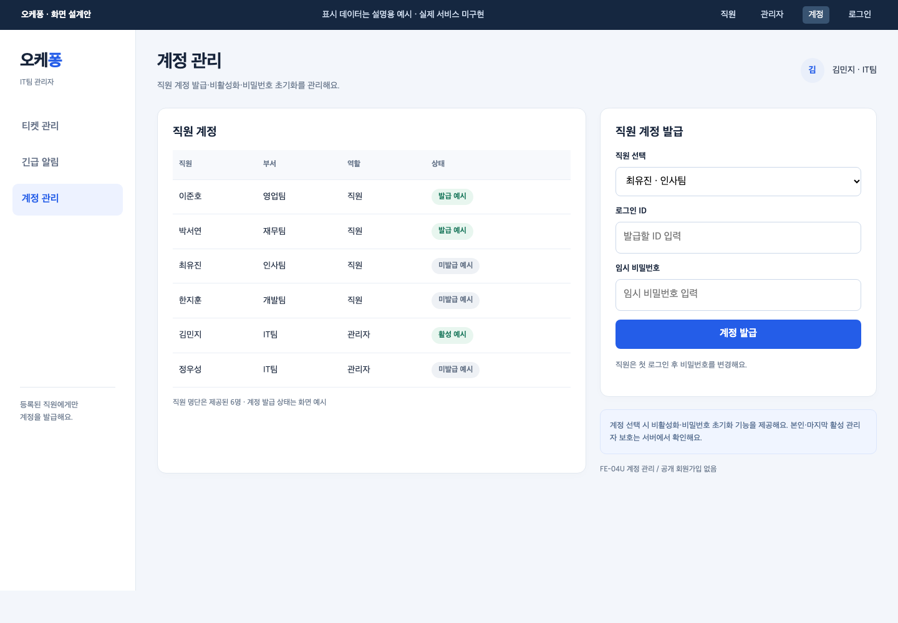
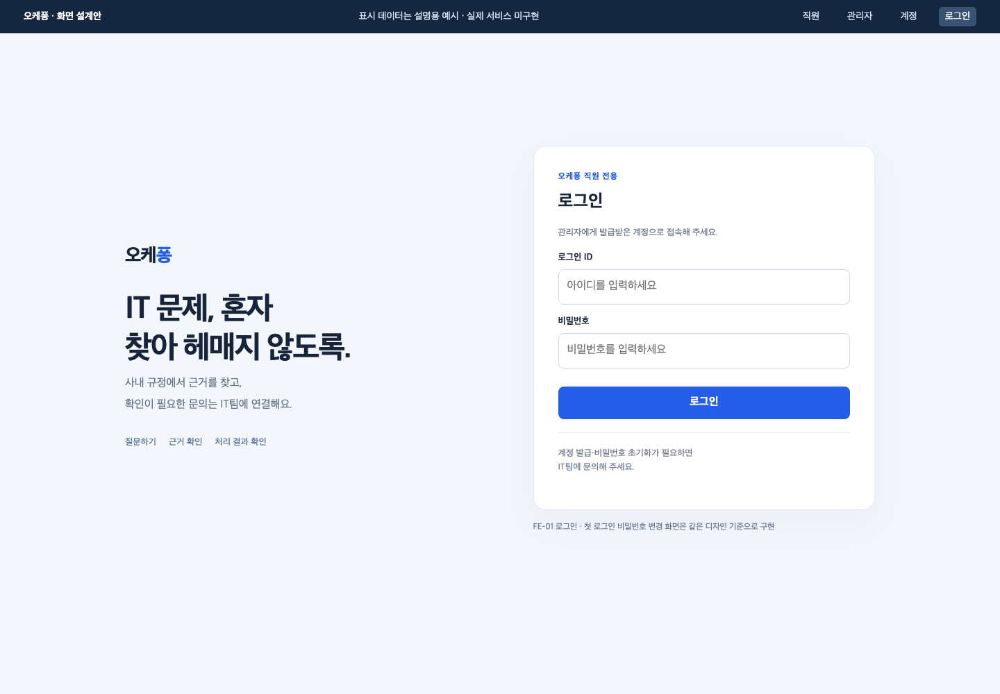

# 화면·기능 한눈에 보기

모두 구현 전 예상 화면이다. 화면의 티켓·처리 상태는 설명용 예시이며 실제 실행 결과가 아니다. 레이아웃은 수언님이 구현하면서 다듬고, 기능·권한·API는 공통 계약을 따른다.

| 기능 | 사용자가 할 일 | 화면 담당 / 연결 담당 | 구현 기준 |
| --- | --- | --- | --- |
| FE-01 | 로그인·첫 비밀번호 변경·로그아웃 | 수언님 / 지혜님 인증 API | 관리자 발급, 세션, 공개 가입 없음 |
| FE-02 | 질문·근거 확인·보완 답변·이관 결과 확인 | 수언님 / 지혜님 → 다혁님, 검색 유빈님·이관 원민님 | 공통 route 5종·출처·접수 결과 |
| FE-03 | 내 문의·IT팀 답변·상태 재조회 | 수언님 / 지혜님 | 본인 기록만 |
| FE-04T | 담당자 배정·답변·티켓 상태 변경 | 수언님 / 지혜님, 티켓 생성 원민님 | 직원 ID·접수/처리 중/완료 |
| FE-04U | 직원 계정 발급·비활성화·비밀번호 초기화 | 수언님 / 지혜님 | 제공 직원 6명, IT팀만 관리자 |
| FE-04A | 긴급·저장 실패 알림 확인 | 수언님 / 지혜님, 알림 생성 원민님 | 티켓 없는 실패 알림도 표시 |

## 직원 · 질문과 내 문의

직원이 질문하면 규정 근거가 있는 답 또는 보완 질문을 받는다. 이관되면 접수 결과와 티켓 상태를 확인한다. 근거 없는 답이나 접수 실패를 성공처럼 표시하지 않는다.

## 관리자 · 티켓과 알림

관리자가 담당자·답변·상태를 저장하면 직원 내 문의에서 다시 확인한다. UI의 목록·상세 배치는 디자인안이며 별도 미정 상세 API를 임의로 추가하라는 뜻은 아니다.

## 관리자 · 계정 발급

계정 선택 후 비활성화·초기화를 제공한다. 원본 직원 목록을 임의 수정하거나 비밀번호 원문을 응답·캡처에 남기지 않는다.

## 로그인

첫 변경·로그인 실패·401/403·로딩·빈 목록·route별 상태는 수언님 SPEC대로 구현한다. 이 네 장이 모든 상태를 그린 것은 아니다.

## 연결 예 · VPN 문의 한 건

1. 수언님 화면이 질문 → 지혜님이 세션 직원 확인·문의 저장 → 다혁님 본체 호출.
2. 다혁님이 분류 → 유빈님 검색 근거 → 답변·검증. 해결 안내 또는 원민님 이관 호출.
3. 원민님이 같은 키로 티켓·알림 저장 → 지혜님 DB → 화면에 접수 결과.
4. IT팀 관리자가 답변·상태 변경 → 직원이 내 문의에서 재조회.
5. 각 담당자가 실제 입력·결과·실패를 넘기고 원민님이 시험, 오현님이 취합한다.

그림은 기능 설명용이며 규정에 없는 VPN 조치·응답시간·통과 수치를 주장하지 않는다.

[전체 구조](ARCHITECTURE.md) · [워크플로우 5종](WORKFLOW-DESIGN.md) · [실행·검증 시작](../SUBMISSION.md) · [상세 API](API-CONTRACT.md)

화면 원본은 [미리보기 HTML](previews/screens.html)이다. 다운로드 후 브라우저에서 열어 직원/관리자/계정/로그인 탭으로 비교할 수 있다. API·로그인·저장을 실행하는 앱이 아니다.
