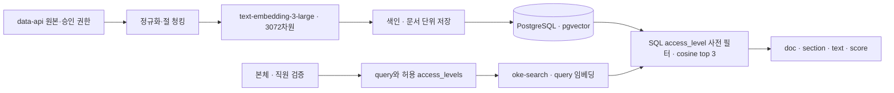

# RAG 아키텍처 · 오케퐁

**기준 실측:** 2026-11-07, VM 배포 코드 `af82c3b`. PostgreSQL의 규정 인덱스 8문서·33청크, 권한 분류, 원문/저장 청크 해시 정합성, 임베딩 모델과 차원을 확인했다. 토큰 통계는 `cl100k_base`로 산출했다. 검색 점수 분포는 2026-11-06 로컬 `oke-local` 검색 실행에서 측정했으며, VM 실DB 저장 통계와 구분한다. 평가 기준 및 운영 설명은 [데이터·DB 기준](DATA-AND-DB.md), [API 계약](API-CONTRACT.md), [실행 결과](EXECUTION-RESULT.md)를 따른다.

## 1. 원본과 실측 색인

| 항목 | 적용 및 확인 결과 |
| --- | --- |
| 원본 | data-api에서 제공하는 사내 규정 Markdown 8종 |
| 문서 키 | `password-policy`, `remote-work-vpn`, `email-and-documents`, `device-issue-return`, `software-usage`, `security-incident`, `meeting-room`, `privacy` |
| 저장 규모 | PostgreSQL `rag.documents` 8행, `rag.chunks` 33행 |
| 임베딩 | `text-embedding-3-large`, pgvector `vector(3072)`; 33개 저장 벡터 모두 차원 3072 |
| 본문 정합성 | 원문 API 본문과 저장 청크의 해시 대조 일치 |
| 검색 결과 계약 | cosine distance 오름차순, `score = 1 - distance`, `top_k=3`; 점수는 확률이나 정답률이 아님 |
| 보조 데이터 | FAQ 6종은 본체에서 보조 조회하며 규정 인덱스에 합치지 않음. 기존 티켓은 본인 상태 조회 경로에서 사용 |

실측 본문 길이는 제목을 제외한다. 임베딩 입력은 문서 제목과 절 접두어를 본문에 붙인 실제 입력이다.

| 자료 | N | 글자 수 min / max / 평균 | `cl100k_base` 토큰 min / max / 평균 |
| --- | ---: | ---: | ---: |
| 문서 본문 | 8 | 240 / 433 / 338.12 | 195 / 375 / 301.38 |
| 저장 청크 본문 | 33 | 13 / 156 / 81.97 | 10 / 163 / 73.06 |
| 임베딩 입력(제목·절 접두어 포함) | 33 | 26 / 182 / 103.06 | 22 / 192 / 95.12 |

| 접근 범위 | 문서 | 청크 | 문서 본문 평균 글자 | 청크 본문 평균 글자 | 임베딩 입력 평균 글자 |
| --- | ---: | ---: | ---: | ---: | ---: |
| `all` 일반 직원 | 7 | 30 | 342.29 | 79.87 | 101.00 |
| `it` 전용 | 1 | 3 | 309.00 | 103.00 | 123.67 |

문서 권한은 원본의 검증된 메타데이터 또는 승인된 권한 매핑에서 가져온다. 현재 분류에서는 `security-incident`만 `it`, 나머지 7개 문서는 `all`이다.

## 2. 전처리와 청킹

원문은 LF 줄바꿈으로 정규화하고 제목·절 행, 목록, 표, 코드 순서를 보존한다. 청크 본문과 임베딩 입력을 구분한다. 임베딩 입력은 `문서 제목 + 절 제목 + 본문`이며 동일 content를 검색 evidence로 반환한다. 문서별 `chunk_no`는 0부터 순서대로 부여하고, 청크는 원문 범위와 해시로 추적한다. 빈 절은 색인 청크에서 제외하되 분석 기록에는 남긴다.

| 방식 | 규칙 | 8개 문서 결과 | 용도 및 관측 |
| --- | --- | ---: | --- |
| 절 단위 (기준선) | Markdown `##` 절 단위, overlap 0, 제목·절 접두어 포함 | **33 청크** | VM에 저장된 기준 색인. 문서/청크 해시와 DB 집계를 확인 |
| 고정 300자 | 본문 유니코드 문자 300자 단위, overlap 0, 접두어 별도 | **45 청크** | 같은 원본 스냅샷에 적용한 청킹 비교안 |
| 고정 500자 | 본문 유니코드 문자 500자 단위, overlap 0, 접두어 별도 | **28 청크** | 같은 원본 스냅샷에 적용한 청킹 비교안 |

이 표의 청크 수는 문서 분할 결과 비교다. 청크 수만으로 검색 품질 우열을 정하지 않는다. 표·목록·코드 블록을 보존하고, 절 경계를 가로지르는 비교 청크에는 포함 절과 원문 범위를 남긴다. 기준 색인은 절 단위이며, 다른 분할 방식으로 운영 기본값을 바꾸려면 동일 질의·모델·권한 조건의 평가 근거가 필요하다.

## 3. 권한 격리와 검색

검색은 권한을 벡터 유사도 계산 뒤에 거르는 방식으로 구현하지 않는다. 본체가 직원 신원을 확인해 `access_levels`를 만든 뒤 검색 요청에 전달한다. DB 질의는 먼저 문서 권한을 SQL `WHERE` 조건으로 제한하고, 허용 집합의 후보에 대해서만 모델·벡터 거리를 계산한다.

```sql
SELECT d.doc_key, c.section, c.content,
       1 - (c.embedding <=> :query_embedding) AS score
FROM rag.documents AS d
JOIN rag.chunks AS c ON c.document_id = d.id
WHERE d.access_level = ANY(:verified_access_levels)
  AND c.embedding_model = :embedding_model
ORDER BY c.embedding <=> :query_embedding, d.doc_key, c.chunk_no
LIMIT 3;
```

일반 직원은 `verified_access_levels = ['all']`, IT 직원은 `['all','it']`로 검색한다. 접근 수준을 SQL 후보 집합에서 선제한 뒤 점수순으로 최대 3건을 반환한다. 쿼리는 바인딩 매개변수를 사용한다. 질문의 문구나 팀 키만으로 직원 권한을 만들어내지 않으며, 허용 집합이 없거나 지원하지 않는 값이면 요청을 거절한다.

**WF-05 권한 격리 결과:** DB에는 `all` 7문서/30청크, `it` 1문서(`security-incident`)/3청크가 저장돼 있다. 일반 직원의 `all` 검색 결과에서 IT 전용 문서 노출은 **0건**이었다. 권한 격리는 응답 후 필터만으로 보장하지 않고, SQL 사전 필터와 결과 검증을 함께 적용한다.

### 유사도 측정 및 0.40 기준

16개 QA 질문의 측정에서 기대 문서가 범위 안인 질문의 기대 문서 점수는 **0.380~0.709**, 범위 밖 질문의 상위 후보 점수는 **0.235~0.383**이었다. 측정은 `text-embedding-3-large`, cosine 정확검색, `top_k=3`에서 수행했다. 이 질문 세트와 결과는 검색 동작의 기준 자료이며 전체 사용자 질의의 품질률을 뜻하지 않는다.

본체의 승인 최소 점수는 **0.40**이다. 이 값은 측정된 범위 밖 질문의 최고 점수 0.383보다 높아 해당 측정 집합의 범위 밖 후보를 배제하고, 상위 범위 안 점수대의 근거를 후보로 남기기 위해 선정했다. 측정값에서 범위 안 최저 0.380과 범위 밖 최고 0.383은 서로 겹치므로 0.40은 단독 정답 판정기가 아니다. 검색 점수 외에도 권한, 실제 evidence 내용, Writer의 답변 가능 여부, Verifier의 근거성·정책 검증을 통과해야 자동 답변할 수 있다. 점수 기준 이상이라는 이유만으로 답변하지 않는다.

점수 평가는 로컬 `oke-local` 결과이며 VM에서의 검색 점수 재측정과 같지 않다. 고정 정답셋의 확대·승인 및 지속적인 품질 평가는 별도다. Hit@3, Recall@3, MRR, p95, 운영 비용을 이 측정에서 추론하지 않는다.

## 4. 임베딩과 인덱스 구조

| 속성 | 적용값 | 의미 |
| --- | --- | --- |
| 모델 | `text-embedding-3-large` | 문서와 query가 동일 모델 사용 |
| 차원 | 3072 | PostgreSQL `vector(3072)`와 일치 |
| 거리 | cosine 정확검색 | 낮은 distance가 가까운 후보 |
| 점수 | `1 - distance` | 유사도 정렬값이며 확률이 아님 |
| `top_k` | 3 | 공통 검색 계약 |
| 자동답변 기준 | 0.40 | 근거 내용·Writer·Verifier 검증과 함께 적용 |



| DB 항목 | 구조 및 원칙 |
| --- | --- |
| 저장소 | PostgreSQL + pgvector; 업무 `app` 스키마와 RAG `rag` 스키마 분리 |
| `rag.documents` | `id`, `doc_key`, `title`, `access_level`, `source_url`, `source_hash`, `updated_at` |
| `rag.chunks` | `id`, `document_id`, `chunk_no`, `section`, `content`, `content_hash`, `embedding`, `embedding_model`, `metadata` |
| 제약 | `doc_key` UNIQUE, `(document_id, chunk_no)` UNIQUE, FK, `all/it` 권한 제약, `vector(3072)` |
| 검색 후보 | 문서/청크 조인 후 `access_level`과 임베딩 모델을 `WHERE`에서 제한 |
| 정렬·반환 | cosine distance 오름차순, 동점은 `doc_key`·`chunk_no`, 최대 3건 |
| 연결·권한 책임 | DB 스키마·마이그레이션·역할은 DB 담당, 색인·검색 어댑터는 RAG 담당 |

초기 검색은 cosine 정확검색을 사용한다. 차원 제한이나 메모리/검색 부하를 확인하지 않은 채 근사 벡터 인덱스를 운영에 추가하지 않는다. 모델 또는 차원이 바뀌면 기존 벡터와 호환되지 않으므로 전체 재임베딩·재색인이 필요하다.

색인은 원본 및 설정 해시로 변경을 탐지하고 문서 단위 거래로 저장한다. 새 청크를 준비한 뒤 해당 문서의 메타데이터와 청크를 일관되게 교체한다. 본문 갱신 실패는 문서별로 기록하고, 전체 원본 조회 실패를 삭제 요청으로 해석하지 않는다. 권한 축소·삭제 대상은 공개 검색에서 먼저 제외하고 권한 변경·삭제를 반영한다.

정상 검색과 검색 결과 없음은 HTTP 200으로 반환하며 빈 결과는 `no_evidence`다. 임베딩 또는 DB 장애는 HTTP 503 `search_unavailable`로 반환한다. 장애를 빈 검색으로 바꾸지 않는다.

## 5. 100배 규모 선형 추정

아래 추정은 8개 문서/33개 기준 청크의 개수와 평균 임베딩 입력 토큰 수가 100배 데이터셋에서도 같다고 가정한 단순 선형 계산이다. 청크 수와 토큰 총량은 용량 계획용이며, 실제 DB 저장량·인덱스 오버헤드·색인 시간·검색 지연·API 비용을 측정한 값이 아니다.

| 지표 | 현재 기준 | 100배 선형 추정 | 계산 |
| --- | ---: | ---: | --- |
| 문서 수 | 8 | 800 | 8 × 100 |
| 절 단위 청크 수 | 33 | 3,300 | 33 × 100 |
| 300자 방식 청크 수 | 45 | 4,500 | 45 × 100 |
| 500자 방식 청크 수 | 28 | 2,800 | 28 × 100 |
| 임베딩 입력 토큰 수 | 3,139 (33 × 평균 95.12) | 약 313,896 | 현재 평균 토큰 수 일정 가정 |
| 원시 벡터 payload | 약 0.387 MiB | 약 38.67 MiB | 3072차원 × 4바이트 × 청크 수; 절 단위 33/3,300 기준 |

벡터 payload 계산은 float32 성분만 포함한다. PostgreSQL 행·TOAST·페이지·인덱스·WAL·복제본·메타데이터의 추가 공간은 포함하지 않는다. 100배에서 검색시간·메모리·정확도·API 비용이 100배가 된다는 뜻도 아니다. 실제 계획은 대표 데이터 적재 후 DB 크기, 실행계획, 동시 요청, 전체 검색시간, 임베딩 사용량과 비용을 측정해 조정한다.

## 6. 운영 검증과 복구 경계

VM 실측에서 확인한 것은 8문서·33청크, 권한 분류, 해시 정합성, 임베딩 모델·차원이다. 별도로 기록된 일반/IT C03 및 n8n 검색에서 HTTP 200과 evidence 3건이 관측됐다. 이 사실만으로 검색 품질 지표나 전 시나리오 성공을 추정하지 않는다.

VM PostgreSQL 재시작 후 8문서/33청크 보존은 [실행 결과](EXECUTION-RESULT.md)에 기록되어 있다. 이는 DB 재시작 후 데이터 보존 관측이다. 백업 복원 및 새 DB 전체 재색인 복구와는 구분한다. 로컬 합성 fixture의 롤백·재처리 시험 또한 VM 원본 복구 증거가 아니다. named volume은 백업 대체물이 아니다.

운영 기록에는 원본 버전·문서별 SHA-256·권한 출처·청킹 설정·모델·차원·색인시각·DB 대상·실패 문서 목록을 연결한다. 권한·모델·차원·청킹 변경은 별도 검토와 회귀 측정을 거친다. 토큰 통계는 `cl100k_base`를 이용한 텍스트 추정치이며 API에서 보고된 실제 사용량이나 비용과 동일시하지 않는다.

참조: [데이터·DB 기준](DATA-AND-DB.md) · [API 계약](API-CONTRACT.md) · [평가·시나리오 기준](EVALUATION-GUIDE.md) · [전체 구성도](ARCHITECTURE.md) · [Step 2 RAG/QA 실측](../../4pj%20준비/orchestrator/status/STEP2-RAG-QA-MEASUREMENTS-2026-11-07.md)
