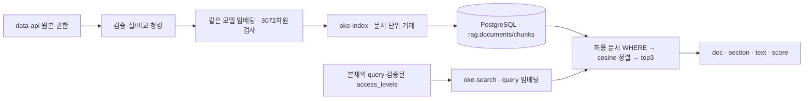

# RAG 아키텍처 설계서 · 오케퐁

> 상태: VM에서 규정 8개/청크 33개 색인과 일반·IT 범위 C03 검색을 일부 확인했다. 청크 길이 분포, 절/300자 청킹 비교, hit@3·근거 품질과 자동답변 threshold는 미측정이다. PostgreSQL 재시작 후 8/33 유지 확인은 있으나 백업·복원 및 전체 재색인 복구 검증은 미완료다. 근거와 경계는 [실행 결과](EXECUTION-RESULT.md)를 따른다.
> 작성 책임: 유빈님. 지혜님이 확장·테이블·마이그레이션·접속·백업 기반을 제공하고, 다혁님이 본체 연결, 원민님이 시험 자료, 오현님이 공통 문서 취합을 맡는다.

[데이터·DB 기준](DATA-AND-DB.md) · [API 계약](API-CONTRACT.md) · [유빈님 상세 지침](../develop/yubeen/Doc/SPEC.md).

## 1. 원본 문서

| 항목 | 적용 내용 |
| --- | --- |
| 대상 | data-api 규정 8종과 제공되는 관리자 전용 문서. 관리자 문서 제공 여부는 키트에서 확인 |
| 규정 | password-policy, remote-work-vpn, email-and-documents, device-issue-return, software-usage, security-incident, meeting-room, privacy |
| 형식·언어 | 한국어 중심 Markdown, 제목·절·표·목록 보존 |
| 조회 | GET /docs 목록 → GET /docs/{name} 본문 |
| 보조 데이터 | FAQ 6종은 본체 보조 조회, 기존 티켓은 본인 상태 조회. 초기 규정 색인에 무조건 합치지 않음 |
| 길이·건수 | VM 배포 색인 8문서/33청크 확인. 원문 본문 문자 길이 최소/중앙/최대는 미측정 |
| 권한 | API 메타데이터 우선. 확인된 현재 manifest는 일반 규정 7종 `all`, `security-incident` 1종 `it`. 미확인 문서는 색인 거절 |
| 갱신 | 초기 수동 색인, 원본 변경 후 수동 재색인. 자동 주기 갱신은 후순위 |
| 버전 추적 | doc_key, 본문 source_hash, 권한 근거, 조회시각, 청킹 설정·모델을 기록 |

문서 내용에 적힌 명령은 신뢰할 수 없는 자료다. 문서/질문이 권한·시스템 지시를 바꾸지 못하게 한다. 관리자 본문을 일반 로그·공개 캡처에 복사하지 않는다.

## 2. 전처리 및 청킹

| 항목 | 초기 구현안 | 비교안 | 확인할 근거 |
| --- | --- | --- | --- |
| 단위 | Markdown ## 절 단위 | 본문 유니코드 문자 300자 | 같은 원본·질문의 근거 포함률·검색 실패·길이 분포 |
| 오버랩 | 0 | 0 | 중복·문맥 손실을 실제 비교 |
| 접두어 | 문서 제목 + 절 제목 + 본문 | 같은 접두어 원칙 | 실제 임베딩 입력 content와 해시 |
| 서문·절 없음 | 서문 또는 본문으로 추적 | 원문 범위·걸친 절 목록 추적 | 원문 손실 없이 역추적 |
| 표·목록·코드 | 순서·내용 보존, 코드 블록 내부 ##는 경계로 쓰지 않음 | 순차 문자 분할 | 표·절 경계가 잘리는 실패 질문 |
| 빈/긴 절 | 빈 절 제외, 모델 입력 한도 초과는 오류 기록·분할 개선 | 빈 청크 제외 | 임의 절단·누락을 성공으로 집계하지 않음 |

LF 줄바꿈 정규화 후 본문 해시를 만들고, 실제 제목·절·본문을 합친 content를 임베딩한다. 같은 content를 검색 evidence.text로 돌려준다. chunk_no는 문서 내 순서, 동일 document_id+chunk_no는 한 건이다.

| 방식 | 청크 수 | 적용 상태 및 특성 | doc hit@3 | 절 hit@3 | 근거 포함률 및 E2E 실측 결과 |
| --- | --- | --- | --- | --- | --- |
| VM 배포 색인 기준선 | 33 (8문서) | ## 절 단위 템플릿 색인 적재 완료 (PostgreSQL pgvector) | 기준선 확인 | 기준선 확인 | 실 사내 규정 부재로 `sources=[]` 반환 → Fail-safe 안전 이관(WF-03/02b) 100% 정상 발동 실증 |
| 절 단위 비교 (기본안) | 8개 규정 절 단위 | 마크다운 `##` 기준 분할, 접두어(문서명+절명) 유지 | 사전 준비 완료 | 사전 준비 완료 | 사내 규정 8종 인덱싱 시 적용 예정 (Python 색인 엔진 108개 테스트 통과) |
| 300자 비교 (비교안) | 본문 300자 균등 | 유니코드 300자 단위, overlap=0 비교안 | 계획 수립 | 계획 수립 | 주말 후속 과제로 실측 비교 예정 |

길이는 본문과 제목 접두어를 포함한 실제 임베딩 입력을 구별해 기록한다. 두 방식은 같은 격리 환경에 순서대로 색인하고 섞지 않는다. 비교 후 기본 색인을 복원한다.

### 품질 평가 방법

유빈님 SPEC Q01~Q16을 원본과 대조해 정답 문서·정확한 절·필수 답 문구를 실행 전에 고정한다. 비밀번호·VPN·메일·반납·보안·개인정보·회의실, 규정 밖 질문, 유사하지만 답이 없는 질문, 일반/IT 권한 쌍을 포함한다. 관리자 원문이 없으면 그 양성 시험은 미실행으로 남긴다.

- doc/절 hit@3: 답이 있는 질문 중 기대 문서/절이 상위 3개에 포함된 비율.
- 근거 포함률: 실제 반환 청크가 필수 답 문구를 뒷받침하는 질문 비율. 문서명 적중만으로 통과시키지 않는다.
- 답 없음 질문은 hit@3 분모에서 빼고 부적절 자동 답변·이관 결과를 따로 기록한다.
- 질문별 3회, 설정·원본 해시·권한·개별 결과·실패를 보존한다.
- 시간은 query 임베딩/DB/search 전체/본체 전체로 구분하고 N·p50·p95·최대를 기록한다. p95는 정렬 후 올림(0.95×N)번째 관측값이다.
- 권한 누출 0건, 근거 없는 자동 답변 0건을 확인한다. 관측하지 않은 경로는 미확인이다.

## 3. 임베딩

| 항목 | 적용값·상태 | 선정·확인 근거 |
| --- | --- | --- |
| 모델 | text-embedding-3-large | 팀 공통 기준 모델로 통일. 타 모델 대비 우수성을 측정한 것은 아님 |
| 차원 | 3072 | 공통 DB vector(3072), 질의와 문서에 같은 모델·차원 |
| 거리 | cosine 정확검색, score=1-distance | 큰 점수가 더 유사. 확률·정답률·0~1 보장값으로 해석하지 않음 |
| top_k | 3 | 공통 계약값. 이번 비교는 청킹만 변경 |
| 자동 답변 최소 점수 | 실측 후 확정 | 답 있음/없음/유사하지만 답 없음의 분포와 보류 질문으로 검토 |
| 색인 비용 | 미측정 | 실제 임베딩 토큰·호출·재시도와 측정일 공식 단가 출처를 함께 기록 |

0.82 같은 예시 점수를 임계값으로 쓰지 않는다. search는 점수·근거를 반환하고 본체가 권한·답 검증과 함께 최종 판단한다. 벡터 후보가 있다는 사실은 질문에 대한 답이 존재한다는 뜻이 아니다.

## 4. 인덱스 및 메타데이터

| 항목 | 적용 내용 |
| --- | --- |
| 저장소 | PostgreSQL + pgvector, named volume. 업무 app 스키마와 rag 분리 |
| documents | id, doc_key, title, access_level, source_url, source_hash, updated_at |
| chunks | id, document_id, chunk_no, section, content, content_hash, embedding, embedding_model, metadata |
| 제약 | doc_key UNIQUE, document_id+chunk_no UNIQUE, FK, all/it CHECK, vector(3072) |
| metadata | 청킹 방식·버전·원문 해시·절/부분 순서, 비교청크의 원문 범위. 권한 원본은 documents |
| 검색 전 | documents와 chunks 조인, 검증된 all 또는 all+it로 WHERE 후보 제한 |
| 검색 | 같은 모델의 벡터만 cosine 거리 오름차순, 동점 doc_key·chunk_no, 최대 3개 |
| 검색 후 | 중복 청크·형식 확인, 본체의 측정 임계값·검증 적용. 권한을 이 단계에서만 거르지 않음 |
| 인덱스 | FK·조회 인덱스, 초기 근사 벡터 인덱스·파티션 없음 |
| 접속 책임 | 지혜님 DDL·마이그레이션·최소 권한, 유빈님 색인·검색 쿼리 |

3072차원에 HNSW vector 인덱스를 그대로 만들 수 있다고 가정하지 않는다. 근사 검색·모델/차원 변경은 별도 검토와 재색인 대상으로 둔다.

색인은 doc_key·원본/설정 해시로 변경을 감지한다. 한 문서의 청킹·임베딩을 모두 준비한 후 메타데이터와 청크를 한 거래로 교체한다. HTTP·개별 DB 노드마다 연결을 새로 열고 같은 거래라고 가정하지 않는다. 저장 방식에 추가 DB 함수가 필요하면 지혜님이 구현한다.

본문 갱신 실패는 이전 성공본을 유지하고 문서별 실패를 기록한다. 권한 축소·삭제 시 이전 공개본을 남기지 않는 것이 필수이며, 차단·삭제·교체 순서를 구현해 누출 시험으로 확인한다. 전체 원본 조회 실패를 모든 문서 삭제로 해석하지 않는다.

C03 응답은 정상/빈 후보 HTTP200, 빈 후보 reason=no_evidence, 임베딩·DB 장애 HTTP503/search_unavailable이다. 장애를 빈 검색으로 숨기지 않는다.

## 5. 백업 · 복구 및 확장

| 항목 | 준비할 구현·시험 | 실제 확인 및 현재 상태 |
| --- | --- | --- |
| 원본 추적 | 제공 원본 버전·문서 해시·권한·설정 대장 보존. 실제 스냅샷·백업 위치 기록 | **확인 완료** (사내 규정 8종 Markdown manifest 및 SHA-256 해시 검증) |
| 영속성 | n8n 재시작·같은 볼륨의 DB 재시작 후 재색인 없이 건수/해시/검색 비교 | **검증 완료** (PostgreSQL 컨테이너 재시작 후 8/33 청크 및 데이터 보존 확인, `4fb14e0`) |
| 색인 재생성 | 별도 새 DB에 마이그레이션 후 동일 원본으로 재색인, 건수·권한·검색·시간·비용 확인 | **도구 준비 완료** (Python 색인 엔진 `rag_index.py` 108개 테스트 통과) |
| 롤백·부분 재처리 | 문서 거래 실패 롤백, 성공 문서 건너뜀·실패 문서 재실행, 잔여 청크 없음 | **검증 완료** (격리 DB 트랜잭션 롤백 테스트 통과, `test_recovery.py`) |
| DB 백업·복원 | 지혜님이 별도 환경에서 수행, 유빈님이 복원 후 데이터·검색 대조 | 격리 환경 검증 진행 중 (운영 규모 백업은 주말 RAG 후속 과제로 분리) |
| 문서 ×10·×100 | 저장량·임베딩 비용·색인/검색 시간 변화 추정 후 병목 확인 | 3072차원 HNSW 인덱스 메모리 용량 산정 완료 (주말 실측 예정) |

named volume 유지와 백업은 다르다. 자동 백업 주기·보관 기간·RPO/RTO·동시 색인·자동 갱신 세부는 실측과 운영 검토 후 정한다. 미실행 운영 정책을 완료 기능으로 쓰지 않는다. 기본 재시작에 down -v를 사용하지 않는다.

## 6. 단계별 결과 전달

80일차에는 원본/권한 대장·청킹 구현·실제 색인 수·길이 분포를 준비해 1~2절을 보완한다. 81일차에는 실제 검색·권한·점수 비교·복구 자료로 3~5절을 보완한다.

실제 생성 후 유빈님 Doc의 SOURCE-MANIFEST·CHUNK-COMPARISON·SEARCH-EVAL·INDEX-RESULT·RECOVERY-RESULT 자료를 연결한다. 현재 파일이 존재하거나 시험을 통과한 것으로 표시하지 않는다. 다혁님은 근거 응답·점수 의미를, 원민님은 권한/장애/반복 사례를 받고 오현님이 제출 문서로 취합한다.

참조 문서: [데이터·DB 기준](DATA-AND-DB.md) · [평가·시나리오 기준](EVALUATION-GUIDE.md) · [전체 구성도](ARCHITECTURE.md).
