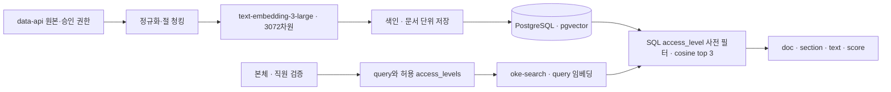

# RAG 아키텍처 · 오케퐁

> 현재 main의 규정·색인·검색 코드를 설명한다. 저장소 재계산과 과거 실서버 기록은 구분한다. [실서버 검색 보고서](../runs/rag-search-eval-20261107.json)는 8문서·33청크, 일반·IT 권한 분류, 벡터 차원과 C03 응답의 근거다. 문자·토큰·분할 통계는 현재 저장소 원본으로 다시 계산했으며 2절의 명령으로 재현할 수 있다. DB·API·전체 시험 범위는 [데이터·DB 기준](DATA-AND-DB.md), [API 계약](API-CONTRACT.md), [실행 결과](EXECUTION-RESULT.md)를 따른다.

**11/09 유빈님 설계서 취합:** `feat/yubeen-p0`의 `70c215a`에서 동일 원본 8종의 격리 A/B 실검색과 사용량 기록을 가져왔다. 문서 적중은 두 방식 모두 11/11, 필수 근거 적중은 절 단위 11/11·300자 10/11이다. main 원본과 반환 청크 해시·66개 검색의 근거 순위·사용량 합계를 오프라인으로 재검토했다. [취합·재계산 근거](../runs/rag-handoff-review-20261109.json)에 작성자 원본과 main 보관 위치를 연결했다. **격리 실험 근거가 보완된 상태이며 운영 품질·복구 전체 판정은 PARTIAL**이다. 이 취합에서 API·DB·VM을 새로 호출하거나 색인을 바꾸지 않았다.

**문서 마감 대조:** 기준 main `19087ef`의 원본·설정과 기존 보고서를 다시 확인했다. 선생님 체크리스트의 문서별 판단은 [필수 문서 점검표](FINAL-DOCUMENT-REVIEW.md)에 모았다. N14 검증 보정에는 숫자 오류를 승인한 오프라인 재현이 있으므로 Writer·Verifier가 모든 잘못된 답변을 차단한다고 설명하지 않는다. [설계의 결함·한계](WORKFLOW-DESIGN.md#42-기준과-한계)를 함께 따른다. 이번 대조에서 운영 DB·색인·서비스는 변경하지 않았다.

## 1. 원본과 실측 색인

| 항목 | 적용 및 확인 결과 |
| --- | --- |
| 원본 | data-api에서 제공하는 사내 규정 Markdown 8종 |
| 현재 원본 경로 | 루트 `knowledge/`의 Markdown 8종. `README.md` 제외, [권한·해시 대장](../apps/rag/rag-permissions.json)과 대조 |
| 형식·언어 | `#` 제목·`##` 절·목록을 가진 한국어 중심 Markdown, VPN 등 영문 기술 용어 포함 |
| 갱신 | 승인된 규정·권한 대장 변경 후 수동 재색인. 주기적 자동 갱신 작업은 현재 구성에 없음 |
| 문서 키 | `password-policy`, `remote-work-vpn`, `email-and-documents`, `device-issue-return`, `software-usage`, `security-incident`, `meeting-room`, `privacy` |
| 저장 규모 | PostgreSQL `rag.documents` 8행, `rag.chunks` 33행 |
| 임베딩 | `text-embedding-3-large`, pgvector `vector(3072)`; 33개 저장 벡터 모두 차원 3072 |
| 원본 정합성 | 현재 파일 8개의 SHA-256은 권한 대장과 일치. 이 검사는 현재 DB 청크의 재조회·해시 대조와 구분 |
| 검색 결과 계약 | cosine distance 오름차순, `score = 1 - distance`, `top_k=3`; 점수는 확률이나 정답률이 아님 |
| 보조 데이터 | FAQ 6종은 본체에서 보조 조회하며 규정 인덱스에 합치지 않음. 기존 티켓은 본인 상태 조회 경로에서 사용 |

아래 길이는 현재 main 원본의 오프라인 계산이다. 문서 원문은 제목·공백·줄바꿈을 포함한다. 청크 본문은 원문에서 자른 범위이며 제목·절 행이 포함될 수 있다. 임베딩 입력은 여기에 문서 제목과 절 접두어를 붙인 `content`다. 토큰은 `tiktoken==0.14.0`의 `cl100k_base`로 계산했으며 실제 API 사용량은 아니다.

| 자료 | N | 글자 수 최소 / 중앙 / 최대 | 토큰 최소 / 중앙 / 최대 | 토큰 합계 |
| --- | ---: | ---: | ---: | ---: |
| 문서 원문(제목 포함) | 8 | 240 / 338.5 / 433 | 195 / 312 / 375 | 2,411 |
| 절 단위 청크 본문 | 33 | 13 / 90 / 156 | 10 / 78 / 163 | 2,411 |
| 임베딩 입력(접두어 포함) | 33 | 26 / 113 / 182 | 22 / 96 / 192 | 3,139 |

| 접근 범위 | 문서 | 청크 | 문서 원문 평균 글자 | 청크 본문 평균 글자 | 임베딩 입력 평균 글자 |
| --- | ---: | ---: | ---: | ---: | ---: |
| `all` 일반 직원 | 7 | 30 | 342.29 | 79.87 | 101.00 |
| `it` 전용 | 1 | 3 | 309.00 | 103.00 | 123.67 |

문서 권한은 원본의 검증된 메타데이터 또는 승인된 권한 매핑에서 가져온다. 현재 분류에서는 `security-incident`만 `it`, 나머지 7개 문서는 `all`이다.

## 2. 전처리와 청킹

원문은 LF 줄바꿈으로 정규화하고 제목·절 행, 목록, 표, 코드 순서를 보존한다. 청크 본문과 임베딩 입력을 구분한다. 임베딩 입력은 `문서 제목 + 절 제목 + 본문`이며 동일 content를 검색 evidence로 반환한다. 문서별 `chunk_no`는 0부터 순서대로 부여하고, 청크는 원문 범위와 해시로 추적한다. 빈 절은 색인 청크에서 제외하되 분석 기록에는 남긴다.

| 방식 | 규칙 | 청크 수 | 본문 글자 수 최소 / 중앙 / 최대 | 확인 범위 |
| --- | --- | ---: | ---: | --- |
| 절 단위 (기준선) | Markdown `##`와 서문, overlap 0, 임베딩에 접두어 추가 | **33** | 13 / 90 / 156 | 현재 코드로 계산. 기존 VM 보고서의 33청크와 건수 일치 |
| 고정 300자 | 원문 전체를 유니코드 문자 300자 단위로 분할, overlap 0 | **14** | 9 / 253.5 / 300 | 현재 코드의 비교 모드로 오프라인 계산. 실검색 품질 비교는 별도 |
| 고정 500자 · 계산안 | 원문 전체를 500자 단위로 단순 분할 | **8** | 240 / 338.5 / 433 | 계산만 수행. 현재 색인 코드가 지원하는 방식은 아님 |

이 표는 같은 원본의 분할 계산 비교다. 청크 수·길이만으로 검색 품질 우열을 정하지 않는다. 동일 질문 세트의 실검색 비교는 아래 11/09 격리 A/B 결과로 구분한다. 절·300자 구현은 포함 절과 원문 범위를 기록하지만, 500자 계산안에는 실제 색인·메타데이터 구현이 없다.

절 단위 선택 이유는 짧은 규정의 제목·절차·조건을 함께 유지하고 `doc`·`section` 출처를 표시하기 위해서다. 현재 가장 긴 청크 본문은 156자다. 글자 수 분할은 절 중간을 나눌 수 있으므로 비교 대상으로 두며, 길이 계산과 아래 검색 품질 실험을 구분한다. 표·목록·코드 블록 내부의 가짜 `##`를 경계로 쓰지 않는 처리는 [청킹 코드](../apps/rag/rag_prepare.py)에서 확인한다.

### 11/09 격리 A/B 실검색 비교

유빈님이 동일 원본 8종·권한·모델·3072차원·cosine·`top_k=3`으로 두 격리 PostgreSQL DB를 구성했다. [동결 정답표](../runs/rag-ab-answer-key-frozen-20261109.json)의 **고유 양성 질문 11개**(Q01~Q07, Q08-IT, Q09~Q11)를 각 방식에서 3회씩 검색해 총 66회다. 질문 임베딩 11개를 양쪽 방식과 반복에 재사용했으므로 반복 SQL 관측을 독립적인 LLM 생성 3회로 해석하지 않는다. [승인 권한표](../runs/rag-ab-permissions-approved-20261109.json)의 문서별 권한·바이트 해시는 현재 main의 `knowledge/`·권한 대장과 8/8 일치했다. 기존 `cases/*.json`의 초안·기대값은 변경하지 않았다.

| 지표 | 절 단위 | 고정 300자 | 확인 범위 |
| --- | ---: | ---: | --- |
| 문서·청크 | 8문서·33청크 | 8문서·14청크 | 두 격리 DB의 초회 색인 |
| 문서 Hit@3 / 문서 MRR | 11/11 · 1.000 | 11/11 · 1.000 | 반복 집계 각 33/33, 문서 적중은 동률 |
| 필수 근거 Hit@3 | **11/11** | **10/11** | 반복 집계 33/33 대 30/33; 단일 반환 청크가 승인 문구 전부를 포함 |
| 필수 근거 첫 순위 MRR | **1.000** | **0.864** | 반복 역순위 합계 33/33 대 28.5/33 |
| SQL 어댑터 왕복 평균 / 최대 | 5.845 / 18.734 ms | 4.736 / 12.762 ms | 방식별 33회; query 임베딩·n8n·최종 답변 시간 제외 |
| 초회 색인 경과 | 8.389초 | 3.311초 | API 대기·DB 저장 포함; 운영 VM 색인 시간은 아님 |

[실행 원본](../runs/rag-ab-actual-rerun-20261109.json)과 [근거 감사 원본](../runs/rag-ab-evidence-audit-20261109.json)을 그대로 보관했다. main에서 원문을 같은 방식으로 청킹해 **198개 반환 근거의 내용 해시**와 66개 단일 청크 근거 순위를 다시 대조했다. DB·유료 호출을 재실행한 검사는 아니다. [로컬 청킹 원본](../runs/chunk-comparison-local-20261109.json)은 원본 2,705자의 손실·제외·거절 0자와 양쪽 방식의 문서 8/8 보존을 기록한다.

**실패·차이:** Q08-IT의 필수 근거는 절 1위·300자 2위였다. Q10은 300자에서 정답 문서가 1위여도 필수 문구가 top3 청크에 없었다. 이 11문항에서는 절 단위가 필수 근거 회수에 앞섰지만 문서 적중은 동률이며, 운영 트래픽 전체의 우위로 일반화하지 않는다.

성공 임베딩은 **58회**(문서 47·질문 11), 응답 `prompt_tokens` **6,402**, 실패·재시도 0회였다. 실험 기록의 단가 USD 0.13/100만 입력 토큰으로 계산한 금액은 **USD 0.00083226**이며 계정 청구액은 미확인이다. 4절의 절 단위 1회 텍스트 추정과 달리, 두 방식의 문서와 공유 질문 사용량을 포함한다. [이전 401 실패](../runs/rag-ab-actual-20261109.json)는 성공 색인·usage 0, 두 DB 0문서·0청크였으며 지우지 않았다. [인증 확인 1회](../runs/rag-api-auth-probe-20261109.json)와 이후 추가 검색 사용량은 58회 합계와 별도다. [재실행 전 조건](../runs/rag-ab-preflight-rerun-20261109.json)도 보관했다.

이번 취합은 설계와 실험 근거의 반영이다. 당시 격리 실험 실행기·DB 구성은 main에 이식하지 않았으므로 이 JSON만으로 66회를 즉시 재실행할 수 있다고 안내하지 않는다. main 안의 원본·정답표·권한표·청킹 코드로 근거 해시와 판정을 대조할 수 있다.

### 원본 통계 재현 방법

저장소 루트에서 다음 명령을 실행한다. 권한 대장의 해시를 확인한 원본만 읽고, DB·n8n·OpenAI API를 호출하지 않는다. tokenizer 패키지·인코딩 자료 설치가 필요할 수 있다. 500자는 현재 엔진의 실행 모드가 아닌 별도 계산임을 출력에 구분한다.

<details>
<summary>문자·토큰·청크 수 계산 명령</summary>

```sh
PYTHONDONTWRITEBYTECODE=1 uv run --no-project --with tiktoken==0.14.0 python - <<'PY_STATS'
import statistics
import sys
from pathlib import Path
import tiktoken

sys.path.insert(0, str(Path("apps/rag").resolve()))
from rag_load import build_snapshot
from rag_prepare import chunk_document

snapshot = build_snapshot("knowledge", "apps/rag/rag-permissions.json")
encoding = tiktoken.get_encoding("cl100k_base")
raw, sections, inputs, fixed300, fixed500 = [], [], [], [], []
for key, doc in sorted(snapshot["document_responses"].items()):
    source = doc["text"]
    raw.append(source)
    variants = {}
    for method in ("section", "300"):
        parts = chunk_document(key, doc["title"], source,
                               doc["access_level"], method)["chunks"]
        variants[method] = parts
        for part in parts:
            start, end = part["metadata"]["source_range"]
            if method == "section":
                sections.append(source[start:end])
                inputs.append(part["content"])
            else:
                fixed300.append(source[start:end])
    calculation = [source[i:i + 500] for i in range(0, len(source), 500)
                   if source[i:i + 500].strip()]
    fixed500.extend(calculation)
    print(key, "section", len(variants["section"]),
          "300", len(variants["300"]), "500-calculation", len(calculation))

for name, values in (("source", raw), ("section-body", sections),
                     ("embedding-input", inputs), ("300-body", fixed300),
                     ("500-calculation", fixed500)):
    chars = [len(value) for value in values]
    tokens = [len(encoding.encode(value)) for value in values]
    print(name, "N", len(values),
          "chars(min/median/max)", min(chars), statistics.median(chars), max(chars),
          "tokens(min/median/max)", min(tokens), statistics.median(tokens), max(tokens),
          "total_tokens", sum(tokens))
PY_STATS
```

</details>

## 3. 권한 격리와 검색

검색은 권한을 벡터 유사도 계산 뒤에 거르는 방식으로 구현하지 않는다. 본체가 직원 신원을 확인해 `access_levels`를 만든 뒤 검색 요청에 전달한다. DB 질의는 먼저 문서 권한을 SQL `WHERE` 조건으로 제한하고, 허용 집합의 후보에 대해서만 모델·벡터 거리를 계산한다.

- **아키텍처 선정 근거 ② — 검색 전 권한 필터(SQL Pre-Filtering)를 선택한 이유:** 허용되지 않은 `it` 전용 청크를 Top-3 후보 계산 전에 원천 배제해야 비권한 일반 직원에게 보안 문건이 근거로 노출되거나 일반 규정 후보가 밀려나는 현상을 막을 수 있다.

```sql
WITH allowed AS MATERIALIZED (
 SELECT d.doc_key, c.chunk_no, c.section, c.content, c.embedding
 FROM rag.documents d JOIN rag.chunks c ON c.document_id = d.id
 WHERE d.access_level = ANY(%s) AND c.embedding_model = %s
)
SELECT doc_key, section, content, 1 - (embedding <=> %s::vector) AS score
FROM allowed
ORDER BY embedding <=> %s::vector ASC, doc_key ASC, chunk_no ASC
LIMIT %s
```

일반 직원은 `verified_access_levels = ['all']`, IT 직원은 `['all','it']`로 검색한다. 접근 수준을 SQL 후보 집합에서 선제한 뒤 점수순으로 최대 3건을 반환한다. 위 SQL은 현재 `rag_search.py`의 쿼리다. `MATERIALIZED` 허용 후보 집합을 먼저 만들며 `%s`는 드라이버의 바인딩 매개변수다. 순서대로 접근 수준·모델·질의 벡터·동일 벡터·3을 전달한다. 질문의 문구나 팀 키만으로 직원 권한을 만들어내지 않으며, 허용 집합이 없거나 지원하지 않는 값이면 요청을 거절한다.

**WF-05 권한 격리 실서버 검증 결과 ([`runs/rag-search-eval-20261107.json`](../runs/rag-search-eval-20261107.json)):**

- 실서버 DB에는 `all` 7문서/30청크, `it` 1문서(`security-incident`)/3청크(전 청크 3072차원)가 저장돼 있다.
- **동일 보안사고 질의 비교 실측:**
  - 일반 직원 범위(`access_levels=["all"]`, `test_id: WF05-ALL-SCOPE`): HTTP 200, 반환 문서 ID `["privacy", "device-issue-return", "password-policy"]` (점수 `0.5394`, `0.4420`, `0.3790`) ➔ **IT 전용 규정(`security-incident`) 누출 0건 (`wf05_leaked_it_count: 0`, PASS)**.
  - IT 부서 범위(`access_levels=["all", "it"]`, `test_id: WF05-IT-SCOPE`): HTTP 200, 반환 문서 ID `["security-incident", "security-incident", "privacy"]` (점수 `0.5544`, `0.5466`, `0.5394`) ➔ **IT 전용 규정 2건 정상 반환 (PASS)**.
  - 일반 규정 검색(`C03-PASS-POLICY`, `C03-VPN-POLICY`)에서도 각각 `password-policy` 3건(최고 `0.6558`), `remote-work-vpn` 3건(최고 `0.5487`)이 누출 0건으로 정확히 반환되었으며, 인증 누락(`403`) 및 잘못된 `top_k`(`400 invalid_request`) 방어도 실서버에서 통과했다.

### 유사도 측정 및 0.40 기준

현재 본체 `N12 Evidence gate`의 실연결 기준은 **0.40**이다. 이 값은 검색 서비스가 아니라 본체가 자동 답변용 근거를 채택하는 기준이다. 검색 설정 파일의 `score_threshold`는 null이며, C03은 허용 범위의 top 3을 반환한다.

선정 당시 기록은 [본체 JSON](../workflows/oke-support.json)의 N12 주석에 남아 있다. 로컬 `oke-local`에서 범위 안 12개 질문의 기대 문서 점수 0.380~0.709(중앙 0.571), 범위 밖 6개 질문의 top 1 최고 0.383을 참고했다는 기록이다. 주석이 가리키는 `runs/search-score-dist-20261106-1.json`은 현재 main에 없으므로 이 분포를 제출된 원본 보고서로 다시 확인할 수는 없다. 따라서 이를 현재 QA 16개를 모두 평가한 결과로 표시하지 않는다.

[현재 RAG 질문 세트](../cases/rag-search.json)는 16개이며, 기록 상태는 draft 13개·not_executed 3개다. 이 상태만으로 과거의 모든 실행 여부를 단정하지 않지만, 현재 고정 정답셋 전체 평가의 근거로 사용하지도 않는다. 별도 승인한 11개 양성 질문의 격리 A/B는 2절의 동결 정답표로 구분한다. 실서버 C03의 개별 검색·권한 검사는 위 보고서다. 0.40은 단독 정답 판정기가 아니며 권한·근거 내용·Writer·Verifier 검증까지 필요하다. 초안·과거 점수 주석만으로 Hit@3·Recall@3·MRR·p95·모델 간 품질 우위를 추론하지 않는다.

### 추가 격리 검색과 0.40의 한계

[Q08·Q12·Q13 원본](../runs/rag-final-q08-noanswer-20261109.json)은 기존 두 인덱스에 재색인 없이 실제 질문 임베딩 3개를 만들고, 권한·방식별 SQL 검색 8회를 기록했다. Q12·Q13은 원문을 대조한 **답 없음 후보**이며 사람 승인 정답표로 승격하지 않았다.

| 질문·권한 | 절 단위 최고 점수 | 300자 최고 점수 | 관측 |
| --- | ---: | ---: | --- |
| Q08 일반 `all` | 0.285 | 0.255 | IT 문서·검색 근거에서 투영한 sources 노출 각각 0건 |
| Q08 IT `all,it` | 0.380 | 0.351 | IT 문서 양성 회수. 정상 근거도 0.40 미만 |
| Q12 연차 일수 후보 | 0.272 | 0.236 | 원문에 일수 근거 없음; 검색은 top3 후보를 반환 |
| Q13 노트북 CPU 모델 후보 | 0.383 | 0.323 | 원문에 정확한 모델 근거 없음; 검색은 top3 후보를 반환 |

절 단위에서 답 없음 후보 Q13의 0.383이 정상 Q08-IT의 0.380보다 높다. 따라서 이 소표본도 단일 점수로 정답 유무를 완전히 구분할 수 없음을 보여 준다. 검색 서비스는 0.40을 적용하지 않았고, 가정상 점수 게이트의 보류 여부를 계산했을 뿐 본체의 실제 답변·이관을 시험하지 않았다. 운영 TM-12와는 질문·환경이 달라 동일 시험이나 문제 해결로 집계하지 않는다.

이 추가 실행의 임베딩은 3회·80토큰·실패/재시도 0회, 실험 기록 단가로 계산한 **USD 0.0000104**이며 앞선 A/B 58회와 별도다. [기존 벡터를 질의 대용으로 쓴 권한 검사](../runs/rag-ab-security-proxy-20261109.json)는 API 0회인 또 다른 검사다. 모두 명시적으로 전달한 권한의 격리 검색 경계이며 실제 직원 세션→최종 답변의 단일 실행을 입증하지 않는다. 검색 결과의 문서·절·해시는 추적되지만 개별 DB 숫자 청크 ID와 최종 직원 응답의 연결은 미확인이다.

## 4. 임베딩과 인덱스 구조

| 속성 | 적용값 | 의미 |
| --- | --- | --- |
| 모델 | `text-embedding-3-large` | 문서와 query가 동일 모델 사용 |
| 차원 | 3072 | PostgreSQL `vector(3072)`와 일치 |
| 거리 | cosine 정확검색 | 낮은 distance가 가까운 후보 |
| 점수 | `1 - distance` | 유사도 정렬값이며 확률이 아님 |
| `top_k` | 3 | 공통 검색 계약 |
| 자동답변 기준 | 0.40 | 근거 내용·Writer·Verifier 검증과 함께 적용 |

모델은 수업 기본 모델과 기존 색인·검색 어댑터의 3072차원 계약을 유지하기 위해 `text-embedding-3-large`를 사용한다. 한국어 규정과 VPN 등 영문 용어를 같은 모델로 색인·조회하며, 현재 C03의 규정 검색 사례는 확인됐다. 다른 모델과 동일 질문·비용으로 비교한 결과는 없어 성능상 최선이라고 주장하지 않는다. `top_k=3`도 공통 C03 계약값이며 3·5 비교로 최적화한 값은 아니다.

이번 원본 계산의 임베딩 입력은 **3,139토큰**이다. [OpenAI 모델 안내](https://developers.openai.com/api/docs/models/text-embedding-3-large)의 일반 입력 단가 **100만 토큰당 $0.13**을 적용하면 전체 신규 임베딩 1회 예상액은 `3,139 / 1,000,000 × 0.13 = $0.00040807`이다(단가 확인: 2026-11-08). 이는 텍스트 토큰 수에 따른 추정이며 실제 청구액이 아니다. 질문 임베딩·답변 LLM·재시도·서버 비용은 제외한다. 변경 없는 문서는 색인을 건너뛰므로 매 실행마다 이 비용이 드는 것도 아니다.



| DB 항목 | 구조 및 원칙 |
| --- | --- |
| 저장소 | PostgreSQL + pgvector; 업무 `app` 스키마와 RAG `rag` 스키마 분리 |
| `rag.documents` | `id`, `doc_key`, `title`, `access_level`, `source_url`, `source_hash`, `updated_at` |
| `rag.chunks` | `id`, `document_id`, `chunk_no`, `section`, `content`, `content_hash`, `embedding`, `embedding_model`, `metadata` |
| 제약 | `doc_key` UNIQUE, `(document_id, chunk_no)` UNIQUE, FK, `all/it` 권한 제약, `vector(3072)` |
| 검색 후보 | 문서/청크 조인 후 `access_level`과 임베딩 모델을 `WHERE`에서 제한 |
| 정렬·반환 | cosine distance 오름차순, 동점은 `doc_key`·`chunk_no`, 최대 3건 |
| 연결·권한 책임 | DB 스키마·마이그레이션·역할은 DB 담당, 색인·검색 어댑터는 RAG 담당 |

초기 검색은 cosine 정확검색을 사용한다. 차원 제한이나 메모리/검색 부하를 확인하지 않은 채 근사 벡터 인덱스를 운영에 추가하지 않는다. 모델 또는 차원이 바뀌면 기존 벡터와 호환되지 않으므로 전체 재임베딩·재색인이 필요하다.

색인은 원본·설정 해시로 변경을 탐지하고 문서 단위 트랜잭션으로 저장한다. 새 임베딩을 준비한 뒤 저장 직전 문서 버전을 확인해 교체한다. `all`에서 `it`로 권한 축소가 확인되면 기존 청크를 검색에서 제외하고 `permission_reduction_requires_review`로 중단한다. 중단된 문서는 검토 없이 자동 재개하지 않는다. 현재 고정 8문서 목록·해시와 맞지 않는 원본은 조회 단계에서 거절하며, 원본 누락을 자동 삭제 요청으로 처리하지 않는다.

버전은 `doc_key`·`source_hash`·`updated_at`과 청크 metadata의 `chunking_version,source_range,included_sections,index_settings_hash`로 추적한다. 물리적 권한별 파티션이나 새 인덱스 alias 전환은 현재 구현에 없다. 동일한 `rag` 테이블에서 SQL로 권한을 제한한다. 모델·차원 전환은 별도 DB/스키마에 재색인·검증 후 검색 연결을 바꾸는 운영 설계로 두며, 현재 자동 전환 기능으로 표시하지 않는다.

정상 검색과 검색 결과 없음은 HTTP 200으로 반환하며 빈 결과는 `no_evidence`다. 임베딩 또는 DB 장애는 HTTP 503 `search_unavailable`로 반환한다. 장애를 빈 검색으로 바꾸지 않는다.

## 5. 100배 규모 선형 추정

아래 추정은 8개 문서/33개 기준 청크의 개수와 평균 임베딩 입력 토큰 수가 100배 데이터셋에서도 같다고 가정한 단순 선형 계산이다. 청크 수와 토큰 총량은 용량 계획용이며, 실제 DB 저장량·인덱스 오버헤드·색인 시간·검색 지연·API 비용을 측정한 값이 아니다.

| 지표 | 현재 기준 | 100배 선형 추정 | 계산 |
| --- | ---: | ---: | --- |
| 문서 수 | 8 | 800 | 8 × 100 |
| 절 단위 청크 수 | 33 | 3,300 | 33 × 100 |
| 300자 방식 청크 수 | 14 | 1,400 | 14 × 100 |
| 500자 단순 계산안 청크 수 | 8 | 800 | 8 × 100; 미구현 방식 |
| 절 단위 임베딩 입력 토큰 수 | 3,139 | 313,900 | 정수 합계 3,139 × 100 |
| 절 단위 신규 임베딩 예상액 | $0.00040807 | $0.040807 | 위 일반 단가·토큰 수 일정 가정 |
| 원시 벡터 payload | 약 0.387 MiB | 약 38.67 MiB | 3072차원 × 4바이트 × 청크 수; 절 단위 33/3,300 기준 |

벡터 payload 계산은 float32 성분만 포함한다. PostgreSQL 행·TOAST·페이지·인덱스·WAL·복제본·메타데이터의 추가 공간은 포함하지 않는다. 100배에서 검색시간·메모리·정확도·API 비용이 100배가 된다는 뜻도 아니다. 실제 계획은 대표 데이터 적재 후 DB 크기, 실행계획, 동시 요청, 전체 검색시간, 임베딩 사용량과 비용을 측정해 조정한다.

## 6. 운영 검증과 복구 경계

| 항목 | 현재 구현·확인 범위 | 운영 설계·후속 확인 |
| --- | --- | --- |
| 원본·설정 보존 | `knowledge/`와 권한·설정 파일을 Git으로 관리. 변경 파일은 해시 대조 | 규정 변경 때 검토·커밋 후 수동 색인. 삭제·권한 축소는 별도 승인 |
| DB 백업 | [배포 기록](../deploy/README.md)에 배포 전 DB dump·체크섬 확인 이력이 있음 | 정기 작업의 설정·실행 기록은 이 문서에서 확인하지 못함. 운영안은 일 1회·주요 변경 전 암호화 백업, 7일 보관이며 아직 적용·검증 완료로 표시하지 않음 |
| 새 DB 복구 | DB 재시작 후 8문서·33청크 유지 관측과 새 DB 복원은 구분 | 별도 DB에 스키마·역할 준비 → 검증된 dump 복원 또는 동일 원본 재색인 → 문서/청크·해시·권한·대표 검색 대조 → 승인 후 연결 전환. 운영 DB에서 시험하지 않음 |
| 롤백 | 문서 교체 트랜잭션 실패 시 rollback 코드가 있음. 커밋 ACK 유실은 commit_unknown으로 구분 | 새 DB/모델 전환 시 이전 DB·설정·원본 버전 보존 후 연결을 되돌리는 절차 검증 필요 |
| 부분 재처리 | 문서별 성공·skipped·거절·실패 집계. 동일 원본 재실행 시 변경 없는 문서 skip | 실패 원인 해소 후 수동 재실행. 자동 DLQ 소비·권한 중단 자동 해제는 현재 없음 |
| 복구 시간·손실 목표 | 전체 재색인 시간·백업 복원 시간·실제 API 비용은 현재 근거로 확정하지 않음 | RPO·RTO 수치는 복원 연습과 소요 시간 측정 후 확정 |

VM 실측에서 확인한 것은 8문서·33청크, 권한 분류, 임베딩 모델·차원이다. 별도로 기록된 일반/IT C03 및 n8n 검색에서 HTTP 200과 evidence 3건이 관측됐다. **운영 DB 문서별 source_hash의 원시 대조는 미확인**이며, main 파일·승인 대장·격리 실험 원본의 해시 일치와 구분한다. VM C03 관측을 격리 A/B 품질 지표나 전 시나리오 성공으로 확대하지 않는다.

VM PostgreSQL 재시작 후 8문서/33청크 보존은 [실행 결과](EXECUTION-RESULT.md)에 기록되어 있다. 이는 DB 재시작 후 데이터 보존 관측이다. 백업 복원 및 새 DB 전체 재색인 복구와는 구분한다. 로컬 합성 fixture의 롤백·재처리 시험 또한 VM 원본 복구 증거가 아니다. named volume은 백업 대체물이 아니다.

운영 기록에는 원본 버전·문서별 SHA-256·권한 출처·청킹 설정·모델·차원·색인시각·DB 대상·실패 문서 목록을 연결한다. 권한·모델·차원·청킹 변경은 별도 검토와 회귀 측정을 거친다. 토큰 통계는 `cl100k_base`를 이용한 텍스트 추정치이며 API에서 보고된 실제 사용량이나 비용과 동일시하지 않는다.

11/09 격리 초회 색인·검색은 수행됐지만 변경 없는 재색인, 실제 규정 8종의 실패 후 복구, 백업 복원·×10 부하·운영 비용은 미실행 또는 미확인이다. 작성자가 전달한 Q08·Q12·Q13 통합 화면 관찰은 지속 가능한 캡처가 main에 없어 이번 취합에서 새 UI 검증 근거로 추가하지 않았다. 0.40 안전성·운영 복구·직원 세션 전체 경로를 완료로 표시하지 않는다. 취합 파일의 [비밀 검사](../runs/secret-scan-rag-publication-20261109.json)는 기존 검토 예외의 작업 트리 텍스트 범위이며 Git 과거 이력·바이너리 전체 검사가 아니다.

참조: [데이터·DB 기준](DATA-AND-DB.md) · [API 계약](API-CONTRACT.md) · [평가·시나리오 기준](EVALUATION-GUIDE.md) · [전체 구성도](ARCHITECTURE.md) · [실서버 RAG 검색 검증 영수증](../runs/rag-search-eval-20261107.json) · [실서버 검색 연동 관측 영수증](../runs/vm-search-observed-20261106.json)
