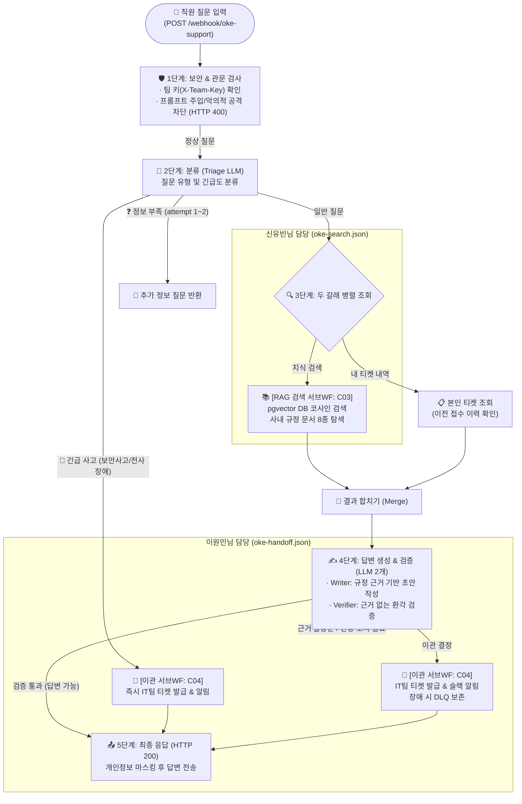
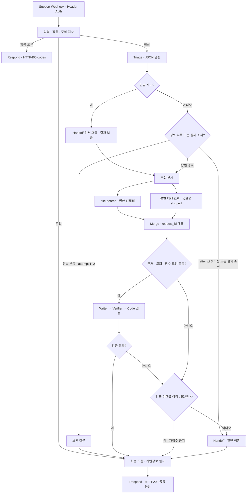
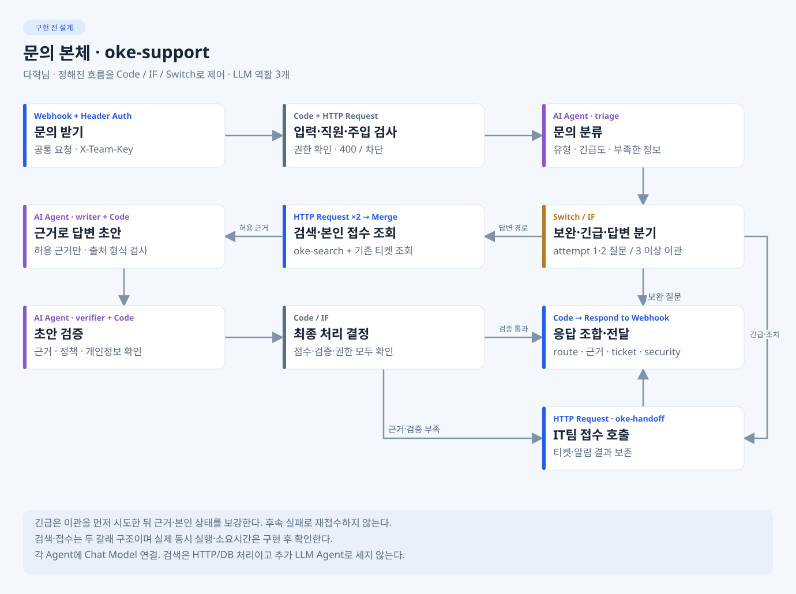
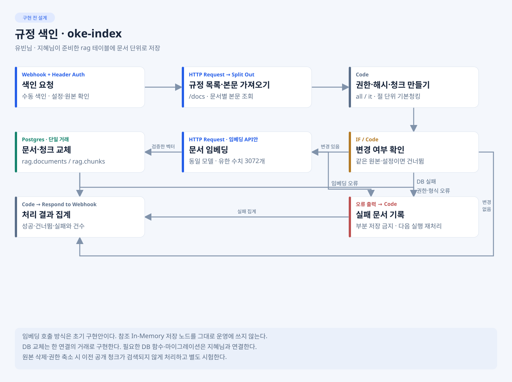
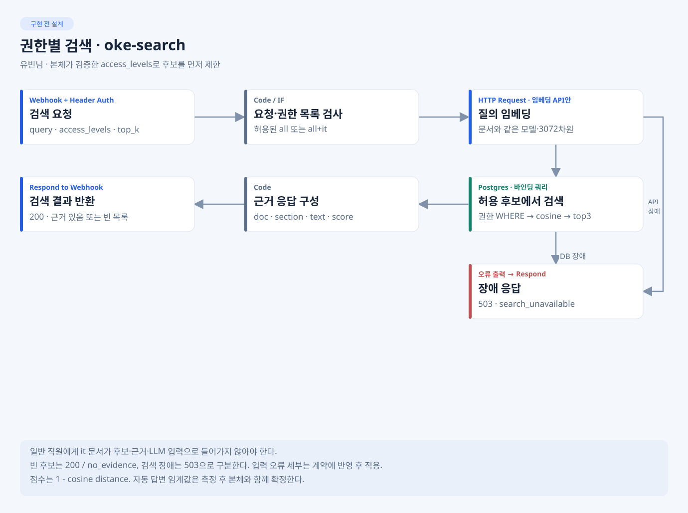
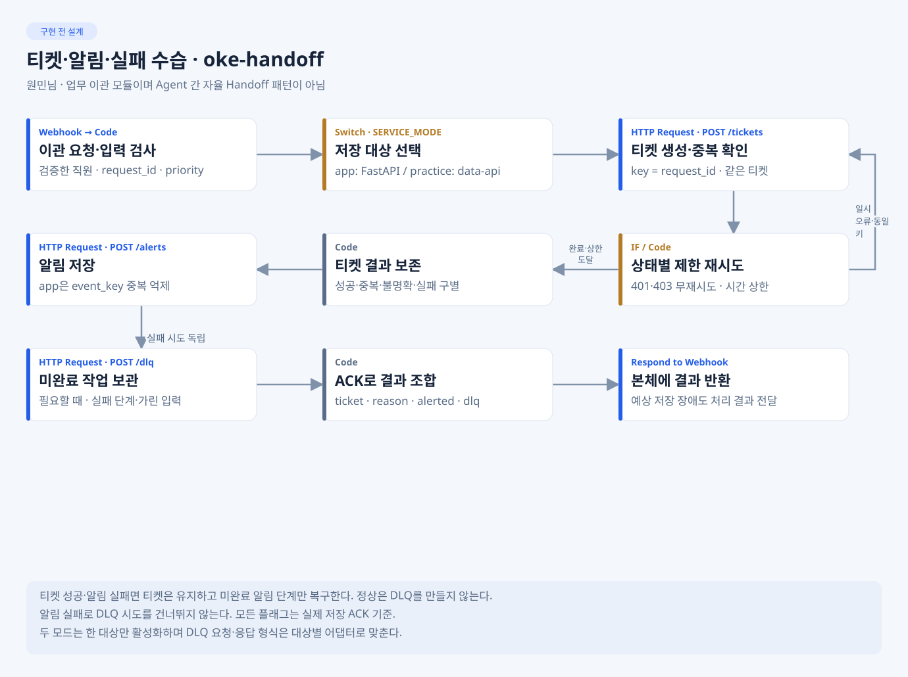
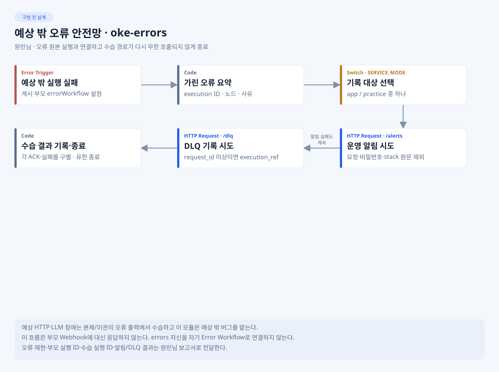

# 노코드 워크플로우 설계서 · 오케퐁

> 상태: 설계 대상 JSON은 구현·게시되어 VM 배포본(`3ff836a`)의 support/search/handoff/errors 4대 워크플로우가 활성 상태이며, 실제 VM 환경에서 WF-03(무근거 이관 및 T-2005 실저장)과 WF-02b(보완 한도 도달 및 T-2011 실저장) E2E 실측 검증을 완료했다. 실행 범위·결과는 [실행 결과](EXECUTION-RESULT.md)를 따른다.
> 작성 책임: 다혁님. 원민님은 이관·오류, 지혜님은 인증·저장, 유빈님은 검색 자료를 제공한다. 공통 문서 편집·제출 취합은 오현님이 맡는다.

[전체 구성도](ARCHITECTURE.md) · [API 계약](API-CONTRACT.md) · [데이터·DB](DATA-AND-DB.md) · [본체 상세 지침](../develop/dahyeok/Doc/SPEC.md). 필드·시간 예산은 최신 공통 계약이 우선이다.

## 먼저 이해할 구조 · Agent와 제어 방식

- 서비스는 **고정된 오케스트레이션**으로 시작한다. Code·IF·Switch가 입력·권한·순서·분기를 제어하고 triage(분류)·writer(작성)·verifier(검증)의 LLM 역할 3개를 필요한 경로에서 호출한다. 별도 Supervisor LLM은 기본안에 없다.
- retriever는 HTTP/DB 검색 역할이며 추가 LLM으로 세지 않는다. 차단·입력 오류는 LLM0회, 보완 경로는 triage만 경유할 수 있다. 모든 문의가 3개 LLM을 전부 호출해야 한다는 뜻이 아니다.
- oke-handoff는 IT팀 티켓·알림·DLQ를 처리하는 **업무 이관**이다. Agent끼리 자율적으로 제어권을 넘기는 Handoff 패턴을 선택한 것이 아니다.
- 워크플로우5종은 기능별 파일 경계다. 팀원에게 붙인 개발 CLI는 이 서비스를 만드는 도구이며 서비스 안의 Agent 수와 별개다.
- 화면에서 보이는 기능과 담당자는 [예상 화면·기능표](PREVIEW.md), 재사용할 코드는 [내부 참고 예제](references/README.md)를 따른다.

## 0. 한눈에 보는 워크플로우 종합 구조 (1장 요약)

> **핵심 정의:**  
> 오케퐁(OKE-Pong)은 사내 직원이 IT 문제를 질문했을 때, **AI가 사내 규정을 찾아 직접 답변**하거나 **해결이 불가능/긴급한 경우 IT 지원팀에 티켓을 발급(이관)**해 주는 단 1개의 통합 서비스(`POST /webhook/oke-support`)입니다.



### 3대 마이크로 워크플로우 역할 및 연동 구조

| 담당자 | 워크플로우 파일 | 역할 | 본체와의 연동 방식 |
|---|---|---|---|
| **임다혁** | **`oke-support.json`** (메인 본체) | 전체 뼈대 및 오케스트레이션 | 관문 검사 → Triage(분류) → 병렬 호출 → Writer/Verifier(답변 생성) 총괄 |
| **신유빈** | **`oke-search.json`** (서브 WF) | 사내 규정 RAG 지식 검색 | 본체가 3단계에서 **`Webhook C03`**으로 호출하면 pgvector DB에서 규정 찾아 반환 |
| **이원민** | **`oke-handoff.json`** (서브 WF) | IT팀 티켓 발급 및 알림/장애 수습 | 본체가 긴급/이관 필요 시 **`Webhook C04`**로 호출하면 티켓 생성 및 알림 발송 |

### 4대 시나리오별 처리 기준 요약

1. **정상 규정 질문 (예: VPN 오류):** 관문 통과 → Triage(네트워크) → RAG 검색(C03) → Writer/Verifier 답변 작성 → 해결 가이드 답변 반환
2. **긴급/보안 사고 (예: 랜섬웨어/사내망 마비):** Triage(긴급) → Handoff(C04) 즉시 호출 → IT팀 긴급 티켓 발급 + 초동 조치 안내
3. **정보 부족 (예: "인터넷 안 돼요"):** Triage(정보부족) → attempt 1~2회차면 보완 질문 반환 (3회차 이상 시 Handoff 이관)
4. **보안 공격 (예: 주입 공격/권한 탈취):** 1단계 관문에서 LLM 호출 없이 즉시 거절 (HTTP 400)

## 1. 업무 시나리오

오케퐁 직원 6명이 로그인해 사내 IT 문제를 질문한다. FastAPI가 세션으로 직원을 확인하고 문의를 저장한 뒤 n8n에 전달한다. n8n은 입력·주입 공격·권한을 확인하고 규정 검색과 본인 접수 조회를 거쳐 검증된 답변을 제공한다. 정보가 부족하면 보완 질문을 하고, 세 번째에도 부족하거나 근거·검증이 불충분하거나 실제 조치가 필요하면 IT팀 티켓으로 이관한다. 보안 사고는 긴급 접수·알림을 우선하며 규정에 있는 초동 조치만 안내한다.

| 문의 유형 | 근거 문서 | 처리·이관 기준 |
| --- | --- | --- |
| 계정·인증 | password-policy | 재설정·잠금 해제 절차 안내. 직접 계정 조작은 이관 |
| 네트워크·VPN | remote-work-vpn | 연결·인증서 점검. 현장 조치는 이관, 전사 장애는 high |
| 메일·문서·개인정보 | email-and-documents, privacy | 용량·공유·정보 처리 안내. 유출 의심은 high |
| 장비·프린터·회의실 | device-issue-return, meeting-room | 자가 점검·반납 안내. 교체·현장 조치는 이관 |
| 소프트웨어 | software-usage | 승인·사용 절차 안내. 실제 설치·승인은 이관 |
| 보안 사고 | security-incident | 피싱 클릭·감염·분실·유출 의심은 high |

일반 직원은 all 문서와 본인 접수만 조회한다. IT팀 김민지·정우성은 all+it 권한이다. 웹 관리자 기능은 FastAPI가 별도로 검사한다. 질문의 관리자 주장으로 권한을 올리지 않는다.
본체의 기존 티켓 조회는 제공된 T-1001~T-1004를 사용한다. 새 app 티켓 상태는 FastAPI의 내 문의·관리자 API에서 확인한다. 새 티켓의 대화형 상태 조회를 추가할 때는 없는 내부 API를 가정하지 않고 연결 계약부터 보완한다.

## 2. 전체 흐름

1. 직원 화면 → Next.js 동일 출처 프록시 → FastAPI. 실제 로그인·계정 활성·첫 비밀번호 변경을 확인한다.
2. FastAPI가 요청과 소유권을 검증하고 문의를 저장한다. user는 화면 입력 대신 세션의 제공 직원 name으로 만든다.
3. 웹 요청과 공통 시험은 같은 POST /webhook/oke-support를 호출한다. X-Team-Key로 보호한다.
4. support가 입력·직원·주입을 확인한다. 입력 오류는 HTTP400 codes, 알려진 주입은 LLM 없이 차단한다.
5. triage가 유형·긴급도·부족한 정보·티켓 ID·실제 조치 필요 여부를 JSON으로 분류하고 Code가 검증한다.
6. 긴급은 handoff를 먼저 호출한다. 일반 정보 부족은 attempt 1·2에 보완 질문, 3 이상에 이관한다.
7. 답변 경로는 search와 본인 티켓 조회의 두 갈래로 나누고 request_id로 합친다. 조회가 없거나 실패해도 상태 항목을 반환한다.
8. 허용 근거·점수·권한을 확인하고 writer 초안 → verifier → Code 최종 판단을 거쳐 답변 또는 이관한다.
9. handoff가 설정된 대상 하나에 티켓·알림·DLQ를 기록한다. 같은 request_id의 티켓은 한 건만 만든다.
10. 개인정보 필터 후 한 번 응답한다. FastAPI가 결과를 저장하고 직원 내 문의·관리자 처리 화면으로 연결한다.

practice 저장은 data-api, app 저장은 FastAPI→PostgreSQL이다. 공통 시험을 먼저 확인한 뒤 웹·실제 저장 어댑터를 연결한다.

## 3. 워크플로우 흐름도



LLM 장애도 안전한 이관 경로로 보낸다. 입구 인증 실패는 n8n이 거절한다. 예상 밖 실패는 oke-errors가 처리하며 원래 웹 응답을 대신 반환한다고 가정하지 않는다.
긴급 경로는 후속 근거·접수 조회와 답 검증에 성공해도 최종 route=담당자 이관과 먼저 받은 ticket을 유지한다. 검증한 보안 초동 조치·본인 상태만 안내에 보강하고, 후속 실패로 재접수하거나 긴급도를 낮추지 않는다.

| 개발 원본 파일 | 트리거 | 담당자 | 상태 |
| --- | --- | --- | --- |
| develop/dahyeok/workflows/oke-support.json | POST /webhook/oke-support | 다혁님 | VM 배포 및 활성 상태 (15번 최신 커밋 aedbb95) |
| develop/yubeen/workflows/oke-index.json | POST /webhook/oke-index | 유빈님 | VM 등록 완료 (수동 실행/색인 지원) |
| develop/yubeen/workflows/oke-search.json | POST /webhook/oke-search | 유빈님 | VM 배포 및 활성 상태 (C03 검색 연동) |
| develop/wonmin/workflows/oke-handoff.json | POST /webhook/oke-handoff | 원민님 | VM 배포 및 활성 상태 (C04 티켓/알림 연동) |
| develop/wonmin/workflows/oke-errors.json | Error Trigger | 원민님 | VM 배포 및 활성 상태 (장애 수습/DLQ) |

계획 노드 묶음: N01 Webhook → N02 입력 → N03 직원 → N04 주입 → N06 Triage → N07 분기 → N08 검색 입력 → N09 검색/N10 접수 → N11 Merge → N12 근거 검사 → N13 Writer → N14 Verifier → N15 판단 → N20 이관 → N22 최종 필터 → N23 Respond. 모든 요청이 전부 경유하는 것은 아니다. 상세 연결은 개인 SPEC에 따른다.

N05 결과 재사용의 저장·조회 연결은 추가 검토하고 없는 내부 API를 가정하지 않는다. 티켓 멱등성은 이 연결과 별도로 필수다. 실제 노드 수와 게시 상태는 구현 후 기록한다.

### 3.1 담당별 노드 설계 그림

그림은 구현 전 노드 계획이다. 한 박스에 묶인 HTTP×2→Merge처럼 여러 노드를 요약한 부분이 있으며 실제 노드 수·이름·버전·연결선은 구현 후 확인한다. 내부 구현 선택은 담당자가 구체화하고 외부 계약은 유지한다.

**다혁님 · 본체** — Webhook·직원/입력·triage·두 조회·writer·verifier·분기·Respond.



**유빈님 · 색인** — HTTP 목록/본문·Split Out·Code 청킹·임베딩·Postgres 문서 거래·집계·Respond. 임베딩 HTTP Request는 초기 구현안이며 기존 Embeddings 하위 노드를 쓰려면 저장 노드·rag 스키마 호환을 먼저 검증한다.



**유빈님 · 검색** — 입력/권한 검증·동일 모델 임베딩·Postgres 권한 WHERE/정렬/top3·근거·Respond. 후보 없음과 장애를 구분한다.



**원민님 · 이관** — 입력 검사·Switch 모드·티켓/제한 재시도·알림·필요한 DLQ·ACK 집계·Respond. 두 저장 대상에 동시 생성하지 않는다.



**원민님 · 예상 밖 오류** — Error Trigger·마스킹·모드·독립 알림/DLQ·종료. 부모 응답을 대신하지 않는다.



규정·공통 계약을 바꾸는 결정과 내부 노드 구현 선택은 구분한다. 개인 README의 확정/담당자 결정/선택 표에서 자기 범위를 확인한다.

## 4. 에이전트 역할 · 분기 · 병렬 · 루프

### 4.1 역할 카드

| 역할 | 목적·입력 | 출력 JSON | Tool·실행 경계 |
| --- | --- | --- | --- |
| triage | 질문/context/확인한 dept로 분류 | type, urgency, missing, ticket_id, needs_action | Tool 없음. 답변·권한 부여·티켓 생성 금지 |
| retriever | 검색어·검증된 권한·티켓 ID로 조회 | evidence, ticket_lookup | HTTP·DB 노드 역할이며 별도 LLM Agent가 아님 |
| writer | 허용 근거·가린 본인 접수로 안내 초안 | answer, used_sources, used_ticket | Tool 없음. 없는 근거·접수 사실 생성 금지 |
| verifier | 질문·초안·원근거·가린 접수 검증 | grounded, policy_ok, issues | Tool 없음. 답 재작성 대신 검증 결과 반환 |
| Code | 형식·출처·권한·실제 상태로 최종 판단 | route, sources, ticket, security | 엄격한 타입·enum·boolean 검사, 출력 마스킹 |

LLM Agent 3개는 각자 모델 연결을 두고 공통 기준 `gpt-4.1-mini`를 사용한다. 시스템 지시와 직렬화된 질문/근거 데이터를 구분한다. 프롬프트는 다혁님 SPEC에 유지하고 제출 때 실제 노드와 대조한다.

### 4.2 구조

| 구조 | 위치·목적 | 기준·종료 조건 | 확인할 사례 |
| --- | --- | --- | --- |
| 분기 | N07 긴급/보완, N12·15 근거/검증, N20 이관 | 자동 답변은 권한·근거·출처·검증·측정 임계값 모두 충족 | WF-01/03/05/12 |
| 두 갈래 조회 | N08 → N09/N10 → N11 | 성공·skip·오류 모두 한 항목, 같은 request_id만 병합 | WF-06/11/12 |
| 보완 루프 | 요청 사이 attempt/context | 1·2 질문, 3 이상에도 부족하면 이관. 새 차례 새 ID, 재시도 같은 ID | WF-02/02b |
| 전송 재시도 | handoff 저장 | 티켓 최대 2회·각 1초, 알림/DLQ 각 1회·0.6초. 401/403 무재시도 | WF-04/09/11 |
| 재검색·재작성 | 기본 답변 경로 | 검색 1회·writer 재작성 0회. 추가 재검색은 P2 검토 | 팀 경계 시험 |

두 갈래 연결은 n8n 실행 설정에 따라 순차 처리될 수 있다. 동시 실행·속도 개선을 실측 전 성과로 쓰지 않는다. 자동 답변 임계값은 RAG 비교 후 반영한다.

## 5. 외부 연동 노드

| 연동 | 이번 대상·인증 | 입력 → 출력 | 오류 처리 | 운영 확장 예 |
| --- | --- | --- | --- | --- |
| 화면 → FastAPI | /api, HttpOnly 세션 | question → 공통 결과 | 401/403·입력 재검증 | 사내 SSO |
| FastAPI → support | 웹훅 X-Team-Key | 세션 직원+공통 요청 → 응답 | 연결 3초·전체 30초, 자동 재시도 0 | 사내 API 게이트웨이 |
| 직원·FAQ·기존 티켓 | data-api, 경로별 인증 | name/질문/티켓ID+requester → 데이터 | 타인403 폐기, 404와 장애 구별 | 인사·업무 API |
| search | 웹훅 X-Team-Key, DB Credential | query·권한 → evidence | 4초, 503은 장애로 이관 | 검색 서비스 |
| LLM·임베딩 | OpenAI Credential | 분류·생성·검증·벡터 | 429/장애를 정상 답변으로 위장하지 않음 | 승인 모델 API |
| handoff | 웹훅 X-Team-Key | 이관 JSON → ticket·수습 결과 | 5초, 불명확한 결과는 접수 완료 금지 | 접수 서비스 |
| 티켓·알림·DLQ | app FastAPI / practice data-api, X-Api-Key | key·가린 요약 → 저장 ACK | 멱등·제한 재시도·부분 실패 기록 | Jira, Slack·Email |

Slack·Jira는 운영 확장 예다. app 저장은 FastAPI→PostgreSQL로 구현한다. FAQ는 보조 자료이며 규정 evidence의 문서·절을 임의로 만들지 않는다. 키트 제공 후 실제 API 형태를 확인한다.

## 6. 노드 간 페이로드

아래는 설계 예시이며 실제 실행 자료는 구현 후 가려서 추가한다. 외부 필드는 API-CONTRACT의 C02/C03/C04/C05를 따른다.

| 연결선 | 필수·선택 데이터 | 변환·검증 |
| --- | --- | --- |
| FastAPI → N01 | request_id,user,question / channel,attempt,context | user는 세션 직원 name, 화면 role·dept 무시 |
| N03 → N06/08 | user,dept,access_levels,질문,attempt | IT all+it, 그 외 all. 원본 연락처는 LLM에 보내지 않음 |
| N06 → N07 | type,urgency,missing,ticket_id,needs_action | enum·정확한 boolean, 실제 질문에 있는 티켓 ID 검사 |
| N08 → search | request_id,query,type,access_levels,top_k | top_k=3, 인증·권한 선필터 |
| N09/N10 → N11 | request_id,search 또는 ticket_lookup | skip·403·404·timeout 구분, 비공개 본문 폐기 |
| N11 → writer → verifier | 허용 evidence,가린 접수,초안,사용 출처 | 실제 doc/section만 인용. 검증 true/true·issues=[] |
| N20 → handoff | request_id,requester,title,category,priority,reason / evidence_summary | key=request_id, 가린 요약, 재접수 방지 |
| handoff → 저장 | tickets key/title/requester/category/priority, alerts·dlq 계약 | 대상 하나, event_key는 app 계약 적용 |
| N22 → FastAPI/시험 | request_id,route,answer,sources,ticket,agents,security / reason,timings | 실제 사용 출처·역할만, 마스킹 후 단일 응답 |

공통 요청 예:

```json
{"request_id":"design-vpn-001","user":"박서연","question":"VPN이 계속 끊겨요. 어떻게 점검하나요?","channel":"web","attempt":1}
```

검색 호출 예:

```json
{"request_id":"design-vpn-001","query":"VPN 연결 점검","type":"network","access_levels":["all"],"top_k":3}
```

이관 호출 예:

```json
{"request_id":"design-vpn-001","requester":"박서연","title":"VPN 연결 점검 요청","category":"network","priority":"normal","reason":"no_evidence"}
```

이관 성공을 가정한 형식 예(실제 접수 기록이 아님):

```json
{"request_id":"design-vpn-001","route":"담당자 이관","answer":"IT팀 확인이 필요한 문의로 접수했습니다.","sources":[],"ticket":{"ticket_id":"T-2001","priority":"normal","duplicate":false},"agents":["triage","retriever"],"security":{"blocked_by":"","reason":"","masked":0},"reason":"no_evidence"}
```

티켓 장애는 ticket=null·reason=tickets_down과 접수 실패 안내를 반환한다. 알림만 실패하면 생성된 ticket을 보존한다. HTTP400 codes를 웹 오류 객체로 바꿔 잃어버리지 않는다.

## 7. 오류 처리

| 상황 | 감지·처리 | 사용자 결과·증거 |
| --- | --- | --- |
| 입력 오류 | N02·03, LLM 0 | HTTP400 codes, WF-13 |
| 주입 | N04, 검색·LLM·티켓 0 | 차단, WF-08·정상 질문 오탐 검사 |
| 타인 티켓·제한 문서 | N10·search SQL, 제한 본문 폐기 | 권한 없음 또는 허용 부분 처리, WF-05/06 |
| 검색 없음·검증 실패 | N12·14·15, 추측 중단 | 이관, WF-03·팀 검증 실패 |
| 429·LLM 중단 | 호출 오류 출력·제한 처리 | 안전한 이관, WF-10·호출/대기 기록 |
| 티켓 장애 | handoff, 알림/DLQ 독립 시도 | ticket=null·tickets_down, WF-04 ACK·건수 |
| 알림만 실패 | handoff, 티켓 보존·실패 단계 기록 | alerts_down, 팀 부분 실패·재처리 |
| 느린 조회·하위 장애 | 조회 2초/search 4초/handoff 5초 초기 상한 | 실제 상태 구별, WF-11 원본 상한 우선 |
| 중복 | FastAPI 소유권·DB UNIQUE | 동일 키 티켓 1건·같은 ID, WF-09 순차·동시·재시작 |
| 예상 밖 실패 | oke-errors, 가린 요약·독립 수습 | 실행 ID·알림/DLQ, 무한 재귀 금지 |

브라우저 35초·FastAPI 30초 등은 실측 전 초기 예산이다. LLM을 포함한 누적 시간과 원본 시험 상한을 비교해 조정한다. HTTP200 수습을 업무 성공으로 집계하지 않는다.
oke-errors 게시·부모 errorWorkflow 설정은 구현 후 확인한다. 예상 HTTP/LLM 오류는 본체·handoff의 오류 출력에서 처리한다.

## 8. 아키텍처 원칙 적용과 검증 자료

| 배운 흐름 | 적용 |
| --- | --- |
| 67 연동·68/69 Agent·분기/병렬/루프 | 역할별 JSON 검증·계약에 따른 HTTP 연동 |
| 70 모듈 | 워크플로우 5종·개인별 파일 소유권 |
| 71 RAG | 청킹 비교·권한 선필터·pgvector 영속 저장 |
| 72/73 안정성·보안 | 재시도·DLQ·주입 차단·마스킹 |
| 74/76/77 시험·관측 | 원본 공통·팀 사례·반복·장애·시간 측정 |
| 78 품질 | 형식 오류와 처리 실패 구별, 수정 후 해당 건 재확인 |
| Vibe 순서 | TODO → SPEC → IMP-PLAN → 작은 구현 → 확인 → 커밋 |

78일차 FAQ 가져오기·격리함·품질 보고서 전체를 추가 필수 워크플로우로 복제하지 않는다. 79일차는 자료 배포 후 적용 범위를 확인한다.

- 공통 14유형(02b 포함)·팀 5개 이상·LLM 3회 반복·bench를 실제 수행한다.
- fault/reset/ops와 실제 저장 호출의 대상을 맞춘다. app 결과를 practice 관측으로 판정하지 않는다.
- 실패·수정·같은 조건 재시험을 보존한다. 티켓 성공·알림 실패는 미완료 단계만 복구한다.
- 실제 노드·연결선·입출력·시간·보고서는 구현 후 [실행 결과서](EXECUTION-RESULT.md)에 연결한다.
- [취합 안내](../develop/ohyun/SUBMISSION.md)에 따라 최종 원본을 루트 제출 경로로 모은다.

참조 문서: [전체 구성도](ARCHITECTURE.md) · [API 계약](API-CONTRACT.md) · [평가·시나리오 기준](EVALUATION-GUIDE.md).
