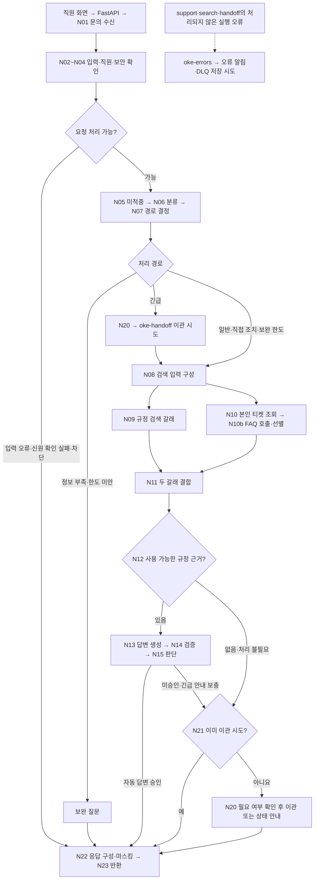

# 노코드 워크플로우 설계서 · 오케퐁

> 현재 main의 `workflows/*.json`을 기준으로 작성했다. 실제 노드 이름과 필드명은 JSON과 대조할 수 있도록 그대로 표기한다. 이 문서의 설정 설명은 저장소 기준이며, 배포 상태·시험 통과 여부는 [실행 결과서](EXECUTION-RESULT.md)의 근거로 확인한다.

**11/09 문서 마감 대조:** 기준 main `19087ef`의 5개 JSON은 117노드·143연결이다. 기존 VM 관측에서 활성 support·search·handoff·errors의 비교한 구현 필드는 일치했으나, Git checkout·전체 배포·수동 index 실행까지 일치·완료한 것은 아니다. 새 배포·시험은 하지 않았다. 아래 7절의 실제 Error 발화와 미해결 결함을 [필수 문서 점검표](FINAL-DOCUMENT-REVIEW.md)·실행 결과서와 함께 읽는다.

## 1. 업무 시나리오

오케퐁 직원이 웹에서 로그인해 IT 문제를 질문하면 FastAPI가 로그인한 직원의 신원과 입력을 확인해 `oke-support`를 호출한다. 워크플로우는 문의를 분류하고, 직원에게 허용된 규정과 필요한 본인 접수 기록을 찾는다. 근거가 충분하고 답변 검증을 통과하면 안내하고, 정보가 부족하면 보완 질문을 한다. 실제 조치가 필요하거나 근거·검증이 부족하면 IT팀 티켓으로 이관한다. 보안 사고는 긴급 접수를 먼저 시도한 뒤 가능한 안내를 보충한다. 직원의 문의와 관리자의 처리 결과는 FastAPI·PostgreSQL에서 관리한다.

| 문의 유형 | 처리 방식 | 근거 문서 | 긴급도 기준 |
| --- | --- | --- | --- |
| 계정·인증 | 절차 안내, 잠금 해제 등 직접 조치 요청은 이관 | `password-policy` | 일반 문의는 보통, 사고 징후는 별도 긴급 판단 |
| 네트워크·VPN | 규정·FAQ 안내, 모호한 질문은 보완 | `remote-work-vpn` | 분류 결과가 `high`이면 긴급 |
| 메일·문서·개인정보 | 허용된 문서만 검색·안내 | `email-and-documents`, `privacy` | 유출 등 사고 징후는 긴급 |
| 기기·회의실 | 자가 점검 안내, 수리·현장 조치는 이관 | `device-issue-return`, `meeting-room` | 분류 결과가 `high`이면 긴급 |
| 소프트웨어 | 사용·승인 절차 안내, 실제 설치 요청은 이관 | `software-usage` | 일반 문의는 보통 |
| 보안 사고 | 긴급 티켓·알림 우선, 가능한 초동 안내 | `security-incident`는 IT팀만 검색 가능 | 피싱 클릭·감염·유출 등규칙 또는 분류 결과가 긴급이면 `high` |

규정은 [knowledge/](../knowledge/README.md)의 8종, FAQ·직원·기존 티켓은 제공 데이터 API를 사용한다. 일반 직원은 `all`, IT팀은 `all,it` 문서 범위로 검색한다. 부서는 질문 속 주장을 사용하지 않고 직원 조회 결과로 결정한다. 웹 사용자의 신원은 FastAPI 세션으로 확인하며, 직접 웹훅 호출은 팀 키와 제공 직원 이름을 사용하는 별도 시험 경로다.

## 2. 전체 흐름

1. `N01 Support webhook`에서 인증된 문의를 받는다.
2. `N02 Normalize input`에서 길이·자료형·필수 입력을 검사하고, 직원 조회로 제공 직원과 부서를 확인한다.
3. `N04 Injection rules`에서 주입 패턴을 검사한다. 차단된 요청은 LLM을 호출하지 않고 응답한다.
4. 이전 응답 조회용 자리를 통과한다. 현재 `N05 Replay MOCK`은 정상 요청에 **미적중(miss)**을 반환하므로 실제 응답 캐시 조회 기능은 연결되지 않았다.
5. 분류 Agent와 `N07 Route triage`에서 문의 유형·긴급도·보완 항목·직접 조치 여부를 결정한다.
6. 정보가 부족하면 보완 질문을 반환한다. **보완 항목이 있고** `attempt >= 3`이면 이관한다. 세 번째 요청이라는 이유만으로 모든 문의를 이관하지 않는다.
7. 긴급 문의는 `N20 Prepare handoff`에서 이관을 먼저 시도한다. 이후 검색·본인 티켓 조회로 안내를 보충하되 같은 실행에서 다시 이관하지 않는다.
8. 일반 문의는 규정 검색과 필요한 본인 티켓 조회로 나눈다. FAQ 호출 결과는 티켓 조회 갈래에 합치고, 두 갈래를 `N11 Collect retrieval`과 `N11 Join retrieval`에서 모은다.
9. `N12 Evidence gate`에서 실연결 규정 점수 `0.40` 이상을 사용한다. 규정 근거가 있어야 FAQ를 보충 자료로 사용할 수 있다.
10. Writer가 답변 초안을 만들고 Verifier가 근거·정책을 검사한다. `N15 Decide answer`가 검증 결과와 출처를 확인해 자동 답변 여부를 결정한다.
11. 근거·검증이 부족하거나 직접 조치가 필요하면 `oke-handoff`에서 티켓·알림·필요 시 DLQ를 저장한다. 확인된 본인 티켓의 상태만 묻는 경우는 새 티켓 대신 상태를 안내할 수 있다.
12. `N22 Finalize P0-3`와 `N22 Output filter`가 공통 응답을 구성·마스킹하고 반환한다. 웹 요청의 저장·재조회는 FastAPI가 담당한다.

## 3. 워크플로우 흐름도



이 그림은 처리 흐름을 요약한다. 모든 실제 노드·분기·연결 입력 번호는 6절과 부록에서 확인한다. 규정 검색과 티켓 조회는 갈래를 나눈 구조이며, 현재 `executionOrder=v1` 설정만으로 동시 실행이나 시간 단축을 보장하지 않는다.

| 파일 | 웹훅·트리거 | 담당 | 노드 수 |
| --- | --- | --- | --- |
| [oke-support.json](../workflows/oke-support.json) | `POST /webhook/oke-support` | 임다혁 | 63 |
| [oke-index.json](../workflows/oke-index.json) | 수동 색인 시작 | 신유빈 | 3 |
| [oke-search.json](../workflows/oke-search.json) | `POST /webhook/oke-search` | 신유빈 | 7 |
| [oke-handoff.json](../workflows/oke-handoff.json) | `POST /webhook/oke-handoff` | 이원민 | 30 |
| [oke-errors.json](../workflows/oke-errors.json) | Error Trigger | 이원민 | 14 |

합계 **117노드·143연결**이다. 색인 워크플로우는 수동 실행하고, 오류 워크플로우는 Error Trigger로 시작하므로 웹훅은 세 개다.

## 4. 에이전트 역할·분기·병렬·반복

### 4.1 역할 카드

| 역할·노드 | 목적 | 입력 | 출력 JSON | Tool·모델 연결 | 하지 않는 것 |
| --- | --- | --- | --- | --- | --- |
| 분류 · `N06 Triage Agent` | 유형·긴급도·정보 부족·직접 조치 판단 | 질문·맥락·검증된 부서 | `type,urgency,missing,ticket_id,needs_action` | Tool 연결 없음, `N06 Triage model` | 답변 작성·권한 부여·티켓 생성 |
| 검색 · `N09 C03 HTTP` → `oke-search` | 허용된 규정 검색 | `query,access_levels,top_k` 등 | `ok,evidence,reason` | RAG HTTP 서비스·pgvector | 검색 전 권한 확대, 점수만으로 답변 승인 |
| 작성 · `N13 Writer Agent` | 규정·FAQ·본인 티켓 근거로 초안 작성 | 마스킹된 질문·맥락, `evidence,ticket_lookup` | `answerable,answer,used_sources,used_ticket` | Tool 연결 없음, `N13 Writer model` | 근거 밖 절차·기한·약속 생성 |
| 검증 · `N14 Verifier Agent` | 초안의 근거·정책 검사 | 질문·초안·규정/FAQ·본인 티켓 | `grounded,policy_ok,issues` | Tool 연결 없음, `N14 Verifier model` | 답변을 새로 작성 |
| 이관 · `oke-handoff` | 티켓·알림·실패 기록 저장 | C04 요청 | `ok,ticket,reason,alerted,dlq` | 저장 API HTTP 호출 | 저장 확인 없이 티켓 성공 선언 |

검색과 이관은 HTTP·Code 노드로 구현한 역할이며 LLM Agent로 세지 않는다. 실제 LLM Agent는 분류·작성·검증의 **3개**다. 각 Agent는 `maxIterations=1`, 연결 모델은 `gpt-4.1-mini`, `temperature=0`이다. 모델 Credential은 n8n에서 관리하고 업무 JSON에 넣지 않는다.

### 4.2 기준과 한계

| 구조 | 실제 위치 | 기준·최대 횟수 | 확인 근거·한계 |
| --- | --- | --- | --- |
| 분기 | `N07 Route triage` | 긴급 → 직접 조치 → 보완 한도 → 보완 질문 → 일반 검색 순서 | [분류·답변·이관 기록](../runs/support-v18-integration-20261107.json) |
| 근거 분기 | `N12 Evidence gate`, `N15 Decide answer` | 실연결 `0.40`, Mock `0.80`. 허용 근거·Writer·Verifier 승인 필요 | 선정 근거와 측정 범위는 [RAG 설계서](RAG-ARCHITECTURE.md#유사도-측정-및-040-기준) |
| 두 갈래 수집 | `N08 Build search input` → 검색 / 티켓·FAQ → `N11 Collect retrieval` | Merge는 append·입력 2개. 검색 결과 1개·티켓 결과 1개와 동일 `request_id` 확인 | 구조상 병렬이다. 순차 대비 단축 시간은 이 문서에서 측정·주장하지 않음 |
| 요청 사이 보완 반복 | `N07 Route triage` | 정보 부족 상태에서 `attempt >= 3`이면 이관 | [보완 질문·한도 기록](../runs/support-v18-integration-20261107.json). 새 차례는 새 요청 ID와 증가한 attempt/context 사용 |
| 티켓 저장 재시도 | `H05 Retry Gate` → 대기·예산 재확인 → 재시도 노드 | 최초 1회+재시도 최대 1회. 401·403은 재시도하지 않음 | [중복 방지 기록](../runs/live-integration-qa-20261107T113546Z.json)은 멱등성 근거이며 모든 재시도 조건의 시험 근거는 아님 |
| 검색 재시도 | `N09 C03 HTTP` | 현재 저점수 질문을 재작성해 재검색하는 반복은 없음 | 낮은 근거 점수는 안전 이관 또는 본인 티켓 상태 안내로 처리 |

`N14 Parse verifier`에는 검증 결과를 보정하는 코드도 있다. `grounded=false`인 경우, issues의 인용구가 근거와 정규화된 2글자 조각 기준 80% 이상 일치하면 해당 issue를 제거한다. 남은 issue가 없으면 `grounded=true`로 바꾼다. 이는 의미 일치를 완전히 증명하는 검사가 아니므로, 모든 허위 답변을 차단한다고 주장하지 않는다. 최종 승인은 `policy_ok=true`, 빈 issues, 유효한 작성·검증 결과와 규정 출처까지 요구한다.

[원본 노드 합성 검사](../runs/isolated-node-fault-check-20261109.json)에서는 원문의 90일을 91일로 바꾼 초안·거절 verdict가 보정 후 승인되는 결함을 재현했다. 미수정이며, 위 조건들이 숫자 오류까지 확실히 차단한다는 뜻이 아니다. 운영 서비스에 같은 오답을 보내 확인한 결과와 구분한다.

### 4.3 실연결·Mock·기존 티켓 조회의 구분

- `SERVICE_MODE=app` 또는 `practice`이면 본체의 `integration_mode=real`이다. `app`의 이관 저장 대상은 FastAPI, `practice`는 data-api다. `mock`만 모의 직원·분류·검색·작성·검증·이관 결과를 사용한다.
- 직원 목록·FAQ·기존 티켓 조회는 `app` 모드에서도 data-api를 호출한다. 새 서비스 문의·티켓과 직원 재조회는 FastAPI·업무 DB에서 처리한다.
- `N05 Replay MOCK`은 현재 정상 요청에 항상 `404 / state:miss`를 공급한다. 파서에 hit·forbidden·conflict 처리 코드가 있어도 이 JSON에서 해당 실제 조회는 연결되지 않았다. FastAPI의 동일 요청 처리·저장과 티켓 API의 `key=request_id` 중복 방지는 별도 기능이다.
- FAQ HTTP 노드는 그래프에 남아 있어 일반 답변 대상이 아니어도 빈 검색어로 호출될 수 있다. `N10b Match FAQ`가 일반 `pending` 요청만 최대 2건 채택하며 긴급·보완·이관 요청에서는 결과를 사용하지 않는다. FAQ만으로 자동 답변하지 않고 최종 `sources`에는 점수가 있는 규정만 남긴다.
- 긴급 보안 문의는 티켓 접수를 우선한다. 검증된 `security-incident` 근거로 안내를 보충할 수 있고, 그 근거가 없으면 최종 Code 노드가 고정된 사내망 분리 안내와 확인된 본인 티켓 상태를 제공한다. 이 고정 안내를 RAG 근거 답변으로 표시하지 않는다.

## 5. 외부 연동 노드

브라우저는 FastAPI만 호출한다. 직원·관리자 권한은 서버 세션으로 확인한다. 워크플로우 웹훅은 `X-Team-Key`, app 저장 API는 `X-Api-Key`, 검색·색인 서비스는 Header Auth Credential을 사용한다. 실제 값은 저장소에 넣지 않는다.

| 노드·경계 | 대상·방식 | 인증 | 입력 → 출력 | 시간 제한·실패 처리 |
| --- | --- | --- | --- | --- |
| `N01 Support webhook`, `검색 요청 수신`, `H01 Handoff Webhook` | support·search·handoff 웹훅 | n8n Header Auth | S1 / S10 / S7 → 공통 응답 / C03 / C04 | 인증은 본문 처리 전 확인 |
| `N03 Get employees HTTP` | data-api `GET /employees` | JSON 설정상 없음, 내부 서비스 경계 | 직원 목록 → 검증된 이름·부서 | 2,000ms, 불일치·조회 실패 구분 |
| `N09 C03 HTTP` | n8n `POST /webhook/oke-search` | Header Auth Credential | S4 → S5 | 4,000ms, 실패는 검색 불가 처리 |
| `실제 검색 서비스 호출` | `SEARCH_SERVICE_URL` | Header Auth Credential | S10 → S5 | 4,000ms, 400·401·403 구분, 기타 실패 503 |
| `N10 Own ticket HTTP` | data-api `GET /tickets/{id}?requester=…` | JSON 설정상 없음, requester로 본인 확인 | 조회 요청 → 티켓·상태 | 2,000ms, 403·404·장애 구분 |
| `N10b FAQ HTTP` | data-api `GET /faq?q=…` | JSON 설정상 없음 | 질문 → FAQ results | 2,000ms, 실패하면 규정 근거만 사용 |
| `N20 C04 HTTP` | n8n `POST /webhook/oke-handoff` | Header Auth Credential | S7 → S8 | 5,000ms, 유효한 결과만 반영 |
| `H04 Create Ticket App` / `H04 Retry Ticket App` | FastAPI `POST /tickets` | Header Auth Credential, `X-Api-Key` | `key,title,requester,category,priority` → 티켓 ID·중복 여부 | 호출당 1,000ms, 예산 내 재시도 1회 |
| `H08 Store Alert App` / `H09 Store DLQ App` | FastAPI `POST /alerts`, `POST /dlq` | Header Auth Credential, `X-Api-Key` | S11 → 저장 확인 | 각각 600ms, 티켓 결과 유지·실패 표시 |
| handoff의 `Practice` HTTP 노드 | 위 저장 API를 data-api에 호출 | JSON 설정상 없음 | 같은 업무 계약 | app/practice 중 한 저장 대상만 선택 |
| `E03 Store Alert App` / `E04 Store DLQ App` | FastAPI 알림·DLQ API | Header Auth Credential, `X-Api-Key` | S12에서 만든 안전한 저장 요청 | 각각 600ms, 저장 실패를 다시 던지지 않음 |
| errors의 `Practice` HTTP 노드 | data-api 알림·DLQ API | JSON 설정상 없음 | 동일한 안전 요약 | app/practice 대상 구분 |
| `실제 색인 서비스 호출` | `POST INDEX_SERVICE_URL` | Header Auth Credential | 본문 없는 색인 요청 → S9 | 180,000ms, 결과 검증 실패 시 `index_unavailable` |
| 분류·작성·검증 모델 3개 | OpenAI `gpt-4.1-mini` | OpenAI Credential | 역할별 입력 → JSON 문자열 | Agent 오류를 후속 Code에서 검사. JSON에 모델 호출 제한 시간이 별도로 설정돼 있지는 않음 |

티켓 저장의 내부 예산은 `WONMIN_HANDOFF_BUDGET_MS` 기본 4,000ms(허용 1,500~4,000ms), 대기는 `WONMIN_RETRY_WAIT_MS` 기본 200ms(허용 0~200ms)다. 429에서 `Retry-After`가 없으면 기본 대기를 적용한다. 헤더가 있으면 정수 초 또는 GMT 날짜를 검사하고, 유효하며 대기가 200ms 이내일 때만 재시도 후보로 삼는다. 5xx·통신 오류도 재시도 후보이며, 모두 남은 예산을 만족해야 한다. 재시도 직전에 남은 시간을 다시 확인한다. 이 값은 개별 호출·내부 예산이며 전체 문의가 반드시 그 시간 안에 끝난다는 뜻은 아니다.

## 6. 노드 간 데이터 형식과 연결선

### 6.1 읽는 방법

연결 표의 S 번호는 아래 데이터 형식을 가리킨다. 내부 item은 이전 단계의 문맥을 포함할 수 있으므로 필수·선택 필드는 해당 단계에서 필요한 값 기준이다. HTTP Request 노드는 응답의 `statusCode,body`를 받고, Capture 노드가 원래 문맥에 필요한 값을 붙인다. `main[0]`·`main[1]`은 출력 번호이며, If 노드에서 각각 조건 참·거짓이다. Merge의 입력 번호도 별도로 적는다. 모델의 `ai_languageModel` 연결은 업무 JSON 전달선이 아니다.

아래 JSON은 **계약 설명용 예시**다. 실제 실행에서 얻은 응답·시간·저장 결과는 6.4절의 보고서에 연결한다. 문서에 없는 실제 노드별 입력·출력을 측정한 것처럼 만들지 않는다.

### 6.2 데이터 형식 목록

| ID | 필수 필드·구조 | 선택 필드·변환 |
| --- | --- | --- |
| S1 · 문의 요청 | `request_id,user,question` | `channel,attempt,context`. request_id 1~64자, 질문 공백 제거 후 1~500자, attempt 정수 ≥1·기본 1, context 문자열 ≤2,000자·기본 빈 문자열 |
| S2 · 내부 문의 문맥 | `request_id,user,clean_question,context,attempt,codes,employee_lookup,integration_mode` | 조회 후 `dept,access_levels`, 이후 `blocked,replay_state,triage,decision,search,ticket_lookup,handoff` 등 추가. 검증 결과와 실행 모드 유지 |
| S3 · 분류 JSON | `type,urgency,missing,ticket_id,needs_action` **5개 키 모두 필수** | ticket_id는 문자열 또는 null, reason은 분류 응답 키가 아님. 유형 7종, urgency normal/high. 없는 접수 ID를 만들면 거절 |
| S4 · 검색 요청 | `request_id,query,type,access_levels,top_k` | 일반 `["all"]`, IT `["all","it"]`, top_k=3. 질문·맥락을 합쳐 query 생성 |
| S5 · 검색 응답 | `ok,evidence,reason`. 각 근거는 `doc,section,text,score` | 정상 근거는 reason=null, 빈 근거는 no_evidence. C03은 최대 3개 반환. 실패는 빈 근거·사유와 상태 코드로 전달 |
| S6 · 기존 티켓·FAQ | 티켓 정규화: `branch,ticket_lookup,mask_count`. FAQ 채택 시 `faq_state,faq_evidence` | 티켓 state는 skipped/ok/not_found/forbidden/unavailable. FAQ 근거는 `doc,section,text`이며 점수를 만들지 않음 |
| S7 · C04 이관 요청 | `request_id,requester,title,category,priority,reason` | evidence_summary 문자열을 받을 수 있으나 저장 전에 버림. 현재 본체는 필수 6필드만 구성하며 ticket_id를 C04로 보내지 않음 |
| S8 · 이관·최종 응답 | C04: `ok,ticket,reason,alerted,dlq`. 최종: `request_id,route,answer,sources,ticket,agents,security` | ticket은 null 또는 `ticket_id,priority,duplicate`. 최종 sources는 `doc,section,score`, agents는 문자열 배열, security는 `blocked_by,reason,masked`. 최종 reason은 선택 |
| S9 · 색인 결과 | 성공 판정에 HTTP 200, `ok=true`, `counts.failed=0`, `counts.rejected=0`, documents 8개 필요 | 반환은 `mode,counts,documents`. 문서는 doc_key/status/chunk_count/reason으로 축약. indexed=8을 별도 조건으로 검사하지 않음 |
| S10 · 검색 웹훅 내부 | 검사 후 `valid,request`, HTTP 결과 검사 후 `status,body` | request=S4, body=S5. 부적합 요청은 400 invalid_request |
| S11 · 저장 요청·결과 | 티켓 `key,title,requester,category,priority`. 알림 `workflow,node,message,severity`. DLQ `request_id,workflow,node,reason,safe_payload` | 알림 ticket_id/event_key, DLQ execution_ref는 선택. 티켓은 신규 201·duplicate=false 또는 기존 200·duplicate=true만 성공 인정 |
| S12 · 예상 밖 오류 | 입력은 Error Trigger의 workflow/execution/trigger 객체. 안전 요약 `skip,request_id,execution_ref,source_workflow,source_node,error_kind` | request_id는 추정하지 않고 null. 실행 ID는 1~20자리 숫자 문자열만 보존. 알려지지 않은 이름은 unknown. 최종 `outcome,alerted,dlq` 추가 |
| S13 · 모델 연결 | 역할별 `gpt-4.1-mini` 모델 설정, temperature=0 | 모델 Credential 참조이며 HTTP 업무 요청 JSON이 아님 |
| S14 · 작성 단계 | writer_input: `question,context,urgency,evidence,ticket_lookup`. Agent JSON: `answerable,answer,used_sources,used_ticket` | 파서가 `writer_valid,draft,verification_failure` 등 추가. used_sources는 받은 근거의 doc/section만 허용 |
| S15 · 검증 단계 | verifier_input: `question,context,draft,evidence,ticket_lookup`. Agent JSON: `grounded,policy_ok,issues` | 파서가 `verifier_valid,verdict,verifier_dropped_issues` 등 추가. 최종 판단은 출처·모드까지 확인 |

`trigger_error_workflow`는 본체 JSON에서 읽는 별도의 시험 입력이다. `N13 Prepare writer` 또는 `N20 Prepare handoff` 도달 시 의도한 오류를 던진다. 두 throw에는 app 운영 모드를 제외하는 조건이 없어, 인증된 직접 웹훅에서는 app에서도 발동한다. 웹의 [AskRequest](../apps/backend/app/schemas/support.py)에는 이 필드가 없고 일반 문의 필수 계약도 아니다. 실행은 승인된 시험 범위에서만 한다. 11/09 승인 시험의 실제 발화·복구는 7.2절에 연결했다. 코드 제거·격리 조치는 아직 하지 않았다.

최종 route는 `자동 답변`·`보완 질문`·`담당자 이관`·`권한 없음`·`차단`이다. `timings`는 백엔드 스키마에서 선택 필드이며 현재 본체의 최종 응답 생성 코드에는 없다. 알림·DLQ 저장 여부는 C04에 있고 최종 공통 응답에는 그대로 모두 노출되지 않는다.

### 6.3 계약 예시

**S1·S2·S3: 요청, 직원 확인 후 문맥, 분류 출력**

```json
{"request_id":"r-001","user":"박서연","question":"VPN이 계속 끊겨요. 어떻게 해야 하나요?","channel":"web","attempt":1,"context":"Windows 11"}
```

```json
{"request_id":"r-001","user":"박서연","clean_question":"VPN이 계속 끊겨요. 어떻게 해야 하나요?","context":"Windows 11","attempt":1,"codes":[],"employee_lookup":"ok","integration_mode":"real","dept":"재무팀","access_levels":["all"],"blocked":false}
```

```json
{"type":"network","urgency":"normal","missing":[],"ticket_id":null,"needs_action":false}
```

**S4·S5·S10: 검색 요청과 정상·장애 응답**

```json
{"request_id":"r-001","query":"VPN이 계속 끊겨요. 어떻게 해야 하나요? Windows 11","type":"network","access_levels":["all"],"top_k":3}
```

```json
{"ok":true,"evidence":[{"doc":"remote-work-vpn","section":"연결 점검","text":"계약 설명을 위한 근거 텍스트 예시","score":0.62}],"reason":null}
```

```json
{"ok":false,"evidence":[],"reason":"search_unavailable"}
```

score 0.62와 근거 텍스트는 형식 예시이며 실측·규정 인용이 아니다. 검색 워크플로우 내부는 위 본문을 `{"status":200,"body":…}` 또는 `{"status":503,"body":…}`로 감싼 뒤 응답한다.

**S6: 본인 티켓·FAQ 정규화 결과**

```json
{"branch":"ticket","ticket_lookup":{"state":"ok","data":{"ticket_id":"T-1002","status":"open","note":"","title":"VPN 인증서 갱신","updated":null},"phone_hint":null},"mask_count":0,"faq_state":"found","faq_evidence":[{"doc":"faq","section":"FAQ-003 VPN 접속 오류","text":"계약 설명용 FAQ 문장"}]}
```

**S7·S8: 이관 요청·응답과 최종 자동 답변**

```json
{"request_id":"r-001","requester":"박서연","title":"네트워크 문의","category":"network","priority":"normal","reason":"low_confidence"}
```

```json
{"ok":true,"ticket":{"ticket_id":"T-2030","priority":"normal","duplicate":false},"reason":null,"alerted":true,"dlq":false}
```

```json
{"request_id":"r-001","route":"자동 답변","answer":"계약 형식을 설명하기 위한 예시 답변입니다.","sources":[{"doc":"remote-work-vpn","section":"연결 점검","score":0.62}],"ticket":null,"agents":["triage","retriever","writer","verifier"],"security":{"blocked_by":"","reason":"","masked":0}}
```

**S9: 색인 실패 결과**

```json
{"ok":false,"reason":"index_unavailable"}
```

성공 시에는 8개 문서의 결과가 필요하므로 한 문서만 있는 축약 예시를 성공 판정용 입력으로 사용하지 않는다.

**S11: 티켓·알림·DLQ 저장 요청**

```json
{"key":"r-001","title":"네트워크 문의","requester":"박서연","category":"network","priority":"normal"}
```

```json
{"workflow":"oke-handoff","node":"H06 Keep Ticket","message":"담당자 이관 티켓이 접수되었습니다.","severity":"normal","ticket_id":"T-2030","event_key":"r-001:ticket-created"}
```

```json
{"request_id":"r-001","workflow":"oke-handoff","node":"H04 Create Ticket","reason":"tickets_down","safe_payload":{"stage":"ticket","priority":"normal","attempts":2,"last_status":503}}
```

**S12: 오류 이벤트와 양쪽 저장 성공 후 내부 결과**

```json
{"workflow":{"name":"oke-support","id":"okeSupportFlow01"},"execution":{"id":"42","lastNodeExecuted":"N13 Writer Agent","error":{"name":"NodeApiError","message":"[가림]"}}}
```

```json
{"workflow":"oke-errors","outcome":"success","request_id":null,"execution_ref":"42","source_workflow":"oke-support","source_node":"N13 Writer Agent","error_kind":"execution_error","alerted":true,"dlq":true}
```

**S14·S15: 작성·검증 Agent의 JSON 출력**

```json
{"answerable":true,"answer":"계약 설명용 초안입니다.","used_sources":[{"doc":"remote-work-vpn","section":"연결 점검"}],"used_ticket":false}
```

```json
{"grounded":true,"policy_ok":true,"issues":[]}
```

### 6.4 실제 실행 근거

| 경계·확인 내용 | 실제 보고서 | 범위 |
| --- | --- | --- |
| 직원 로그인 → 문의 → 관리자 처리 → 직원 재조회 | [서비스 예시 검사](../runs/service-examples-20261108T101612Z.json) | API 경로 검사. 브라우저 클릭 시연과 구분 |
| 직원·관리자 권한·DB 저장 | [업무 API·DB 검사](../runs/be-db-integration-20261107.json) | 세션·RBAC·문의 저장 |
| C03 권한별 규정 검색 | [실검색 검사](../runs/rag-search-eval-20261107.json) | 일반·IT 문서 접근 범위와 반환 근거 |
| C04 같은 요청 중복 방지 | [재시험 기록](../runs/live-integration-qa-20261107T113546Z.json) | 동일 요청의 티켓·알림 중복 방지 |
| app 티켓 저장 실패·해제 후 동일 ID 재접수 | [장애·복구 검사](../runs/app-ticket-fault-20261108T110410Z.json) | 요청별 장애, 문의·알림·DLQ 및 재접수. DLQ 자동 재처리 시험은 아님 |

11/09 추가 83요청의 반복·지연·Error·벤치와 실패는 [검토 집계](../runs/day82-reviewed-results-20261109.json), [최신 커버리지](EXECUTION-RESULT.md#21-공통-14유형과-관련-실행-근거)에 연결했다. 이 보고서들은 해당 경계의 실측 근거다. 모든 내부 연결선의 실제 item 전체를 수집했다는 뜻은 아니며, 공식 공통 14유형 전체 재현 완료로 합산하지 않는다.

### 6.5 연결선 전체 목록

아래 표는 현재 JSON의 모든 연결을 포함한다. 필수·선택 필드는 S 형식 목록, 예시는 6.3절을 함께 읽는다. 출력 변환은 보내는 노드 기준이고, 받는 노드의 입력 번호를 표시한다. 긴 목록은 파일별로 펼쳐 볼 수 있다.

<details>
<summary>oke-support.json · 79연결</summary>

| 보내는 노드 | 출력 | 받는 노드·입력 번호 | 데이터 형식 | 변환·분기 |
| --- | --- | --- | --- | --- |
| `N01 Support webhook` | `main[0]` | `N02 Normalize input` · 입력 0 | S1 | 인증된 요청의 body 전달 |
| `N02 Normalize input` | `main[0]` | `N03 Employee mode` · 입력 0 | S2 | 입력 형식·길이 검사, 기본값·codes·실행 모드 구성 |
| `N03 Validate employee MOCK` | `main[0]` | `N04 Injection rules` · 입력 0 | S2 | mock 모드에서만 고정 직원 확인, 그 외 미확인 상태 유지 |
| `N04 Injection rules` | `main[0]` | `N05 Replay MOCK` · 입력 0 | S2 | 주입 규칙에 따른 blocked 상태를 더해 replay 자리로 전달 |
| `N05 Triage gate` | `main[0]` | `N05 Triage mode` · 입력 0 | S2 | 조건 `$json.codes.length === 0 && $json.employee_lookup === 'ok' && $json.blocked !== true`이 참인 문맥 전달 |
| `N05 Triage gate` | `main[1]` | `N22 Finalize P0-3` · 입력 0 | S2 | 조건 `$json.codes.length === 0 && $json.employee_lookup === 'ok' && $json.blocked !== true`이 거짓인 문맥 전달 |
| `N05 Triage mode` | `main[0]` | `N06 Triage MOCK` · 입력 0 | S2 | 조건 `$json.triage_mode === 'mock'`이 참인 문맥 전달 |
| `N05 Triage mode` | `main[1]` | `N06 Triage Agent` · 입력 0 | S2 | 조건 `$json.triage_mode === 'mock'`이 거짓인 문맥 전달 |
| `N06 Triage MOCK` | `main[0]` | `N06 Parse triage` · 입력 0 | S2/S3 | 모의 분류 JSON 문자열 반환 |
| `N06 Triage Agent` | `main[0]` | `N06 Parse triage` · 입력 0 | S2/S3 | 역할별 JSON 문자열 또는 Agent 오류 전달 |
| `N06 Triage model` | `ai_languageModel[0]` | `N06 Triage Agent` · 입력 0 | S13 | 해당 Agent에 모델 설정 공급. 업무 JSON 전달 없음 |
| `N06 Parse triage` | `main[0]` | `N07 Route triage` · 입력 0 | S2/S3 | 분류 5필드·유형·접수 ID 검사 후 triage 또는 오류 구성 |
| `N07 Route triage` | `main[0]` | `N07 Route urgent` · 입력 0 | S2/S3 | 긴급 규칙·분류 결과·직접 조치·보완 한도로 decision 구성 |
| `N20 Prepare handoff` | `main[0]` | `N20 Handoff gate` · 입력 0 | S2/S7/S8 | 보완·자동 답변·본인 상태·권한 거절은 이관 생략, 필요 시 필수 6필드 구성 |
| `N20 Handoff gate` | `main[0]` | `N20 Handoff mode` · 입력 0 | S2/S7/S8 | 조건 `$json.handoff_needed === true`이 참인 문맥 전달 |
| `N20 Handoff gate` | `main[1]` | `N22 Finalize P0-3` · 입력 0 | S2/S7/S8 | 조건 `$json.handoff_needed === true`이 거짓인 문맥 전달 |
| `N20 Mock C04` | `main[0]` | `N20 Map handoff` · 입력 0 | S2/S7/S8 | 실제 저장 없는 모의 C04 결과 구성 |
| `N20 Map handoff` | `main[0]` | `N20 After handoff` · 입력 0 | S2/S7/S8 | 티켓·알림·DLQ 응답 검증 후 handoff 상태·handoff_done 구성 |
| `N22 Finalize P0-3` | `main[0]` | `N22 Output filter` · 입력 0 | S8 | status_code·공통 response 구성. 오류·차단·보완·답변·상태·이관 결과 구분 |
| `N08 Build search input` | `main[0]` | `N09 Search mode` · 입력 0 | S2/S4 | 검증된 부서로 search_request·권한 구성. 검색과 티켓 갈래로 같은 문맥 전달 |
| `N08 Build search input` | `main[0]` | `N10 Build ticket lookup` · 입력 0 | S2/S4 | 검증된 부서로 search_request·권한 구성. 검색과 티켓 갈래로 같은 문맥 전달 |
| `N09 Mock C03` | `main[0]` | `N09 Normalize search` · 입력 0 | S4/S5/S6 | 모의 검색 또는 검색 생략 결과 제공 |
| `N09 Normalize search` | `main[0]` | `N11 Collect retrieval` · 입력 0 | S4/S5/S6 | 검색 응답 text·score 검사·마스킹, branch=search와 상태 구성 |
| `N10 Build ticket lookup` | `main[0]` | `N10 Ticket mode` · 입력 0 | S4/S5/S6 | 접수 ID·조회 필요 여부 검사, 검증된 직원 이름으로 requester 구성 |
| `N10 Mock ticket` | `main[0]` | `N10 Normalize ticket` · 입력 0 | S4/S5/S6 | 모의 또는 생략된 조회 결과 제공 |
| `N10 Normalize ticket` | `main[0]` | `N10b FAQ HTTP` · 입력 0 | S4/S5/S6 | 본인·거절·없음·장애 정규화와 연락처 마스킹, branch=ticket 구성 |
| `N11 Collect retrieval` | `main[0]` | `N11 Join retrieval` · 입력 0 | S4/S5/S6 | 두 입력 item을 append하여 후속 Code에 전달 |
| `N11 Join retrieval` | `main[0]` | `N12 Evidence gate` · 입력 0 | S4/S5/S6 | 검색 1개·티켓 1개·동일 요청 ID 확인, 검색·티켓·FAQ 결합 또는 merge_mismatch 구성 |
| `N12 Evidence gate` | `main[0]` | `N12 Route evidence` · 입력 0 | S2/S5 | 근거 점수·조회 상태를 확인해 write·이관·상태 안내 등으로 판정 |
| `N12 Route evidence` | `main[0]` | `N13 Prepare writer` · 입력 0 | S2/S5 | 조건 `$json.retrieval_decision === 'write'`이 참인 문맥 전달 |
| `N12 Route evidence` | `main[1]` | `N21 Already handed off` · 입력 0 | S2/S5 | 조건 `$json.retrieval_decision === 'write'`이 거짓인 문맥 전달 |
| `N13 Prepare writer` | `main[0]` | `N13 Writer mode` · 입력 0 | S2/S14 | 질문·맥락 마스킹, 근거·본인 티켓으로 writer_input 구성 |
| `N13 Writer mode` | `main[0]` | `N13 Writer MOCK` · 입력 0 | S2/S14 | 조건 `$json.writer_mode === 'mock'`이 참인 문맥 전달 |
| `N13 Writer mode` | `main[1]` | `N13 Writer Agent` · 입력 0 | S2/S14 | 조건 `$json.writer_mode === 'mock'`이 거짓인 문맥 전달 |
| `N13 Writer MOCK` | `main[0]` | `N13 Parse writer` · 입력 0 | S2/S14 | 모의 작성 JSON 반환 |
| `N13 Writer Agent` | `main[0]` | `N13 Parse writer` · 입력 0 | S2/S14 | 역할별 JSON 문자열 또는 Agent 오류 전달 |
| `N13 Writer model` | `ai_languageModel[0]` | `N13 Writer Agent` · 입력 0 | S13 | 해당 Agent에 모델 설정 공급. 업무 JSON 전달 없음 |
| `N13 Parse writer` | `main[0]` | `N13 Writer valid` · 입력 0 | S2/S14 | 답변 가능·출처·본인 티켓 사용 검사 후 draft·writer_valid 구성 |
| `N13 Writer valid` | `main[0]` | `N14 Prepare verifier` · 입력 0 | S2/S14 | 조건 `$json.writer_valid === true`이 참인 문맥 전달 |
| `N13 Writer valid` | `main[1]` | `N21 Already handed off` · 입력 0 | S2/S14 | 조건 `$json.writer_valid === true`이 거짓인 문맥 전달 |
| `N14 Prepare verifier` | `main[0]` | `N14 Verifier mode` · 입력 0 | S2/S15 | 초안·근거의 policy/faq 구분·티켓을 verifier_input으로 구성 |
| `N14 Verifier mode` | `main[0]` | `N14 Verifier MOCK` · 입력 0 | S2/S15 | 조건 `$json.verifier_mode === 'mock'`이 참인 문맥 전달 |
| `N14 Verifier mode` | `main[1]` | `N14 Verifier Agent` · 입력 0 | S2/S15 | 조건 `$json.verifier_mode === 'mock'`이 거짓인 문맥 전달 |
| `N14 Verifier MOCK` | `main[0]` | `N14 Parse verifier` · 입력 0 | S2/S15 | 모의 검증 JSON 반환 |
| `N14 Verifier Agent` | `main[0]` | `N14 Parse verifier` · 입력 0 | S2/S15 | 역할별 JSON 문자열 또는 Agent 오류 전달 |
| `N14 Verifier model` | `ai_languageModel[0]` | `N14 Verifier Agent` · 입력 0 | S13 | 해당 Agent에 모델 설정 공급. 업무 JSON 전달 없음 |
| `N14 Parse verifier` | `main[0]` | `N15 Decide answer` · 입력 0 | S2/S15 | 검증 형식 검사와 인용구 일치 보정 후 verdict 구성 |
| `N15 Decide answer` | `main[0]` | `N15 Route answer` · 입력 0 | S2/S14/S15 | 작성·검증·모드·규정 출처 확인, 자동 답변 또는 긴급 안내 보충 결정 |
| `N15 Route answer` | `main[0]` | `N22 Finalize P0-3` · 입력 0 | S2/S14/S15 | 조건 `$json.decision === 'auto_answer'`이 참인 문맥 전달 |
| `N15 Route answer` | `main[1]` | `N21 Already handed off` · 입력 0 | S2/S14/S15 | 조건 `$json.decision === 'auto_answer'`이 거짓인 문맥 전달 |
| `N22 Output filter` | `main[0]` | `N23 Respond` · 입력 0 | S8 | 답변·출처 식별 필드 마스킹, security.masked 합산 |
| `N07 Route urgent` | `main[0]` | `N20 Prepare handoff` · 입력 0 | S2/S3 | 조건 `$json.urgent_pre_handoff === true`이 참인 문맥 전달 |
| `N07 Route urgent` | `main[1]` | `N08 Build search input` · 입력 0 | S2/S3 | 조건 `$json.urgent_pre_handoff === true`이 거짓인 문맥 전달 |
| `N20 After handoff` | `main[0]` | `N08 Build search input` · 입력 0 | S2/S7/S8 | 조건 `$json.urgent_pre_handoff === true && $json.handoff_done === true`이 참인 문맥 전달 |
| `N20 After handoff` | `main[1]` | `N22 Finalize P0-3` · 입력 0 | S2/S7/S8 | 조건 `$json.urgent_pre_handoff === true && $json.handoff_done === true`이 거짓인 문맥 전달 |
| `N21 Already handed off` | `main[0]` | `N22 Finalize P0-3` · 입력 0 | S2/S7/S8 | 조건 `$json.handoff_done === true`이 참인 문맥 전달 |
| `N21 Already handed off` | `main[1]` | `N20 Prepare handoff` · 입력 0 | S2/S7/S8 | 조건 `$json.handoff_done === true`이 거짓인 문맥 전달 |
| `N05 Replay MOCK` | `main[0]` | `N05 Parse replay` · 입력 0 | S2 | 정상 요청에 고정 미적중 결과 제공. 실제 저장 응답 조회 없음 |
| `N05 Parse replay` | `main[0]` | `N05 Route replay` · 입력 0 | S2 | 현재는 miss 또는 skipped 정규화. 실제 적중 처리에는 조회 연결이 필요 |
| `N05 Route replay` | `main[0]` | `N22 Finalize P0-3` · 입력 0 | S2 | 조건 `$json.replay_terminal === true`이 참인 문맥 전달 |
| `N05 Route replay` | `main[1]` | `N05 Triage gate` · 입력 0 | S2 | 조건 `$json.replay_terminal === true`이 거짓인 문맥 전달 |
| `N03 Employee mode` | `main[0]` | `N03 Get employees HTTP` · 입력 0 | S2 | 조건 `$json.codes.length === 0 && $json.integration_mode === 'real'`이 참인 문맥 전달 |
| `N03 Employee mode` | `main[1]` | `N03 Validate employee MOCK` · 입력 0 | S2 | 조건 `$json.codes.length === 0 && $json.integration_mode === 'real'`이 거짓인 문맥 전달 |
| `N03 Get employees HTTP` | `main[0]` | `N03 Capture employee` · 입력 0 | S2 | HTTP 응답 `statusCode,body` 또는 통신 오류 전달 |
| `N03 Capture employee` | `main[0]` | `N04 Injection rules` · 입력 0 | S2 | 원래 요청 복원, 제공 직원·부서 검사 후 employee_lookup·권한 범위 구성 |
| `N09 Search mode` | `main[0]` | `N09 C03 HTTP` · 입력 0 | S4/S5/S6 | 조건 `$json.integration_mode === 'real' && $json.search_needed === true`이 참인 문맥 전달 |
| `N09 Search mode` | `main[1]` | `N09 Mock C03` · 입력 0 | S4/S5/S6 | 조건 `$json.integration_mode === 'real' && $json.search_needed === true`이 거짓인 문맥 전달 |
| `N09 C03 HTTP` | `main[0]` | `N09 Capture C03` · 입력 0 | S4/S5/S6 | HTTP 응답 `statusCode,body` 또는 통신 오류 전달 |
| `N09 Capture C03` | `main[0]` | `N09 Normalize search` · 입력 0 | S4/S5/S6 | 원래 문맥에 search_http_status·search_raw 합침 |
| `N10 Ticket mode` | `main[0]` | `N10 Own ticket HTTP` · 입력 0 | S4/S5/S6 | 조건 `$json.integration_mode === 'real' && $json.lookup_needed === true`이 참인 문맥 전달 |
| `N10 Ticket mode` | `main[1]` | `N10 Mock ticket` · 입력 0 | S4/S5/S6 | 조건 `$json.integration_mode === 'real' && $json.lookup_needed === true`이 거짓인 문맥 전달 |
| `N10 Own ticket HTTP` | `main[0]` | `N10 Capture ticket` · 입력 0 | S4/S5/S6 | HTTP 응답 `statusCode,body` 또는 통신 오류 전달 |
| `N10 Capture ticket` | `main[0]` | `N10 Normalize ticket` · 입력 0 | S4/S5/S6 | 티켓 조회 전 문맥에 lookup_http_status·lookup_raw 합침 |
| `N20 Handoff mode` | `main[0]` | `N20 C04 HTTP` · 입력 0 | S2/S7/S8 | 조건 `$json.integration_mode === 'real'`이 참인 문맥 전달 |
| `N20 Handoff mode` | `main[1]` | `N20 Mock C04` · 입력 0 | S2/S7/S8 | 조건 `$json.integration_mode === 'real'`이 거짓인 문맥 전달 |
| `N20 C04 HTTP` | `main[0]` | `N20 Capture C04` · 입력 0 | S2/S7/S8 | HTTP 응답 `statusCode,body` 또는 통신 오류 전달 |
| `N20 Capture C04` | `main[0]` | `N20 Map handoff` · 입력 0 | S2/S7/S8 | 원래 이관 문맥에 HTTP 결과 합침 |
| `N10b FAQ HTTP` | `main[0]` | `N10b Match FAQ` · 입력 0 | S4/S5/S6 | HTTP 응답 `statusCode,body` 또는 통신 오류 전달; 대상이 아니면 빈 검색어 호출 가능 |
| `N10b Match FAQ` | `main[0]` | `N11 Collect retrieval` · 입력 1 | S4/S5/S6 | 일반 pending에서만 FAQ 최대 2개 채택, 티켓 갈래 문맥 복원 |

</details>

<details>
<summary>oke-index.json · 2연결</summary>

| 보내는 노드 | 출력 | 받는 노드·입력 번호 | 데이터 형식 | 변환·분기 |
| --- | --- | --- | --- | --- |
| `수동 색인 시작` | `main[0]` | `실제 색인 서비스 호출` · 입력 0 | S9 | 수동 시작 item 전달 |
| `실제 색인 서비스 호출` | `main[0]` | `색인 결과 검증` · 입력 0 | S9 | HTTP 응답 `statusCode,body` 또는 통신 오류 전달 |

</details>

<details>
<summary>oke-search.json · 7연결</summary>

| 보내는 노드 | 출력 | 받는 노드·입력 번호 | 데이터 형식 | 변환·분기 |
| --- | --- | --- | --- | --- |
| `검색 요청 수신` | `main[0]` | `요청 형식 확인` · 입력 0 | S10 | 인증된 요청의 body 전달 |
| `요청 형식 확인` | `main[0]` | `유효한 C03 요청` · 입력 0 | S10 | S4의 필드·권한 배열·top_k=3 검사 후 valid/request 구성 |
| `실제 검색 서비스 호출` | `main[0]` | `검색 응답 검증` · 입력 0 | S10 | HTTP 응답 `statusCode,body` 또는 통신 오류 전달 |
| `검색 응답 검증` | `main[0]` | `C03 응답 반환` · 입력 0 | S10 | HTTP 상태와 text·score 검사 후 status/body 구성 |
| `입력 거절` | `main[0]` | `C03 응답 반환` · 입력 0 | S10 | 400·invalid_request 응답 구성 |
| `유효한 C03 요청` | `main[0]` | `실제 검색 서비스 호출` · 입력 0 | S10 | 조건 `$json.valid`이 참인 문맥 전달 |
| `유효한 C03 요청` | `main[1]` | `입력 거절` · 입력 0 | S10 | 조건 `$json.valid`이 거짓인 문맥 전달 |

</details>

<details>
<summary>oke-handoff.json · 38연결</summary>

| 보내는 노드 | 출력 | 받는 노드·입력 번호 | 데이터 형식 | 변환·분기 |
| --- | --- | --- | --- | --- |
| `H01 Handoff Webhook` | `main[0]` | `H02 Validate and Map` · 입력 0 | S7 | 인증된 요청의 body 전달 |
| `H02 Validate and Map` | `main[0]` | `H02a Valid Input` · 입력 0 | S7 | 필수 입력 검사·제목 마스킹, request_id를 저장 key로 변환 |
| `H02a Valid Input` | `main[0]` | `H03 Select Store` · 입력 0 | S7/S11 | 조건 `$json.valid`이 참인 문맥 전달 |
| `H02a Valid Input` | `main[1]` | `H11 Respond` · 입력 0 | S7/S11 | 조건 `$json.valid`이 거짓인 문맥 전달 |
| `H03 Select Store` | `main[0]` | `H03a Store Ready` · 입력 0 | S7/S11 | app/practice·주소·예산 검사 후 대상·deadline_at 구성 |
| `H03a Store Ready` | `main[0]` | `H03b App Ticket Store` · 입력 0 | S7/S11 | 조건 `$json.ready`이 참인 문맥 전달 |
| `H03a Store Ready` | `main[1]` | `H11 Respond` · 입력 0 | S7/S11 | 조건 `$json.ready`이 거짓인 문맥 전달 |
| `H03b App Ticket Store` | `main[0]` | `H04 Create Ticket App` · 입력 0 | S7/S11 | 조건 `$json.mode === 'app'`이 참인 문맥 전달 |
| `H03b App Ticket Store` | `main[1]` | `H04 Create Ticket Practice` · 입력 0 | S7/S11 | 조건 `$json.mode === 'app'`이 거짓인 문맥 전달 |
| `H04 Create Ticket Practice` | `main[0]` | `H05 Retry Gate` · 입력 0 | S7/S11 | HTTP 응답 `statusCode,body` 또는 통신 오류 전달 |
| `H04 Create Ticket App` | `main[0]` | `H05 Retry Gate` · 입력 0 | S7/S11 | HTTP 응답 `statusCode,body` 또는 통신 오류 전달 |
| `H05 Retry Gate` | `main[0]` | `H05a Retry Allowed` · 입력 0 | S7/S11 | 최초 성공·429·5xx·통신 오류·남은 예산을 검사하고 first_reply 보존 |
| `H05a Retry Allowed` | `main[0]` | `H05 Wait` · 입력 0 | S7/S11 | 조건 `$json.will_retry`이 참인 문맥 전달 |
| `H05a Retry Allowed` | `main[1]` | `H05 Recheck Budget` · 입력 0 | S7/S11 | 조건 `$json.will_retry`이 거짓인 문맥 전달 |
| `H05 Wait` | `main[0]` | `H05 Recheck Budget` · 입력 0 | S7/S11 | wait_ms만큼 대기한 문맥 전달 |
| `H05b App Retry Store` | `main[0]` | `H04 Retry Ticket App` · 입력 0 | S7/S11 | 조건 `$json.mode === 'app'`이 참인 문맥 전달 |
| `H05b App Retry Store` | `main[1]` | `H04 Retry Ticket Practice` · 입력 0 | S7/S11 | 조건 `$json.mode === 'app'`이 거짓인 문맥 전달 |
| `H04 Retry Ticket Practice` | `main[0]` | `H06 Keep Ticket` · 입력 0 | S7/S11 | HTTP 응답 `statusCode,body` 또는 통신 오류 전달 |
| `H04 Retry Ticket App` | `main[0]` | `H06 Keep Ticket` · 입력 0 | S7/S11 | HTTP 응답 `statusCode,body` 또는 통신 오류 전달 |
| `H05 Restore First Result` | `main[0]` | `H06 Keep Ticket` · 입력 0 | S7/S11 | 재시도하지 않을 때 최초 HTTP 응답 복원 |
| `H06 Keep Ticket` | `main[0]` | `H07 Failure Context` · 입력 0 | S7/S11 | 201 신규·200 중복 ACK만 티켓으로 인정, 시도 횟수·최종 상태 구성 |
| `H07 Failure Context` | `main[0]` | `H08a App Alert Store` · 입력 0 | S11 | 티켓 성공/미확인과 긴급도에 따라 알림·app event_key 구성 |
| `H08a App Alert Store` | `main[0]` | `H08 Store Alert App` · 입력 0 | S11 | 조건 `$json.mode === 'app'`이 참인 문맥 전달 |
| `H08a App Alert Store` | `main[1]` | `H08 Store Alert Practice` · 입력 0 | S11 | 조건 `$json.mode === 'app'`이 거짓인 문맥 전달 |
| `H08 Store Alert App` | `main[0]` | `H08 Check Alert` · 입력 0 | S11 | HTTP 응답 `statusCode,body` 또는 통신 오류 전달 |
| `H08 Store Alert Practice` | `main[0]` | `H08 Check Alert` · 입력 0 | S11 | HTTP 응답 `statusCode,body` 또는 통신 오류 전달 |
| `H08 Check Alert` | `main[0]` | `H09a Needs DLQ` · 입력 0 | S11 | 알림 ACK 확인, need_dlq·안전한 실패 요약 구성 |
| `H09a Needs DLQ` | `main[0]` | `H09b App DLQ Store` · 입력 0 | S11 | 조건 `$json.need_dlq`이 참인 문맥 전달 |
| `H09a Needs DLQ` | `main[1]` | `H10 Build Result` · 입력 0 | S11 | 조건 `$json.need_dlq`이 거짓인 문맥 전달 |
| `H09b App DLQ Store` | `main[0]` | `H09 Store DLQ App` · 입력 0 | S11 | 조건 `$json.mode === 'app'`이 참인 문맥 전달 |
| `H09b App DLQ Store` | `main[1]` | `H09 Store DLQ Practice` · 입력 0 | S11 | 조건 `$json.mode === 'app'`이 거짓인 문맥 전달 |
| `H09 Store DLQ App` | `main[0]` | `H09 Check DLQ` · 입력 0 | S11 | HTTP 응답 `statusCode,body` 또는 통신 오류 전달 |
| `H09 Store DLQ Practice` | `main[0]` | `H09 Check DLQ` · 입력 0 | S11 | HTTP 응답 `statusCode,body` 또는 통신 오류 전달 |
| `H09 Check DLQ` | `main[0]` | `H10 Build Result` · 입력 0 | S11 | DLQ 저장 ACK 확인 후 기존 티켓·알림 결과 유지 |
| `H10 Build Result` | `main[0]` | `H11 Respond` · 입력 0 | S11 | HTTP 200·C04 응답과 tickets_down/alerts_down 사유 구성 |
| `H05 Recheck Budget` | `main[0]` | `H05c Retry Still Allowed` · 입력 0 | S7/S11 | 재시도 1,000ms와 후속 기록 1,200ms 예산을 다시 확인 |
| `H05c Retry Still Allowed` | `main[0]` | `H05b App Retry Store` · 입력 0 | S7/S11 | 조건 `$json.will_retry`이 참인 문맥 전달 |
| `H05c Retry Still Allowed` | `main[1]` | `H05 Restore First Result` · 입력 0 | S7/S11 | 조건 `$json.will_retry`이 거짓인 문맥 전달 |

</details>

<details>
<summary>oke-errors.json · 17연결</summary>

| 보내는 노드 | 출력 | 받는 노드·입력 번호 | 데이터 형식 | 변환·분기 |
| --- | --- | --- | --- | --- |
| `E01 Error Trigger` | `main[0]` | `E02 Safe Error Context` · 입력 0 | S12 | 부모 실행의 오류 이벤트 전달 |
| `E02 Safe Error Context` | `main[0]` | `E02a External Parent` · 입력 0 | S12 | 자기 오류 skip·이름 unknown 처리·숫자 실행 ID·안전 요약 구성 |
| `E02a External Parent` | `main[0]` | `E02 Select Store` · 입력 0 | S12 | 조건 `!$json.skip`이 참인 문맥 전달 |
| `E02a External Parent` | `main[1]` | `E05 Outcome` · 입력 0 | S12 | 조건 `!$json.skip`이 거짓인 문맥 전달 |
| `E02 Select Store` | `main[0]` | `E02b Store Ready` · 입력 0 | S12 | app/practice 설정 확인 후 알림·DLQ 안전 요청 구성 |
| `E02b Store Ready` | `main[0]` | `E03a App Alert Store` · 입력 0 | S12 | 조건 `$json.ready`이 참인 문맥 전달 |
| `E02b Store Ready` | `main[1]` | `E05 Outcome` · 입력 0 | S12 | 조건 `$json.ready`이 거짓인 문맥 전달 |
| `E03a App Alert Store` | `main[0]` | `E03 Store Alert App` · 입력 0 | S12 | 조건 `$json.mode === 'app'`이 참인 문맥 전달 |
| `E03a App Alert Store` | `main[1]` | `E03 Store Alert Practice` · 입력 0 | S12 | 조건 `$json.mode === 'app'`이 거짓인 문맥 전달 |
| `E03 Store Alert App` | `main[0]` | `E03 Check Alert` · 입력 0 | S12 | HTTP 응답 `statusCode,body` 또는 통신 오류 전달 |
| `E03 Store Alert Practice` | `main[0]` | `E03 Check Alert` · 입력 0 | S12 | HTTP 응답 `statusCode,body` 또는 통신 오류 전달 |
| `E03 Check Alert` | `main[0]` | `E04a App DLQ Store` · 입력 0 | S12 | 오류 알림 저장 ACK를 확인하고 DLQ 저장으로 계속 진행 |
| `E04a App DLQ Store` | `main[0]` | `E04 Store DLQ App` · 입력 0 | S12 | 조건 `$json.mode === 'app'`이 참인 문맥 전달 |
| `E04a App DLQ Store` | `main[1]` | `E04 Store DLQ Practice` · 입력 0 | S12 | 조건 `$json.mode === 'app'`이 거짓인 문맥 전달 |
| `E04 Store DLQ App` | `main[0]` | `E04 Check DLQ` · 입력 0 | S12 | HTTP 응답 `statusCode,body` 또는 통신 오류 전달 |
| `E04 Store DLQ Practice` | `main[0]` | `E04 Check DLQ` · 입력 0 | S12 | HTTP 응답 `statusCode,body` 또는 통신 오류 전달 |
| `E04 Check DLQ` | `main[0]` | `E05 Outcome` · 입력 0 | S12 | 오류 DLQ ACK와 알림 결과를 합쳐 내부 결과 구성 |

</details>

## 7. 오류 처리와 실행 기록

### 7.1 상황별 처리

| 상황 | 알아채는 노드·경계 | 처리·사용자 응답 | 기록·확인 범위 |
| --- | --- | --- | --- |
| 웹 로그인·권한 실패 | FastAPI 세션·RBAC | 비로그인 401, 직원의 관리자 API 접근 403 | [업무 API·DB 검사](../runs/be-db-integration-20261107.json) |
| 웹훅 인증 실패 | n8n Webhook Header Auth | 본문 처리 전에 인증 거절. 실제 상태 코드는 실행 근거로 확인 | 인증 전 실패가 Error Workflow에 반드시 전달된다고 가정하지 않음 |
| 빈 질문·길이·직원 오류 | N02·직원 확인 → N22 | HTTP 400과 codes. 직원 API 장애는 unknown_user와 구분해 200·identity_unavailable로 안전 종료 | WF-13. 실제 시험 범위는 실행 결과서 |
| 주입 패턴 | `N04 Injection rules` | HTTP 200·route=차단, 후속 LLM 호출 생략 | [추가 예시 검사](../runs/service-additional-examples-20261108T102125Z.json) |
| 남의 기존 티켓 | `N10 Normalize ticket` | 403 조회를 forbidden으로 정규화, 최종 HTTP 200·권한 없음 | 위 추가 예시 검사 |
| 검색 없음·낮은 점수 | `N09 Normalize search`, `N12 Evidence gate` | 자동 답변 중단·담당자 이관. 검증된 본인 상태 문의는 상태만 안내 가능 | WF-03, [본체 검사](../runs/support-v18-integration-20261107.json) |
| 검색 API 400·401·403·장애 | `검색 응답 검증` → 본체 검색 정규화 | 검색 웹훅은 400/401/403을 구분, 기타 실패는 503. 본체가 사용 가능한 결과로 인정하지 않으면 안전 이관 | 모든 상태 코드의 실서버 시험 완료를 주장하지 않음 |
| 티켓 API 429·5xx·통신 오류 | `H05 Retry Gate` | 5절의 시간·Retry-After 예산 내 최대 1회 재시도, 확인 못하면 ticket=null·tickets_down | 429·모든 통신 조건의 실제 시험 근거는 별도 필요 |
| 티켓 저장 결과 불명 | `H06 Keep Ticket` | 실패 알림·DLQ 저장 시도. C04·본체는 통상 HTTP 200·담당자 이관·tickets_down | [app 장애 시험](../runs/app-ticket-fault-20261108T110410Z.json). 늦게 저장될 수 있으므로 미저장 단정 금지 |
| 알림만 실패 | `H08 Check Alert` | 생성된 티켓 보존, alerts_down·DLQ 시도 | 알림 전용 장애 실시험 여부는 실행 결과서에서 구분 |
| DLQ 저장 실패 | `H09 Check DLQ` | 기존 티켓·알림 결과를 보존하고 dlq=false | DLQ 자체의 성공을 가정하지 않음 |
| 중복 요청 | 저장 API의 key, FastAPI 동일 요청 처리 | 같은 논리 요청에는 같은 request_id 사용, 기존 티켓·알림 중복 방지 | [멱등성 검사](../runs/live-integration-qa-20261107T113546Z.json). 본체 Replay MOCK의 실제 캐시 적중과 구분 |
| LLM 호출 오류·출력 형식 오류 | 분류·작성·검증 파서 | 오류를 후속 Code에서 llm_down·invalid 등으로 정규화해 안전 이관 | WF-10 전체 공식 재현은 별도. 호출이 끝나지 않는 상황까지 시간 상한을 보장하지 않음 |
| Writer·Verifier 미승인 | `N13 Parse writer`, `N14 Parse verifier`, `N15 Decide answer` | 자동 답변 미승인·이관 또는 검증된 본인 티켓 상태 안내 | 모델의 모든 오판을 차단한다는 보장은 아님 |
| 설정 오류 | `H03 Select Store` | 저장 대상·예산 부적합 시 C04 HTTP 503·tickets_down | 본체는 저장 확인 실패로 처리 |
| 처리되지 않은 실행 오류 | n8n Error Trigger → `oke-errors` | 오류 알림·DLQ 저장 시도. 이미 실패한 부모 요청의 HTTP 응답을 대신 만들지 않음 | 게시·실행 결과는 실행 결과서 |
| 색인 서비스 오류·불완전 결과 | `색인 결과 검증` | ok=false·index_unavailable 반환 | 저장소 index에는 errorWorkflow 연결이 없음 |

### 7.2 Error Workflow의 실제 동작

support·search·handoff의 `settings.errorWorkflow`는 `okeErrorsFlow01`이다. 오류 워크플로우 자신은 빈 값으로 두어 자기 오류 워크플로우 연결을 만들지 않는다. `E02 Safe Error Context`는 자기 자신이 부모인 이벤트를 skip하고, 허용 목록에 없는 워크플로우·노드 이름은 `unknown`으로 바꾼다. **모르는 부모를 인증해 거절하는 기능은 구현되어 있지 않다.**

알림·DLQ는 각각 HTTP 결과를 확인하며, 알림 저장 실패 후에도 DLQ를 시도한다. 두 저장은 별도 성공 여부로 집계되지만 그래프는 순서대로 진행한다. HTTP 저장 실패는 다시 예외로 던지지 않고 `success,partial_failure,failed,skipped_self,configuration_error` 중 내부 결과를 반환한다. 이 결과는 원래 문의의 성공 응답이 아니다.

DLQ에는 운영상 필요한 안전 요약을 남기며 원문 자격증명·오류 본문을 복사하지 않는다. 현재 흐름에 DLQ를 자동 소비해 원래 요청을 재실행하는 노드는 없다. 장애 해제 후 동일 ID로 재접수한 기록과 DLQ 자동 재처리를 구분한다.

**실제 자동 발화 근거:** [11/09 Error·복구 원본](../runs/error-auto-recovery-20261109.json)에는 아래 두 경로가 있다. 파일 존재·errorWorkflow 설정 확인과 실제 실행을 구분한다.

| 부모 실행·위치 | 실제 Error 실행 | 저장·복구 결과 | 남은 문제 |
| --- | --- | --- | --- |
| 581 · N13 Prepare writer | 583 · E01 Error Trigger→E02→app 알림→app DLQ→E05 | 알림 1·DLQ 1, 플래그 없이 같은 ID 재전송 HTTP 200·4.952초 | E02 목록에 현 노드가 없어 source_node=unknown. 위치 판정 실패 |
| 586 · N20 Prepare handoff | 588 · 같은 저장 경로 | 알림 1·DLQ 1, 같은 ID 재전송 HTTP 200·2.489초 | 위치 식별 성공. 기존 pending DLQ는 유지 |

예를 들어 요청 `e82-8d5d410625-writer`는 실제 부모 581 실패→Error 583→`execution_ref=581`, `request_id=null`인 안전 요약 저장으로 이어진다. 오류 원문에서 요청 ID를 추정하지 않는 설계다. 재전송 복구는 사람이 플래그를 제거한 같은 ID 요청이며 자동 DLQ 소비가 아니다. 이 강제 예외는 provider 장애 WF-10이나 verifier 거절 TM-14를 대신하지 않는다.

### 7.3 저장소의 실행 기록 설정

| 파일 | 성공 기록 | 실패 기록 | 수동 실행 저장 | Error Workflow |
| --- | --- | --- | --- | --- |
| `oke-support.json` | all | all | JSON에 명시 없음 | okeErrorsFlow01 |
| `oke-index.json` | all | all | true | JSON에 명시 없음 |
| `oke-search.json` | all | all | true | okeErrorsFlow01 |
| `oke-handoff.json` | all | all | true | okeErrorsFlow01 |
| `oke-errors.json` | all | all | true | 빈 값 |

이 표는 현재 JSON 설정이다. 실제 n8n의 게시·활성 상태나 저장 기록의 개인정보 가림 완료 여부는 JSON 설정만으로 판정하지 않는다.

### 7.4 미해결·미구현·미확인 구분

| 구분 | 현재 상태 | 근거 |
| --- | --- | --- |
| 구현 결함·미수정 | N14 숫자 오류 승인, app에서도 가능한 강제 예외, Error 노드 목록 불일치 | 위 4.2·6.2·7.2절, [원본 JSON](../workflows/oke-support.json), [오류 JSON](../workflows/oke-errors.json) |
| 실제 실패·조건 부족 | TM-04 거절 사유 공란, TM-13 1/3 이관, TM-12 충분한 정답 절 미검색 | [실행 결과서](EXECUTION-RESULT.md#42-실패개선-사례), [검토 결과](DAY82-TEST-REVIEW.md) |
| 미구현 | 실제 응답 캐시 조회, DLQ 자동 소비, 검색 질의 재작성 반복, 모르는 부모 인증·거절 | 현재 그래프·Code 기준. 웹훅 인증·티켓 key 멱등성과 별개 |
| 실서비스 미실행·미확인 | WF-10·TM-14, 모든 재시도·알림/DLQ 자체 장애, 전체 main 배포 일치 | [미실행 사유](DAY82-TEST-REVIEW.md#실제-vm에서-하지-않은-시험), [VM 경로 대조](../runs/vm-pull-safety-20261109.json) |

노드별 모델/시간 제한 설정은 4~5절의 저장소 값이며, 새 VM 재조회로 모든 환경변수·Credential 설정을 확인한 결과가 아니다. 기능 수정·재배포는 이번 문서 마감 범위에 포함하지 않는다.

## 8. 64~79일차 학습 내용의 적용

| 학습 내용 | 현재 적용 파일·위치 | 팀에서 적용한 방식 |
| --- | --- | --- |
| 65·66일차 Webhook·JSON 연결 | `oke-support`, `oke-search`, `oke-handoff` | 공통 계약, 입력 검사, Header Auth, 최종 응답 분리 |
| 68·69일차 라우팅·역할 분리 | support의 분류·작성·검증 Agent와 If·Code 노드 | 역할별 JSON을 검증하고 규칙 기반 긴급 분기를 보완 |
| 71일차 RAG | `oke-index`, `oke-search`, `apps/rag/` | 제공 규정 8종·pgvector·권한별 검색, 근거 점수 기준 적용 |
| 72·76일차 오류·중복·외부 연동 | `oke-handoff`, `oke-errors` | 시간 예산·재시도, key 중복 방지, 알림·DLQ, 오류 응답 구분 |
| 73일차 입력·보안·출력 정리 | support의 입력 검사·주입 규칙·마스킹 노드 | 길이·형식 검증, 부서 기반 검색 범위, 답변·근거 필드 마스킹 |
| 79일차 공식 시험 도구 | [tools/flow.py](../tools/flow.py) | 원본 포함. 출처·해시는 [출처 기록](../tools/COURSE-SOURCE.json), 준비 상태는 [도구 안내](../tools/README.md) |

앞의 학습 항목은 구현 기법의 대응이며 수업 파일을 그대로 복사했다는 이력이 아니다. 원본을 포함한 시험 도구는 출처 기록으로 구분한다. 저장소 실행은 다른 브랜치·개인 개발 폴더·강의 체크아웃을 필요로 하지 않는다.

## 부록 · 실제 노드 이름 전체

아래 이름은 각 JSON의 `nodes[].name`을 그대로 옮긴 것이다. 업무 역할·입출력은 본문을, 연결 순서는 6.5절을 따른다.

<details>
<summary>oke-support.json · 63노드</summary>

- `N01 Support webhook`
- `N02 Normalize input`
- `N03 Validate employee MOCK`
- `N04 Injection rules`
- `N05 Triage gate`
- `N05 Triage mode`
- `N06 Triage MOCK`
- `N06 Triage Agent`
- `N06 Triage model`
- `N06 Parse triage`
- `N07 Route triage`
- `N08 Build search input`
- `N09 Mock C03`
- `N09 Normalize search`
- `N10 Build ticket lookup`
- `N10 Mock ticket`
- `N10 Normalize ticket`
- `N11 Collect retrieval`
- `N11 Join retrieval`
- `N12 Evidence gate`
- `N20 Prepare handoff`
- `N20 Handoff gate`
- `N20 Mock C04`
- `N20 Map handoff`
- `N22 Finalize P0-3`
- `N23 Respond`
- `N13 Prepare writer`
- `N12 Route evidence`
- `N13 Writer mode`
- `N13 Writer MOCK`
- `N13 Writer Agent`
- `N13 Writer model`
- `N13 Parse writer`
- `N13 Writer valid`
- `N14 Prepare verifier`
- `N14 Verifier mode`
- `N14 Verifier MOCK`
- `N14 Verifier Agent`
- `N14 Verifier model`
- `N14 Parse verifier`
- `N15 Decide answer`
- `N15 Route answer`
- `N22 Output filter`
- `N07 Route urgent`
- `N20 After handoff`
- `N21 Already handed off`
- `N05 Replay MOCK`
- `N05 Parse replay`
- `N05 Route replay`
- `N03 Employee mode`
- `N03 Get employees HTTP`
- `N03 Capture employee`
- `N09 Search mode`
- `N09 C03 HTTP`
- `N09 Capture C03`
- `N10 Ticket mode`
- `N10 Own ticket HTTP`
- `N10 Capture ticket`
- `N20 Handoff mode`
- `N20 C04 HTTP`
- `N20 Capture C04`
- `N10b FAQ HTTP`
- `N10b Match FAQ`

</details>

<details>
<summary>oke-index.json · 3노드</summary>

- `수동 색인 시작`
- `실제 색인 서비스 호출`
- `색인 결과 검증`

</details>

<details>
<summary>oke-search.json · 7노드</summary>

- `검색 요청 수신`
- `요청 형식 확인`
- `유효한 C03 요청`
- `C03 응답 반환`
- `실제 검색 서비스 호출`
- `검색 응답 검증`
- `입력 거절`

</details>

<details>
<summary>oke-handoff.json · 30노드</summary>

- `H01 Handoff Webhook`
- `H02 Validate and Map`
- `H02a Valid Input`
- `H03 Select Store`
- `H03a Store Ready`
- `H03b App Ticket Store`
- `H04 Create Ticket Practice`
- `H04 Create Ticket App`
- `H05 Retry Gate`
- `H05a Retry Allowed`
- `H05 Wait`
- `H05 Recheck Budget`
- `H05c Retry Still Allowed`
- `H05b App Retry Store`
- `H04 Retry Ticket Practice`
- `H04 Retry Ticket App`
- `H05 Restore First Result`
- `H06 Keep Ticket`
- `H07 Failure Context`
- `H08a App Alert Store`
- `H08 Store Alert Practice`
- `H08 Store Alert App`
- `H08 Check Alert`
- `H09a Needs DLQ`
- `H09b App DLQ Store`
- `H09 Store DLQ Practice`
- `H09 Store DLQ App`
- `H09 Check DLQ`
- `H10 Build Result`
- `H11 Respond`

</details>

<details>
<summary>oke-errors.json · 14노드</summary>

- `E01 Error Trigger`
- `E02 Safe Error Context`
- `E02a External Parent`
- `E02 Select Store`
- `E02b Store Ready`
- `E03a App Alert Store`
- `E03 Store Alert App`
- `E03 Store Alert Practice`
- `E03 Check Alert`
- `E04a App DLQ Store`
- `E04 Store DLQ App`
- `E04 Store DLQ Practice`
- `E04 Check DLQ`
- `E05 Outcome`

</details>
