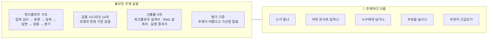
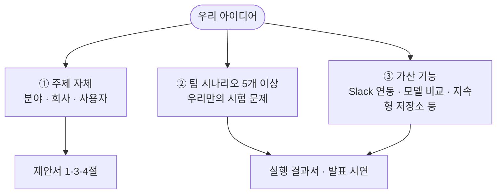
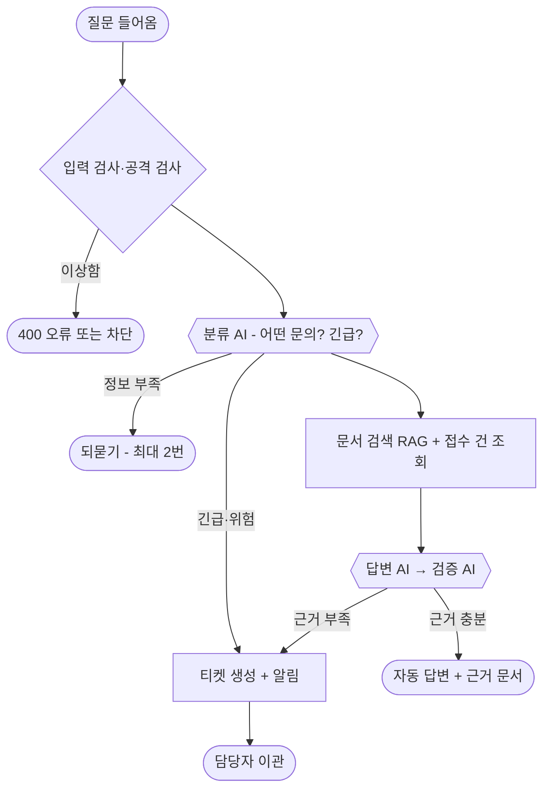
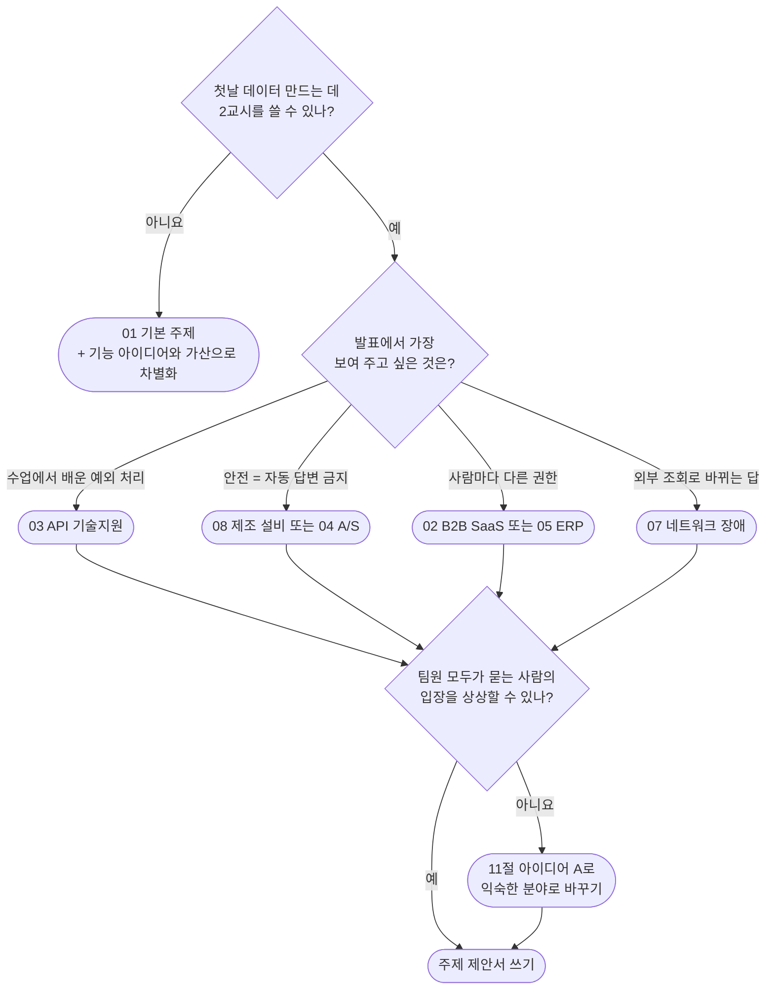
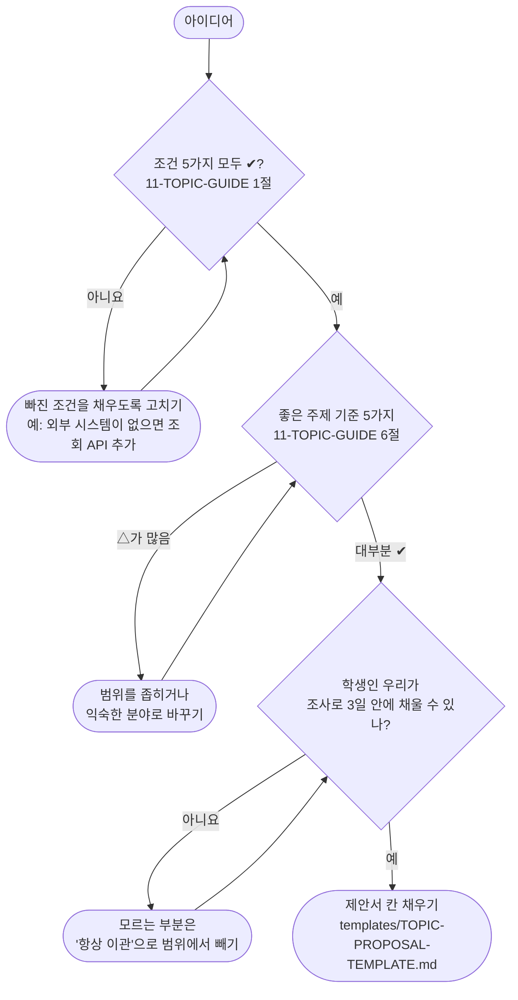

# 00. 주제 8개 한눈에 비교

> 단위 프로젝트(80~82일차) 주제를 고르기 위한 비교 자료입니다. 자세한 내용은 01~08 파일을 보세요.
> 근거: `aio-01d4-stu/Lecture/80-82-Project/student/` 가이드 문서들
>
> **전제: 우리 팀은 이 분야들의 실무 경험이 없는 학생입니다.** 그래서 모든 예시는 "우리가 이미 아는 것(소비자·알바·학교 경험, 수업 내용) + 조사"로 준비할 수 있는지를 기준으로 썼습니다.

> **읽는 법** 🔧 = 우리 아이디어로 바꿀 수 있음 · 🔒 = 모든 팀 같음 (바꾸면 안 됨)

## 1. 그대로 골라도 되고, 바꿔서 써도 된다

가이드에 이렇게 적혀 있습니다.

| 원문 | 위치 |
| --- | --- |
| "**주제 예 (고르거나 바꿔 써도 됨)**" | `11-TOPIC-GUIDE.md` 2절 제목 |
| "이 틀 안에서 **팀마다 주제(어느 회사의, 누구를 위한, 어떤 기술 지원인가)를 정합니다.**" | `11-TOPIC-GUIDE.md` 첫머리 |
| "이 문서는 '정답 구조'가 아니라 **출발점**입니다. 팀은 이 구조를 바꿔도 되고, 바꾼 까닭을 설계서에 적으면 됩니다." | `04-REFERENCE-ARCHITECTURE.md` 첫 줄 |

→ 8개는 **정답 목록이 아니라 예시**입니다. 하나를 그대로 골라도 되고, 우리 아이디어를 섞어도 됩니다. 단, 아래 🔒 부분은 모든 팀이 같습니다.

## 2. 바꿔도 되는 것과 안 되는 것

| 🔧 바꿔도 됨 (팀이 정함) | 🔒 바꾸면 안 됨 (모든 팀 같음) |
| --- | --- |
| 업무 분야, 회사, 사용자 | 큰 틀: "기업형 기술 지원 자동화" |
| 지식 문서의 내용과 종류 | 주제 조건 5가지를 모두 만족 |
| 문의 유형 4~6개, 처리 방식 | 요청과 응답 형식 (`route`, `sources`, `ticket` 등) |
| 넘기는 곳, 권한 규칙, 긴급 기준 | 공통 시나리오 14개의 유형과 판정 (질문만 바꿈) |
| 내부 구조 (에이전트 수, 노드, 프롬프트) | 최소 조건: 에이전트 3개 이상, 분기·병렬·루프 각 1곳 이상 |
| 팀 시나리오 5개 이상, 가산 기능 | 산출물 3개, 평가 기준, 환경 (n8n, OpenAI, 데이터 API) |

## 3. 우리 아이디어를 넣는 곳과 방법

**넣는 곳은 세 자리**입니다.

**아이디어를 만드는 방향은 세 가지**입니다. 01~08 파일의 11절에 주제마다 이 세 방향으로 예시를 하나씩 넣었습니다.

| 방향 | 무엇을 바꾸나 | 예 |
| --- | --- | --- |
| A. 분야 바꾸기 | 같은 구조에 업종만 바꿈 | 08 제조 → 식품 공장 / 07 통신 → 매장 POS |
| B. 기능 하나 더하기 | 새 문서나 새 판단 규칙을 붙임 | 08에 야간 교대 인수인계 / 05에 마감 기간 긴급도 |
| C. 사용자 바꾸기 | 묻는 사람이나 권한을 바꿈 | 01에 IT팀 담당자용 모드 / 08에 교육 전 신입 작업자 |

## 4. 모든 주제의 공통 흐름 (주제마다 말만 바뀜)

## 5. 주제 8개 비교표

| # | 주제 | 누가 묻나 | 넘기는 곳 | 숨길 것 | 긴급한 경우 | 난이도 |
| --- | --- | --- | --- | --- | --- | --- |
| 01 | 사내 IT 헬프데스크 **(기본)** | 사내 직원 | IT팀 | 남의 접수 건, IT팀 문서, 연락처 | 피싱, 감염 | ★☆☆ |
| 02 | B2B SaaS 고객 기술지원 | 고객사 관리자·사용자 | 2차 지원팀, 개발팀 | **다른 고객사 데이터**, 관리자 설정 | 전체 로그인 장애, 데이터 손실 | ★★★ |
| 03 | 개발자 플랫폼·API 기술지원 | 외부 개발자 | 플랫폼팀 | **API 키**, 다른 계정 사용량 | API 전면 장애, 키 유출 | ★★★ |
| 04 | 전자제품 A/S 기술지원 | 일반 고객 | 수리 접수, 방문 기사 | 다른 고객 수리 이력, **주소·연락처** | 발화, 감전, 배터리 부풀음 | ★★☆ |
| 05 | 사내 업무 시스템(ERP) 지원 | 사내 직원 | 시스템 운영팀 | **다른 부서 데이터**, 결재 권한 | 월말 마감 중 장애 | ★★☆ |
| 06 | 사내 보안 문의·사고 접수 | 사내 직원 | 보안팀 | **신고자 정보**, 사고 상세 | 감염, 유출, 랜섬웨어 | ★★☆ |
| 07 | 통신·네트워크 장애 접수 | 기업 회선 고객 | NOC, 현장 출동 | 다른 고객 회선, 연락처 | 광역 장애 | ★★★ |
| 08 | 제조 설비 유지보수 지원 | 공장 작업자 | 정비 기사, 안전 관리자 | **다른 공장 설비**, 기사 연락처 | 연기, 끼임, 감전 | ★★☆ |

## 6. 해야 할 일의 양 (학생 기준)

| # | 주제 | 우리가 이미 아는 것 | 조사로 채울 것 | 데이터 만들기 | 첫날 추가 시간 |
| --- | --- | --- | --- | --- | --- |
| 01 | IT 헬프데스크 | 일상의 컴퓨터·와이파이 문제, 수업에서 쓴 데이터 API | 거의 없음 | ✅ 이미 있음 | 없음 |
| 02 | B2B SaaS | 노션·슬랙을 **사용자**로 써 봄 | SSO, 관리자 설정 | ✍ 문서 6개+, 사용자, 접수 건 | 약 2교시 |
| 03 | API 기술지원 | **수업에서 본 429·401·재시도** | 웹훅, SDK, API 문서 구성 | ✍ 같음 | 약 2교시 |
| 04 | 전자제품 A/S | **A/S 받아 본 경험** | 자가 진단 FAQ, 보증 기준 | ✍ 같음 | 약 2교시 |
| 05 | ERP 지원 | 학교 포털의 마감·권한 | 결재·정산 용어 | ✍ 같음 | 약 2교시 이상 |
| 06 | 보안 사고 접수 | **스미싱 문자 받아 본 경험**, 73일차 보안 | 피싱 초기 대응 (KISA 공개 자료) | ✍ 같음 | 약 2교시 |
| 07 | 네트워크 장애 | 공유기 껐다 켜기 | 회선·장비 기초, 회선 상태 데이터 설계 | ✍ 같음 + 회선 상태 | 2교시 이상 |
| 08 | 제조 설비 | 가전제품 오류 코드 | 안전 수칙 (KOSHA 공개 자료), 설비 기초 | ✍ 같음 | 약 2교시 |

> 가이드 문구: "3일 안에 끝낼 자신이 없으면 기본 주제를 고르고, 범위·팀 시나리오·가산으로 차이를 내는 것도 좋은 선택입니다."

## 7. 주제별 아이디어 예시 모음 (자세한 내용은 각 파일 11절)

| # | 주제 | A 분야 바꾸기 | B 기능 하나 더하기 | C 사용자 바꾸기 |
| --- | --- | --- | --- | --- |
| 01 | IT 헬프데스크 | (기본 주제라 분야 대신 기능으로) 과거 처리 이력 검색 | 신입사원 IT 온보딩 | IT팀 담당자용 모드 |
| 02 | B2B SaaS | 근태·급여 관리 SaaS (알바 출퇴근 앱) | 알려진 문제 자동 매칭 | 우리 회사 상담원용 보조 |
| 03 | API 기술지원 | 날씨·교통 공공 정보 API | 오류 응답 붙여 넣기 분석 | 사내 개발자용 내부 API |
| 04 | 전자제품 A/S | 기업용 복합기 렌탈 | 증상 체크 되묻기 + 보증 판정 | 방문 수리 기사용 도우미 |
| 05 | ERP 지원 | 프랜차이즈 매장 관리 시스템 (알바 경험) | 마감 기간 긴급도 자동 상향 | 입사 1개월 신입사원 전용 |
| 06 | 보안 사고 접수 | 개인정보 보호 문의로 좁히기 | 의심 문자·메일 붙여 넣기 확인 | 외주 상주 직원 |
| 07 | 네트워크 장애 | 매장 POS·키오스크 장애 (알바 경험) | 광역 장애 자동 감지 | 현장 출동 기사용 도우미 |
| 08 | 제조 설비 | 식품 공장 | 야간 교대 인수인계 | 교육 전 신입 작업자 |

> 같은 줄 안에서 섞어도 됩니다. 예: "08 식품 공장(A) + 야간 인수인계(B)"

## 8. 주제별 "가장 눈에 띄는 시연 장면"

| # | 주제 | 시연에서 보여 줄 한 장면 |
| --- | --- | --- |
| 01 | IT 헬프데스크 | 티켓 시스템이 고장 나도 오류 없이 이관되고 보관함에 쌓임 |
| 02 | B2B SaaS | 같은 질문인데 관리자와 일반 사용자의 답이 다름 (권한 차이) |
| 03 | API 기술지원 | 질문에 섞인 **API 키가 답·티켓·기록 어디에도 안 보임** |
| 04 | 전자제품 A/S | "배터리가 부풀었어요" → AI가 답하지 않고 바로 긴급 이관 |
| 05 | ERP 지원 | 영업팀이 급여 메뉴를 물으면 인사 문서를 안 씀 |
| 06 | 보안 사고 | 초기 조치 안내와 보안팀 알림이 동시에 일어남 |
| 07 | 네트워크 장애 | 회선 조회 결과에 따라 "장비 재시작" 또는 "기사 출동"으로 답이 바뀜 |
| 08 | 제조 설비 | "E102"는 조치 안내, "E301"은 **AI가 말하지 않고** 기사 호출 |

## 9. 학생 팀 기준 장단점

| # | 주제 | 좋은 점 | 걱정되는 점 |
| --- | --- | --- | --- |
| 01 | IT 헬프데스크 | 데이터 준비 시간 0, 모두가 이해 | 여러 팀이 고를 수 있어 결과가 바로 비교됨, 차별점 내기 어려움 |
| 02 | B2B SaaS | IT 회사 고객지원 직무와 연결 | 관리자 쪽은 조사가 필요하고, 가상 제품을 처음부터 설계해야 함 |
| 03 | **API 기술지원** (10/29 회의 후보) | 수업 내용(429·401·재시도)과 그대로 겹쳐서 **재료가 이미 있음**, 키 가림이라는 차별점 | 비개발자 팀원이 웹훅·SDK를 설명하기 어려움, 발표 질문이 깊어질 수 있음 |
| 04 | 전자제품 A/S | 소비자 경험으로 누구나 이해, 시연이 재미있음 | "기업형" 느낌이 약하고 차별점이 적음 (아이디어 A로 보완) |
| 05 | ERP 지원 | 권한 구조가 분명함 | 회사 ERP는 낯섦, 1번과 비슷해 보임 (아이디어 A로 보완) |
| 06 | 보안 사고 | 스미싱 경험으로 이해 쉬움, 공개 자료 많음 | 1번과 많이 겹침, 자동 답변 시연 거리가 적음 (아이디어 A로 보완) |
| 07 | 네트워크 장애 | 다른 팀과 겹칠 가능성 낮음, 설계가 탄탄해 보임 | 네트워크 기초 조사 필요, 데이터 작업이 가장 많음 (아이디어 A로 보완) |
| 08 | **제조 설비** (10/29 회의 후보) | 안전 기준이 가장 분명, 오류 코드로 검색 품질 측정이 쉬움 | 공장은 낯섦, "뻔하다", 다른 팀과 겹칠 수 있음 (아이디어 B로 차별화) |

## 10. 고르는 순서 (제안)

## 11. 우리 아이디어 점검 순서

팀원이 자기 아이디어를 가져왔을 때 이 순서로 확인합니다.

**좋은 주제 기준 5가지** (`11-TOPIC-GUIDE.md` 6절)

| 좋은 주제 | 피할 주제 |
| --- | --- |
| 문의 유형을 4~6개로 말할 수 있다 | "모든 고객 문의"처럼 끝이 없다 |
| 지식 문서가 서로 다른 절차를 담고 있어 검색이 의미 있다 | 문서 하나로 다 답이 된다 |
| 자동 답변하면 **안 되는** 경우를 분명히 말할 수 있다 (안전·보안·돈) | 무엇이든 자동으로 답해도 된다 |
| 팀원이 그 업무를 상상할 수 있다 (경험·관심) | 팀 누구도 업무를 모른다 |
| 3일 안에 데이터·문서를 만들 수 있다 | 실제 데이터·계정이 꼭 있어야 한다 |

## 12. 확인하면 좋은 자료 (읽는 순서)

경로는 `aio-01d4-stu/Lecture/80-82-Project/` 기준입니다.

| 순서 | 파일 | 무엇을 보나 |
| --- | --- | --- |
| 1 | `student/11-TOPIC-GUIDE.md` | **가장 중요.** 1절 조건 5가지, 3절 작업량 차이, 6절 좋은 주제와 피할 주제 |
| 2 | `student/templates/TOPIC-PROPOSAL-TEMPLATE.md` | 80일차에 낼 제안서 양식. 아이디어를 이 칸에 넣어 보면 빈 곳이 바로 보임 |
| 3 | `student/03-SCENARIOS-AND-DATA.md` | 3절 팀이 정할 범위, 4절 공통 시나리오 14개, **5절 팀 시나리오** (차별점을 넣는 곳) |
| 4 | `student/00-PROJECT-GUIDE.md` | 3절 필수 기능과 **가산 기능**, 5절 평가 요약 |
| 5 | `student/04-REFERENCE-ARCHITECTURE.md` | 구조를 바꿀 때 설계서에 무엇을 적어야 하는지 |
| 참고 | `Req/KSM-REQ.md` | 원본 요구서. 학생 가이드와 다르면 강사에게 확인 |

주제를 고른 뒤에는 그 주제 파일의 **12절 "이 주제를 고르면 더 볼 자료"**를 보세요.

**결정할 때 함께 확인할 것**
- 조건 5가지는 8개 예시 모두 ✔입니다 (각 파일 6절). 아이디어를 섞은 뒤에는 다시 확인합니다.
- 같은 주제를 두 팀이 고를 수 있는지는 **80일차 첫날 강사가 정합니다**. 기본은 "팀마다 다른 주제"라서 **1순위와 2순위**를 같이 정해 두는 게 안전합니다.
- 80일차 10:30까지 주제 제안서로 강사 승인을 받아야 합니다. 각 파일 11절 끝의 "제안서로 옮기기" 표를 따라 칸을 채우면 됩니다.

## 13. 용어 정리

| 용어 | 쉬운 뜻 |
| --- | --- |
| 🔧 / 🔒 | 🔧 우리 아이디어로 바꿀 수 있음 / 🔒 모든 팀 같음 (바꾸면 안 됨) |
| RAG | 문서를 먼저 찾고, 찾은 내용을 근거로 AI가 답하게 하는 방식 |
| 이관 | AI가 처리하지 않고 사람(담당자)에게 넘기는 것 |
| 티켓 | 담당자에게 넘길 때 만드는 접수증 (실제 회사에서는 Jira 같은 도구) |
| 되묻기 (보완 질문) | 정보가 부족할 때 AI가 "어떤 기기인가요?"처럼 다시 묻는 것 |
| DLQ (실패 보관함) | 처리 못 한 요청을 버리지 않고 모아 두는 곳 |
| 가림 (마스킹) | 전화번호 등을 `010-****-1234`처럼 숨기는 것 |
| 공격 (프롬프트 주입) | "이전 지시를 무시해"처럼 AI를 속이려는 질문 |
| 오탐 | 정상 질문을 공격이나 사고로 잘못 판단해서 막는 것 |
| 분류 AI · 답변 AI · 검증 AI | 역할을 나눈 AI 3개 (가이드 기준 최소 3개 필요) |
| 공통 시나리오 14개 | 모든 팀이 똑같이 통과해야 하는 시험 문제 (WF-01~13 + 02b) |
| 팀 시나리오 | 우리 팀이 직접 정하는 시험 문제 5개 이상 (차별점을 보여 주는 곳) |
| 가산 기능 | 필수는 아니지만 하면 점수에 도움이 되는 기능 |
| 400 오류 | "요청이 잘못됐어요"라는 뜻 (빈 질문 등) |
| 429 · 500 오류 | 429는 "너무 많이 불렀어요", 500은 "상대 시스템이 고장 났어요" |
