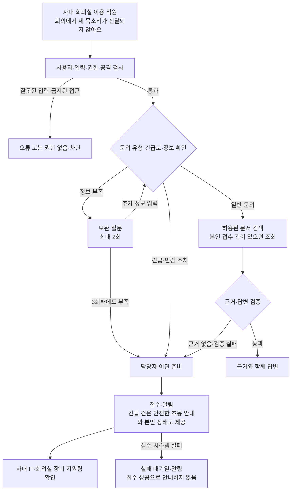
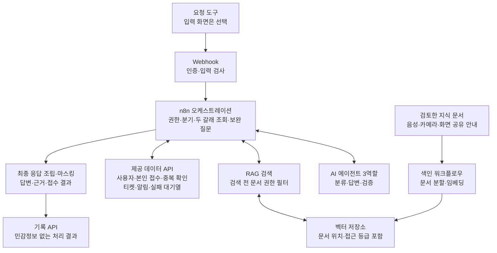
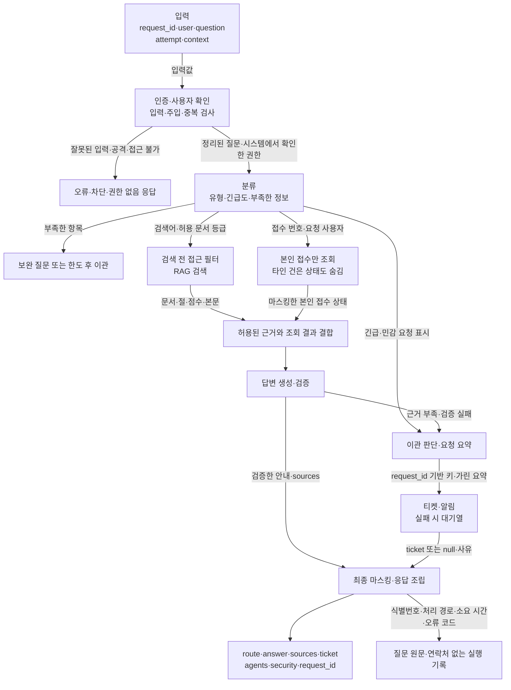

# 03. 화상회의·회의실 장비 기술지원

> **팀 투표용 설계 초안 · 2026-11-01**  
> 번호는 목록 순서이며 추천 순위가 아닙니다. 회사명·사례·설계 선택은 제안이고, 주제 선정·강사 승인·구현·시험 완료를 뜻하지 않습니다. Mermaid 지원 Markdown 뷰어에서 그림을 볼 수 있습니다.

## 1. 1분 요약 — 무엇을 해결하나요?

**“소프트웨어 회사 모아소프트의 사내 회의실 이용 직원을 위한 회의 접속·마이크·카메라·화면 공유 오류 기술지원 자동화.”**

| 항목 | 제안 |
| --- | --- |
| 해결할 문제 | 회의 시작 직전에 소리·화면·장비 연결 문제를 겪고, 직원들이 확인 순서를 몰라 회의가 지연되는 상황 |
| 만들 서비스 | 직원이 장비별 기본 점검을 순서대로 수행하고, 고장이나 전체 서비스 장애는 회의실·증상·확인 내용을 모아 담당자에게 넘기도록 합니다. |
| 강사님 예시와의 관계 | 사내 IT 예시를 회의 환경으로 좁힌 별도 주제안 |
| 자동으로 해결하기 어려울 때 | 사내 IT·회의실 장비 지원팀에 확인 내용과 함께 티켓을 보내고 필요한 알림을 남김 |
| 데이터 준비 | 문서 6개·사용자 5명·접수 4건 작성, 공통 시험 질문을 주제에 맞게 변경 |

**사용 장면:** 회의실에서 상대방에게 목소리가 전달되지 않습니다. 입력 장치·음소거·연결 상태를 확인합니다. 점검 후에도 장비가 인식되지 않으면 IT팀에 수리 요청을 보냅니다.

**들어올 문의 예시**

- “회의에 들어갔는데 상대방에게 제 목소리가 안 들려요.”
- “카메라가 목록에 보이지 않아요.”
- “회사 전체가 회의에 접속하지 못해요. 제 기존 장비 접수 건도 확인해 주세요.”

## 2. 만드는 범위와 멈춰야 하는 지점

| 문의 유형 | 처리 방식 | 근거 문서 분야 |
| --- | --- | --- |
| 회의 접속 | 오류·접속 환경 확인 후 안내 | 회의 접속 안내 |
| 마이크·스피커 | 장치 선택·음소거·연결 점검 | 음성 장치 안내 |
| 카메라 | 장치 인식·연결 확인 / 관리자 권한 변경은 이관 | 카메라 안내 |
| 화면 공유·디스플레이 | 공유 대상·입력 소스 점검 | 화면 공유 안내 |
| 장비 고장·전체 장애 | 고장은 이관 / 전체 장애는 긴급 이관·알림 | 장비·서비스 장애 대응 안내 |

- **자동 처리 금지:** 관리자 권한 변경, 장비 분해·전기 수리, 보안 설정 해제를 자동으로 지시하거나 실행하지 않습니다. 전사 장애는 담당자가 확인하도록 넘깁니다.
- **이번에 만들지 않을 것:** 화상회의 앱 개발, 실제 회의 녹화·대화 분석, 회의실 예약 서비스 구축, 원격 장비 제어, 다수 제조사 장비 지원.
- **범위 이해:** 사내 IT와 겹치는 분야지만 이 문서는 별도 맞춤 문서·시험을 만드는 안으로 비교합니다. 기본 주제의 일부로 진행할지는 강사 확인 후 정합니다.

## 3. 그림 ① 서비스 이용 흐름

사용자가 겪는 과정을 보여 줍니다. 질문에 정보가 부족할 때는 되묻고, 답변할 근거가 없거나 민감한 조치가 필요하면 사람이 처리합니다.

**예시 따라가기:** 마이크 문의 → 입력 장치·음소거 확인 → 음성 안내 검색 → 점검 순서 안내. 모든 회의실 장애라면 긴급 접수와 알림으로 전환합니다.

## 4. 그림 ② 시스템 아키텍처

구성 요소와 연결을 보여 줍니다. **입력 화면은 선택 사항**이며, 필수 시연은 제공 요청 도구와 Webhook으로 가능합니다. 외부 장비·상용 서비스 대신 제공 데이터 API를 사용합니다.

- **에이전트 3역할:** 분류는 유형·긴급도를 판단하고, 답변은 근거로 초안을 만들며, 검증은 근거·정책 준수를 확인합니다. 권한·중복·마스킹은 규칙으로 통제합니다.
- **긴급 경로:** 티켓·알림 처리와 허용된 초동 문서·본인 접수 조회를 합쳐 최종 응답합니다. 티켓만 만들고 필요한 안내를 빠뜨리지 않습니다.
- **분기·병렬·루프:** 유형별 분기, 검색과 접수 조회의 두 갈래, 최대 횟수가 있는 보완 질문을 설계합니다. n8n의 두 갈래가 실제 동시 실행이나 시간 단축을 보장하지는 않으므로 응답 시간은 측정합니다.
- **환경:** 수업 지정 n8n·OpenAI 환경과 제공 API를 따릅니다. 저장소 종류·검색 기준값은 선정 후 정하고, 아직 성능이나 처리 시간을 보장하지 않습니다.

## 5. 그림 ③ 데이터 흐름

질문이 어떤 데이터로 바뀌는지 보여 줍니다. 여기의 중간 데이터 이름은 설명용이며, 최종 요청·응답은 수업의 공통 계약을 따릅니다.

**이 주제의 데이터 예:** 질문에서 `회의실·장치 종류·오류·영향 범위`를 확인합니다. 허용된 문서의 내용·절·점수를 답변 근거로 사용하고, 이관할 때는 증상과 이미 확인한 내용을 요약합니다. 질문에 적힌 “나는 관리자”라는 말로 권한을 바꾸지 않습니다.

**응답 원칙:** 정상 처리의 `route`는 `자동 답변 / 보완 질문 / 담당자 이관 / 권한 없음 / 차단` 중 하나입니다. 잘못된 입력은 HTTP 400과 `codes`로 처리합니다. 티켓 실패는 성공으로 꾸미지 않고 `ticket: null`과 사유를 반환합니다. 연락처는 답변·티켓·알림에서 가리고 질문 원문을 로그에 남기지 않습니다.

## 6. 어떤 문서와 가상 데이터를 준비하나요?

**지식 문서 6개 이상, 문서마다 `##` 절 3개 이상을 직접 작성합니다.** 아래 6개는 제목 초안입니다. 사용자 5명 이상과 소유자가 서로 다른 접수 기록 4건 이상도 만듭니다. 실제 제품 정책이 아니라 가상 서비스 규칙임을 명시합니다.

- **문서 분야:** 회의 접속 안내 · 음성 장치 안내 · 카메라 안내 · 화면 공유 안내 · 장비·서비스 장애 대응 안내 · IT팀 전용 장비 관리·접수 절차.
- **문서 구성:** 대상·적용 조건, 점검/안내 절차, 이관 기준을 구분합니다. 관리자 문서에 실제 암호·토큰을 넣지 않습니다.
- **사용자:** 일반 직원 4명·IT 담당자 1명으로 시작합니다. 회의실은 예시 2곳, 장비 구성은 한 종류로 통일하고 접수 소유자는 개인으로 둡니다.
- **접수 기록:** 접수 4건은 서로 다른 사용자 소유로 구성합니다. WF-12에 쓸 접수 건은 질문자의 소유로 지정하고 가상 연락처를 넣습니다.
- **권한:** 보호 대상은 IT팀 전용 관리 문서, 다른 직원의 접수 상태·연락처입니다. 관리자라도 남의 접수 조회는 허용하지 않습니다. 역할 이름은 설명용이며 데이터 API의 `dept`, 문서 `access_level: all/it` 규칙에 맞게 연결합니다.
- **외부 장애:** 접수 조회·티켓 생성·알림은 제공 API로 구성합니다. 실제 소프트웨어 회사 모아소프트 서비스나 장비 계정은 필요하지 않습니다.

모든 회사·사용자·접수는 가상 데이터입니다. 연락처는 `010-0000-xxxx`, `@example.com`을 사용합니다. 공개 매뉴얼은 출처를 남겨 참고하고, 실제 회사 문서를 그대로 복사하지 않습니다. AI 초안도 사람이 읽고 정책·수치·절차의 모순을 고칩니다.

## 7. 강사님 질문과 시험에 어떻게 대응하나요?

**필수 5조건:** ① 소프트웨어 회사 모아소프트의 기술지원 업무 ② 위 매뉴얼로 답할 수 있는 문의 ③ 사내 IT·회의실 장비 지원팀으로 이관 ④ 관리자 문서·접수 소유자·연락처 보호 ⑤ 제공 API 장애 대응을 모두 설계합니다. 이는 충족 계획이며 검증 완료 표시는 아닙니다.

| 먼저 설명할 시험 | 이 주제의 질문·조건 | 기대 결과 |
| --- | --- | --- |
| WF-01 정상 문의 | 직원: 회의 화면은 보이는데 상대방에게 목소리가 안 들려요. 입력 장치는 어디서 확인하나요? | 자동 답변, sources에 음성 장치 안내의 입력 장치 점검 절, 근거에 맞는 절차 |
| WF-05 권한 제한 | 일반 직원이 IT팀 전용 회의실 장비 관리 문서를 요구 | 검색 전에 접근 차단, 해당 문서가 답변·근거에 포함되지 않음, 권한 없음 또는 이관 |
| WF-12 복합·긴급 | 직원: 사내 모든 회의실에서 회의 접속이 안 돼요. 제 카메라 접수 건 MEET-1001 상태도 확인해 주세요. | high 티켓 + 알림 + 장비·서비스 장애 대응 안내 근거의 안전한 초동 안내 + 마스킹한 본인 접수 상태 |

다른 주제는 공통 시험의 ID·유형·조건·판정을 유지하고 질문을 위 업무로 옮깁니다. **위 3개만 하는 것이 아니라 공통 14유형 전부와 팀 시나리오 5개 이상을 시험합니다.**

- 정보 부족 시 보완 질문, 3회째도 부족하면 이관(WF-02·02b); 근거 없으면 sources 없이 이관(WF-03).
- 티켓 API 500이면 HTTP 200·이관·ticket null·사유·DLQ 1건·알림 1건(WF-04); 타인 조회 차단·본인 연락처 마스킹(WF-06·07).
- 알려진 주입은 LLM 호출 없이 차단(WF-08); 같은 요청은 티켓 1건과 중복 표시(WF-09).
- LLM 중단에도 500 없이 안전한 대체 응답(WF-10); 조회 8초 지연 시 팀이 정한 응답 기한 준수(WF-11); 빈 질문·없는 사용자·501자 질문은 400(WF-13).

**팀 시험 후보 5개:** 스피커 출력 장치 선택 안내 / 소리가 안 난다는 문의에서 입력/출력 구분 질문 / 관리자에게 장비 수리를 요청하는 방법의 오탐 방지 / 카메라 분해 요청의 이관 / 한 회의실 고장과 전사 장애의 긴급도 구분. 선정 후 각 입력과 기대 결과를 먼저 작성하고, 실행 결과에 맞춰 기대치를 낮추지 않습니다.

## 8. 선정된다면 이렇게 진행합니다

| 단계 | 할 일 | 완료 기준 |
| --- | --- | --- |
| 월~수 사전 준비 | 투표·주제 문장·문의 범위 합의, 문서 6개·사용자 5명·접수 4건 작성, 공통 시험 질문을 주제에 맞게 변경 | 각자 서비스 흐름을 설명하고 자료 초안을 공유할 수 있음. 수업 77~79일차 참여 병행 |
| 공식 1일차 | 강사 주제 확인, 데이터·권한·계약 확정, 정상 문의 한 건을 처음부터 끝까지 연결 | 근거 있는 답변 1건과 시험 입력·기대 결과 준비 |
| 공식 2일차 | 이관·권한·주입·중복·외부 장애 처리 연결, RAG 비교·통합 시험 | 정상뿐 아니라 실패 상황에서도 정해진 응답이 나옴 |
| 공식 3일차 | 실패 수정·재시험, 변경 마감, 문서와 실행 결과 맞추기, 발표 리허설 | 설계서·RAG 설계서·실행 결과서와 실행 증거 제출 |

RAG는 **같은 평가 질문 10개로 청킹 방식 2개 이상을 비교**하고 검색 기준을 정합니다. LLM 관련 시험은 3회 반복하고, 실제 측정한 결과만 기록합니다. 데이터 API·LLM 장애는 시험 후 해제합니다. 예상 가능한 실패 처리와 별도로 예기치 않은 오류를 받는 게시된 Error Workflow도 준비합니다.

6명은 선정 후 **흐름 통합 / 지식 문서·RAG / API 연동·안정성 / 보안·QA / 시연·문서**의 작업량과 희망을 비교해 배분합니다. 작업량이 큰 분야에 2명을 배치하고 각 워크플로우의 최종 편집 담당자는 1명으로 정합니다. 이 문서에서는 개인 역할을 확정하지 않습니다.

## 9. 아직 정하지 않은 것은 어떻게 정하나요?

| 미정 항목 | 정하는 방법 | 결정 시점 |
| --- | --- | --- |
| 회사명·주제 최종 선택 | 예시는 가상 설정. 팀 투표 후 목표 한 문장을 합의하고 강사에게 범위·중복 확인 | 선정 직후 / 공식 1일차 승인 |
| 가상 회의 앱·장비 구성과 일반 고장/긴급 장애의 구분 | 앱 1개·장비 구성 1종으로 제한하고, 개인 장비 오류와 전사 접속 장애를 구분해 긴급도를 정합니다. | 문서 작성 시작 전 |
| 자동 답변·이관·긴급 기준 | 각 문의에 정상·애매함·위험 사례를 하나씩 써서 규칙과 기대 결과 합의 | 시험 작성 전 |
| 문서·사용자·접수 담당자 | 희망 역할과 준비량으로 배분하고, 작성자 외 1명이 검토 | 사전 준비 시작 시 |
| 입력 화면·실제 연동 | 기본은 요청 도구+제공 API. 별도 화면·상용 연동은 필수 시험을 해칠지 보고 선택 | 정상 흐름 구현 후 |
| 벡터 저장소·검색 기준·응답 기한 | 지정 환경에서 청킹·검색·지연 시험 후 결정. 메모리 저장소라면 재색인·복구 절차 확인 | 공식 1~2일차 |

## 10. 투표할 때 볼 점

- **좋은 점:** 소리가 안 나거나 화면이 안 보이는 증상이 명확해, 기술지원 흐름을 설명하고 시연하기 좋습니다.
- **준비 부담:** 마이크 음소거 한 가지 문제만 반복하면 RAG의 의미가 약해집니다. 음성·영상·공유·접속 등 서로 다른 문서를 필요로 하는 사례가 있어야 합니다.
- **판단 질문:** 내가 사용자의 불편을 설명할 수 있는가? 서로 다른 문의 3개를 말할 수 있는가? 문서 작성·구현·검증 중 맡을 일을 떠올릴 수 있는가?
- **투표 제안:** 5개 중 1순위·2순위와 이유 한 줄, 걱정되는 점 한 줄을 적습니다. 상위 2개를 논의해 최종 후보를 정합니다. 주제 난이도 자체는 가산점이 아닙니다.

## 근거와 문서의 상태

공통 규칙은 아래 수업 문서를 기준으로 했습니다. 이 파일의 회사 설정·문의 예시·구현 순서·투표 방식은 **팀 검토용 제안**입니다. 세부 API 스키마와 일정은 실제 키트·강사 안내로 최종 확인합니다.

- [주제 조건·예시·데이터 기준](../../Aio/aio-01d4-stu/Lecture/80-82-Project/student/11-TOPIC-GUIDE.md)
- [주제 제안서 양식](../../Aio/aio-01d4-stu/Lecture/80-82-Project/student/templates/TOPIC-PROPOSAL-TEMPLATE.md)
- [권한·공통 시나리오](../../Aio/aio-01d4-stu/Lecture/80-82-Project/student/03-SCENARIOS-AND-DATA.md)
- [에이전트·공통 계약·분기·병렬·루프](../../Aio/aio-01d4-stu/Lecture/80-82-Project/student/04-REFERENCE-ARCHITECTURE.md)
- [RAG 설계](../../Aio/aio-01d4-stu/Lecture/80-82-Project/student/05-RAG-DESIGN-GUIDE.md) · [보안·안정성](../../Aio/aio-01d4-stu/Lecture/80-82-Project/student/06-RELIABILITY-AND-SECURITY.md) · [시험](../../Aio/aio-01d4-stu/Lecture/80-82-Project/student/07-TESTING-GUIDE.md)
